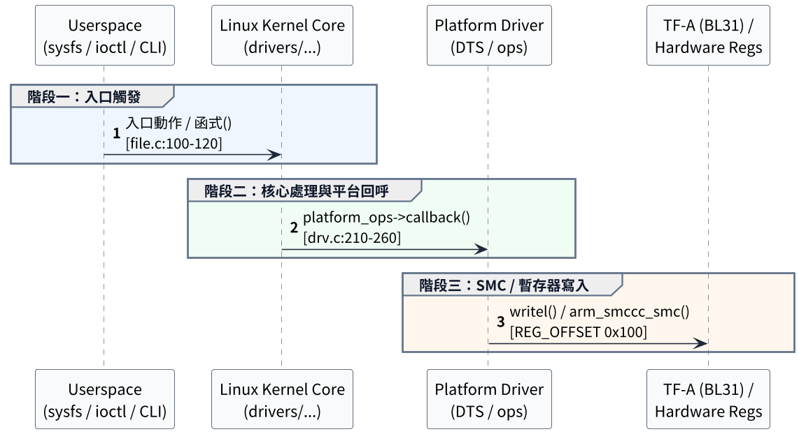

# Yocto BSP PlantUML Diagram Style & Rendering Reference

Aligned with `notes/NOTE-STYLE.md` and compatible with the installed **PlantUML 1.2020.02**.

## Directory & Naming Convention

Keep `.puml` source and rendered `.png` side by side in `figs/`. Markdown must link **only `.png`**.

```text
<topic>-notes/
├── study/
│   ├── <doc>-questions.md
│   └── figs/
│       ├── <doc>-q1-flow.puml
│       └── <doc>-q1-flow.png
├── figs/
└── logs/
```

Markdown embed:

```markdown

```

## Standard Sequence Diagram Header (Multi-Layer BSP)



### Recommended Group Accent Colors

- `#EFF6FF` (soft blue): Userspace entry / setup / probe
- `#F0FDF4` (soft green): Kernel core / framework dispatch
- `#FFF7ED` (soft orange): Hardware register / DMA / IRQ / TF-A SMC
- `#FEF2F2` (soft red): Error / guard / fault / timeout path
- `#F8FAFC` (soft slate): Cleanup / resume / return path

## PlantUML 1.2020.02 Compatibility Notes

- **`map` syntax is NOT supported** in PlantUML 1.2020.02. For register bitfields or key-value struct tables, use a creole table inside `rectangle`:
  ```plantuml
  rectangle "REG_CTRL (0x00)" as reg [
    |= Bit |= Field |= 說明 |
    | [31:16] | DIV | 分頻係數 |
    | [0] | EN | 致能位元 |
  ]
  ```
- For memory maps or bit-level register layouts where PlantUML is cramped, hand-written SVG (white background `<rect width="100%" height="100%" fill="white"/>`, `font-family="Noto Sans CJK TC"`) rendered with `inkscape xxx.svg --export-type=png --export-filename=xxx.png` is also allowed per `NOTE-STYLE.md`.

## Rendering & Mandatory Visual Check

1. Render PNG:
   ```bash
   plantuml -tpng -charset UTF-8 path/to/figs/<name>.puml
   ```
2. Open and visually inspect the rendered `.png` file directly:
   - Verify Traditional Chinese (`Noto Sans CJK TC`) renders cleanly without missing glyphs.
   - Verify no text clipping, awkward wrapping, or box overlaps.
   - Verify file paths, line numbers, and register offsets match source/logs.
   - Verify device naming matches the user's preference.
