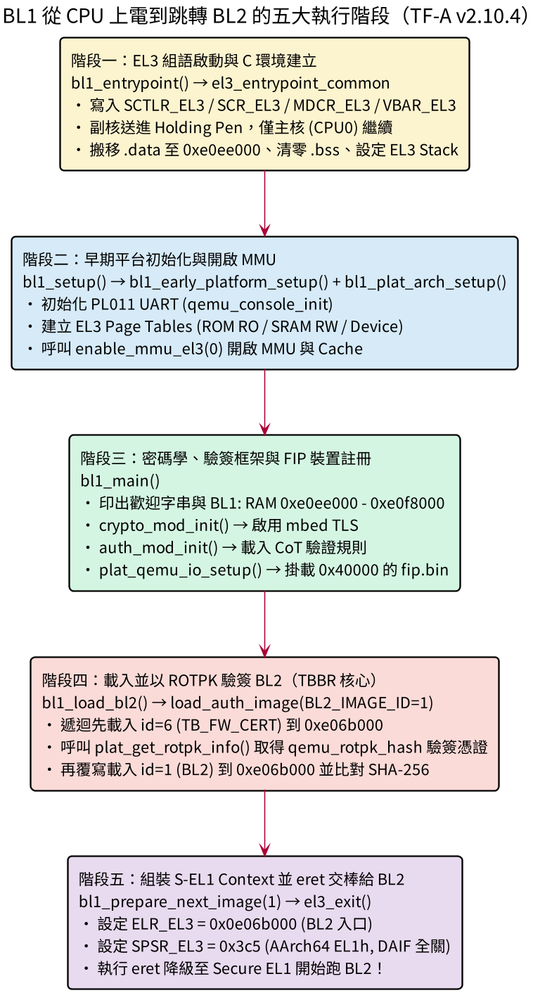
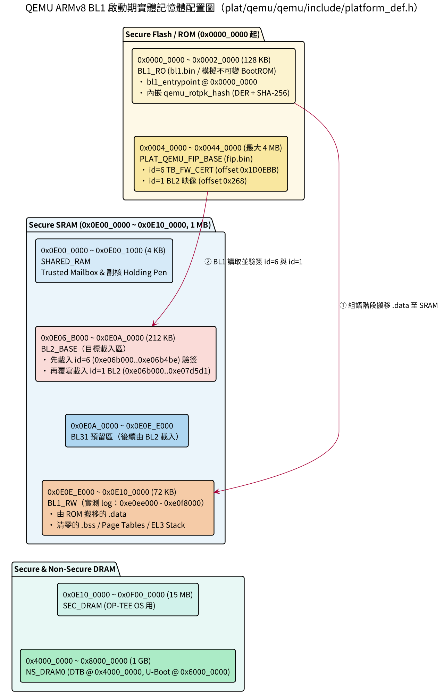
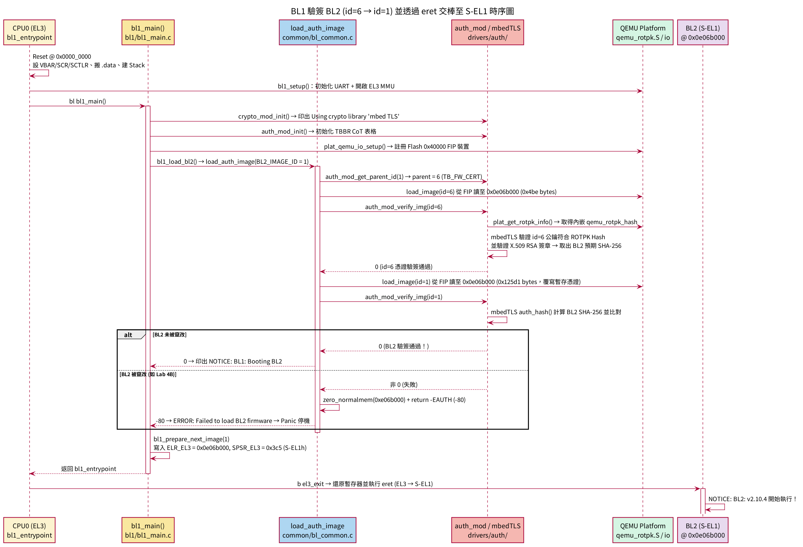

# TF-A BL1 啟動全流程解析：從 CPU 上電到驗簽並跳入 BL2（QEMU ARMv8 / TF-A v2.10.4）

CPU 剛上電時是一片蠻荒：沒有 C 語言 Stack、沒有 MMU 與 Cache、沒有 UART 除錯輸出，外部 Flash 裡的程式碼更不能輕易相信。如果直接跳進外部 Bootloader，攻擊者只要改寫 Flash 就能全面接管晶片。**BL1（模擬不可變 BootROM）就是整顆晶片上電後唯一無條件信任的「第一道門神」**——它用極短的組語把 CPU 整理到能跑 C 程式，開啟 MMU 與 UART，再靠內嵌在自己唯讀區裡的 ROTPK Hash 驗證並載入 BL2，最後才放心把控制權降級交給 Secure EL1 的 BL2。

---

## 1. 基本概念

開始追程式碼前，先對齊 BL1 階段最關鍵的五個名詞：

- **冷開機（Cold Boot）與主／副核分流**：多核 CPU（本環境 `-smp 4`）同時從 `0x0` 啟動，BL1 會讓主核（`CPU0`）走完整開機流程，其餘副核則先放進 Secure SRAM 的 Holding Pen 睡覺，等後續 Linux 透過 PSCI 喚醒。
- **`BL1_RO` vs `BL1_RW`**：BL1 的程式碼與常數放在唯讀區（`0x0000_0000`，模擬 Mask ROM），可寫變數（`.data` / `.bss`）與 Stack 則必須在啟動期搬到可寫的 Secure SRAM 頂端（`0x0E0E_E000`）。
- **ROTPK（Root of Trust Public Key）**：整條安全開機鏈的信任起點。QEMU 平台將開發用 RSA 公鑰的 SHA-256 雜湊透過 `qemu_rotpk.S` 直接編進 `bl1.bin`（真實 SoC 則是燒在硬體 eFuse/OTP）。
- **FIP（Firmware Image Package）**：放在 Flash 偏移 `0x40000` 的打包檔，裡面同時存放 `id=6` (`TB_FW_CERT`) 與 `id=1` (`BL2`)，BL1 透過 `io_fip` 驅動依 UUID 取出。
- **`eret` 降級交棒（EL3 → S-EL1）**：ARMv8 不允許直接用 `b` 指令降特權級；BL1 必須把目標入口寫進 `ELR_EL3`、把目標狀態寫進 `SPSR_EL3`（本次實測為 `0x3c5`），再透過 `el3_exit` 執行 `eret` 指令切進 Secure EL1 啟動 BL2。

### 1.1 `SPSR_EL3 = 0x3c5` 位元意義（對照開機 Log 第 13 行）

在正常開機 log 中會看到 `INFO: SPSR = 0x3c5`（二進位 `0011_1100_0101`），各欄位含義如下：

| 位元 | 數值 | 意義 |
| :---: | :---: | :--- |
| `bit[9:6]` (`D, A, I, F`) | `0b1111` (`0x3c0`) | 遮蔽 Debug、SError、IRQ、FIQ 所有異常與中斷（`DISABLE_ALL_EXCEPTIONS`） |
| `bit[4]` (`M[4]`) | `0` | 執行狀態為 **AArch64**（非 AArch32） |
| `bit[3:2]` (`M[3:2]`) | `0b01` | 目標特權級為 **EL1**（搭配 `SCR_EL3.NS = 0` 即為 **Secure EL1**） |
| `bit[0]` (`M[0]`) | `1` | 使用 **SP_EL1**（`MODE_SP_ELX`，即 `EL1h` 模式） |

---

## 2. 全景架構與記憶體配置

### 2.1 五大執行階段全景



BL1 的生命週期分成清楚的五段：

1. **階段一（EL3 組語與 C 環境）**：初始化核心控制暫存器、掛上例外向量表 `bl1_exceptions`、副核休眠、將 `.data` 從 ROM 複製到 SRAM 並清零 `.bss`、建立 EL3 Stack。
2. **階段二（早期平台與 MMU）**：啟動 PL011 UART 讓後續能印出 log，接著建立 EL3 Page Tables 並呼叫 `enable_mmu_el3(0)` 開啟 MMU 與 Cache（後續 mbedTLS RSA 驗簽若沒開 Cache 會慢上百倍）。
3. **階段三（密碼學與 FIP 裝置）**：初始化 `mbed TLS` 密碼庫與 TBBR 驗簽框架，並透過 `plat_qemu_io_setup()` 把 Flash `0x40000` 註冊為 FIP 讀取來源。
4. **階段四（遞迴驗簽 BL2）**：呼叫 `load_auth_image(BL2_IMAGE_ID)`，先載入並用內嵌 `qemu_rotpk_hash` 驗證 `id=6` 憑證，再載入 `id=1` BL2 並比對 SHA-256。
5. **階段五（準備 Context 並 `eret`）**：設定好 BL2 的 `ELR_EL3 = 0x0e06b000` 與 `SPSR_EL3 = 0x3c5`，執行 `el3_exit` 降級進入 S-EL1 開始執行 BL2。

### 2.2 QEMU ARMv8 啟動期記憶體配置



觀察上圖一個很有趣的細節：**`id=6` (`TB_FW_CERT`) 和 `id=1` (`BL2`) 都是載入到同一個位址 `0x0e06b000`**！因為憑證只需在驗簽階段暫時存在記憶體裡，等 `auth_mod_verify_img(6)` 驗證完並把 BL2 的預期 SHA-256 雜湊抄到 `BL1_RW` 的靜態緩衝區後，載入 `id=1` (BL2) 時就能直接覆寫 `0x0e06b000`，省下寶貴的 Secure SRAM 空間。

### 2.3 檔案地圖（TF-A v2.10.4）

```text
bl1/aarch64/bl1_entrypoint.S              ---- CPU 上電第一個執行點 bl1_entrypoint，呼叫 el3_entrypoint_common → bl1_setup → bl1_main → el3_exit
include/arch/aarch64/el3_common_macros.S  ---- el3_entrypoint_common 巨集（暫存器初始化、副核分流、.data 搬移、.bss 清零、Stack 設定）
bl1/bl1_main.c                            ---- bl1_setup()、bl1_main()、bl1_load_bl2() 主控邏輯
bl1/aarch64/bl1_context_mgmt.c            ---- bl1_prepare_next_image() 組裝 BL2 的 ELR_EL3 / SPSR_EL3 與 CPU Context
plat/qemu/common/qemu_bl1_setup.c         ---- QEMU 平台的 UART、EL3 MMU 與 plat_qemu_io_setup() 實作
plat/qemu/common/qemu_io_storage.c        ---- 將 Flash 0x40000 掛載為 FIP 區塊裝置，定義 UUID 與 Image ID 對應
plat/qemu/common/qemu_rotpk.S             ---- 把編譯期算出的 ROTPK SHA-256 (.incbin) 加上 DER 表頭嵌進 BL1
plat/qemu/common/qemu_trusted_boot.c      ---- plat_get_rotpk_info() 回傳 qemu_rotpk_hash 給 auth_mod 驗簽框架
plat/qemu/qemu/include/platform_def.h     ---- 定義 SEC_ROM_BASE、BL1_RW_BASE、BL2_BASE、PLAT_QEMU_FIP_BASE 等全部實體位址
```

---

## 3. 總呼叫樹與時序圖

入口：QEMU 上電 Reset，CPU0 以 EL3 特權級從 `flash.bin` 偏移 `0x0000_0000` 開始執行 `bl1_entrypoint`。

```text
bl1_entrypoint() (0x0000_0000)                  ## 4.1 組語入口（bl1/aarch64/bl1_entrypoint.S:22）
├── el3_entrypoint_common                       ##     設 SCTLR/SCR/MDCR/VBAR、副核進 Holding Pen、搬 .data、清 .bss、建 Stack
├── bl1_setup()->                               ## 4.2 早期硬體與 MMU 初始化（bl1/bl1_main.c:65）
│   ├── bl1_early_platform_setup()              ##     qemu_console_init() 啟用 UART，設定 Trusted SRAM 範圍
│   └── bl1_plat_arch_setup()                   ##     建立 EL3 Page Tables 並 enable_mmu_el3(0)
├── bl1_main()->                                ## 4.3 BL1 主流程（bl1/bl1_main.c:87，重點關注）
│   ├── NOTICE("Booting Trusted Firmware")      ##     印出 BL1 版本與 RAM 範圍 (0xe0ee000 - 0xe0f8000)
│   ├── bl1_arch_setup()                        ##     設定 SCR_EL3.RW=1（讓下層 EL 跑在 AArch64）
│   ├── crypto_mod_init()                       ##     初始化 mbed TLS → 印出 Using crypto library 'mbed TLS'
│   ├── auth_mod_init()                         ##     初始化 TBBR Chain of Trust 描述符表
│   ├── bl1_platform_setup()                    ##     plat_qemu_io_setup() 掛載 0x40000 的 FIP
│   ├── bl1_load_bl2()->                        ## 4.4 載入並驗簽 BL2（bl1/bl1_main.c:183，重點關注）
│   │   └── load_auth_image(BL2_IMAGE_ID=1)->   ##     common/bl_common.c:209
│   │       ├── load_image(id=6) + auth_mod_verify_img(id=6)
│   │       │   └── plat_get_rotpk_info()       ## 4.5 讀取 qemu_rotpk_hash 驗證 TB_FW_CERT（qemu_trusted_boot.c:11）
│   │       └── load_image(id=1) + auth_mod_verify_img(id=1)
│   │           └── auth_hash()                 ##     用 mbedTLS 比對 BL2 SHA-256（失敗則清零並回傳 -80）
│   └── bl1_prepare_next_image(1)               ## 4.6 設定 ELR_EL3=0xe06b000、SPSR_EL3=0x3c5（bl1_context_mgmt.c:72）
└── el3_exit()                                  ##     還原 Context 並執行 eret → 降級至 S-EL1 進入 BL2！
```



---

## 4. 詳細原始碼分析（TF-A v2.10.4）

### 4.1 `bl1_entrypoint`（`bl1/aarch64/bl1_entrypoint.S:22-76`）

```asm
func bl1_entrypoint
	// 1. 通用 EL3 啟動巨集（定義於 include/arch/aarch64/el3_common_macros.S）
	//    依參數完成：初始化 SCTLR_EL3/SCR_EL3/MDCR_EL3、設定 VBAR_EL3=bl1_exceptions、
	//    主副核分流（副核休眠）、將 .data 從 ROM 搬到 BL1_RW、清零 .bss、設定 EL3 Stack
	el3_entrypoint_common					\
		_init_sctlr=1					\
		_warm_boot_mailbox=!PROGRAMMABLE_RESET_ADDRESS	\
		_secondary_cold_boot=!COLD_BOOT_SINGLE_CPU	\
		_init_memory=1					\
		_init_c_runtime=1				\
		_exception_vectors=bl1_exceptions		\
		_pie_fixup_size=0

	// 2. 進入 C 語言早期初始化（UART + EL3 MMU）
	bl	bl1_setup

	... // 略去 ENABLE_PAUTH 條件編譯（ARMv8.3 Pointer Auth，Cortex-A57 未啟用）

	// 3. 進入 BL1 主流程（mbedTLS、FIP IO、載入並驗簽 BL2、設定 BL2 Context）
	bl	bl1_main

	... // 略去 ENABLE_PAUTH

	// 4. 離開 EL3，執行 eret 跳轉到 bl1_prepare_next_image() 設好的 BL2 入口
#if ENABLE_RME
	b	bl1_run_bl2_in_root
#else
	b	el3_exit
#endif
endfunc bl1_entrypoint
```

整段 `bl1_entrypoint` 只有四個大動作：**建好 C 環境 → `bl1_setup` → `bl1_main` → `el3_exit`**。其中 `el3_entrypoint_common` 還在 `el3_common_macros.S:74-82` 把 `SCR_EL3.SIF = 1`（禁止安全狀態從 Non-Secure 記憶體抓取指令）與 `MDCR_EL3.SDD = 1`（關閉安全態自託管除錯）設好，上電第一時間就先拉起硬體安全防線。

### 4.2 `bl1_setup` 與 QEMU 實作（`bl1/bl1_main.c:65-80`、`plat/qemu/common/qemu_bl1_setup.c:52-90`）

```c
// bl1/bl1_main.c:65
void bl1_setup(void)
{
	// 早期平台設定：啟用 UART 並記錄可用 Trusted SRAM 範圍
	bl1_early_platform_setup();

	// 架構相關設定：建立 Page Tables 並開啟 EL3 MMU 與 Cache
	bl1_plat_arch_setup();
}
```

對應到我們 QEMU 平台的實作（`plat/qemu/common/qemu_bl1_setup.c:52-90`）：

```c
void bl1_early_platform_setup(void)
{
	// 初始化 QEMU PL011 UART (0x0900_0000, 115200 baud)，從這行之後就能印 log
	qemu_console_init();

	// 告訴 BL1 整塊可用 Trusted SRAM 範圍：0x0E00_1000 ~ 0x0E10_0000
	bl1_tzram_layout.total_base = BL_RAM_BASE;
	bl1_tzram_layout.total_size = BL_RAM_SIZE;
}

void bl1_plat_arch_setup(void)
{
	// 定義映射區段：BL1_TOTAL (SRAM RW)、BL1_RO (ROM 程式碼與常數為 RO/Execute)
	const mmap_region_t bl_regions[] = {
		MAP_BL1_TOTAL,
		MAP_BL1_RO,
#if USE_COHERENT_MEM
		MAP_BL_COHERENT_RAM,
#endif
		{0}
	};

	// 建出 4KB 頁表並啟動 EL3 MMU 與 Data/Instruction Cache
	setup_page_tables(bl_regions, plat_qemu_get_mmap());
	enable_mmu_el3(0);
}
```

開啟 MMU 不只為了讓 ROM 區塊具備唯讀保護（防止程式碼被覆寫），更是讓 Data Cache 生效的必要條件——有了 Cache，後面 mbedTLS 驗簽 RSA-2048 才能在幾毫秒內完成。

### 4.3 `bl1_main`（`bl1/bl1_main.c:87-175`，主幹）

```c
void bl1_main(void)
{
	unsigned int image_id;

	// 1. 印出我們在開機 log 第 1~4 行看到的歡迎與版本資訊
	NOTICE(FIRMWARE_WELCOME_STR);
	NOTICE("BL1: %s\n", version_string);
	NOTICE("BL1: %s\n", build_message);
	INFO("BL1: RAM %p - %p\n", (void *)BL1_RAM_BASE, (void *)BL1_RAM_LIMIT);

	... // 略去 errata 狀態列印與 MMU/Cache 開啟斷言檢查

	// 2. 設定 EL3 通用架構暫存器（如 SCR_EL3.RW=1）
	bl1_arch_setup();

	// 3. 初始化密碼學模組（會印出 "Using crypto library 'mbed TLS'"）
	crypto_mod_init();

	// 4. 初始化 TBBR 驗簽模組（載入 CoT 憑證鏈規則表）
	auth_mod_init();

	// 5. Measured Boot 初始化（若未啟用則為空函式）
	bl1_plat_mboot_init();

	// 6. QEMU 平台初始化：呼叫 plat_qemu_io_setup() 掛載 Flash 0x40000 的 FIP
	bl1_platform_setup();

	// 7. 詢問平台下一個要載入的映像（正常開機固定回傳 BL2_IMAGE_ID = 1）
	image_id = bl1_plat_get_next_image_id();

	if (image_id == BL2_IMAGE_ID)
		// 8. 核心步驟：從 FIP 載入並以 ROTPK 驗簽 BL2
		bl1_load_bl2();
	else
		NOTICE("BL1-FWU: *******FWU Process Started*******\n");

	bl1_plat_mboot_finish();

	// 9. 組裝 BL2 的執行環境（ELR_EL3、SPSR_EL3、x0~x3 參數）
	bl1_prepare_next_image(image_id);

	// 10. 清空 UART 緩衝區，準備返回 bl1_entrypoint 執行 el3_exit
	console_flush();
}
```

`bl1_main()` 就像開機總指揮：依序把「密碼引擎 (`mbed TLS`) → 驗簽規則 (`auth_mod`) → 儲存裝置 (`FIP @ 0x40000`)」三件套備齊，接著呼叫 `bl1_load_bl2()` 完成驗簽與載入，最後交由 `bl1_prepare_next_image()` 準備跳轉。

### 4.4 `bl1_load_bl2`（`bl1/bl1_main.c:183-217`）

```c
static void bl1_load_bl2(void)
{
	image_desc_t *desc;
	image_info_t *info;
	int err;

	// 取得 BL2 的映像描述符（指定載入位址為 BL2_BASE = 0x0e06b000）
	desc = bl1_plat_get_image_desc(BL2_IMAGE_ID);
	assert(desc != NULL);

	info = &desc->image_info;
	INFO("BL1: Loading BL2\n");

	// 載入前平台回呼（計算 BL2 可見的記憶體範圍 bl2_mem_layout，排除 BL1_RW）
	err = bl1_plat_handle_pre_image_load(BL2_IMAGE_ID);
	if (err != 0) {
		ERROR("Failure in pre image load handling of BL2 (%d)\n", err);
		plat_error_handler(err);
	}

	// ★ 核心：遞迴載入並驗簽 id=6 (TB_FW_CERT) → id=1 (BL2)
	err = load_auth_image(BL2_IMAGE_ID, info);
	if (err != 0) {
		ERROR("Failed to load BL2 firmware.\n");
		plat_error_handler(err);
	}

	// 載入後平台回呼（把 meminfo 指標塞進 ep_info->args.arg1 傳給 BL2）
	err = bl1_plat_handle_post_image_load(BL2_IMAGE_ID);
	if (err != 0) {
		ERROR("Failure in post image load handling of BL2 (%d)\n", err);
		plat_error_handler(err);
	}

	NOTICE("BL1: Booting BL2\n");
}
```

注意載入前後的兩個 platform hook：BL1 會透過 `bl1_calc_bl2_mem_layout()`（`bl1/bl1_main.c:45-60`）刻意把 `BL1_RW`（`0x0e0ee000..0x0e100000`）從 BL2 的可用記憶體範圍中扣掉——因為之後 BL2 跑完還需要發 SMC 回到常駐在 EL3 的 BL1（`bl1_exceptions.S`），請 BL1 幫它跳進 EL3 的 BL31！

### 4.5 信任根實作：`qemu_rotpk.S` 與 `plat_get_rotpk_info`（`plat/qemu/common/qemu_rotpk.S:7-15`、`qemu_trusted_boot.c:11-19`）

在 `load_auth_image(BL2_IMAGE_ID)` 遞迴驗證 `id=6` (`TB_FW_CERT`) 時，`auth_mod` 會呼叫平台函式 `plat_get_rotpk_info()` 拿取信任根公鑰雜湊：

```asm
// plat/qemu/common/qemu_rotpk.S:7-15
	.global qemu_rotpk_hash
	.global qemu_rotpk_hash_end
qemu_rotpk_hash:
	/* X.509 SubjectPublicKeyInfo SHA-256 DigestInfo 的 DER 表頭 (19 bytes) */
	.byte 0x30, 0x31, 0x30, 0x0D, 0x06, 0x09, 0x60, 0x86, 0x48
	.byte 0x01, 0x65, 0x03, 0x04, 0x02, 0x01, 0x05, 0x00, 0x04, 0x20
	/* 編譯期由 arm_rotprivk_rsa.pem 公鑰算出的 32-byte SHA-256 二進位檔 */
	.incbin ROTPK_HASH
qemu_rotpk_hash_end:
```

```c
// plat/qemu/common/qemu_trusted_boot.c:11-19
int plat_get_rotpk_info(void *cookie, void **key_ptr, unsigned int *key_len,
			unsigned int *flags)
{
	// 直接把內嵌在 BL1唯讀區的 DER+SHA256 指標交給驗簽模組
	*key_ptr = qemu_rotpk_hash;
	*key_len = qemu_rotpk_hash_end - qemu_rotpk_hash;
	// 標記這是公鑰雜湊值（auth_signature 會先對憑證裡的公鑰算 SHA-256 比對）
	*flags = ROTPK_IS_HASH;

	return 0;
}
```

這 25 行程式碼就是整套 QEMU 環境「硬體信任根（Root of Trust）」的真實樣貌：編譯期把 `ROT_KEY` 轉成 32-byte Hash 用 `.incbin` 焊死在 `bl1.bin` 裡；開機驗證 `id=6` 時，mbedTLS 先確認憑證內附的公鑰雜湊吻合 `qemu_rotpk_hash`，再用該公鑰驗證憑證的 RSA 簽章，最後取出憑證裡的 BL2 SHA-256 驗證 `id=1`。

### 4.6 `bl1_prepare_next_image`（`bl1/aarch64/bl1_context_mgmt.c:72-130`，主幹）

```c
void bl1_prepare_next_image(unsigned int image_id)
{
	// 保存 Secure (0) 與 Non-Secure (1) 兩組 CPU Context
	static cpu_context_t bl1_cpu_context[2];
	unsigned int security_state, mode = MODE_EL1;
	image_desc_t *desc;
	entry_point_info_t *next_bl_ep;

	desc = bl1_plat_get_image_desc(image_id);
	next_bl_ep = &desc->ep_info;
	// BL2 的 security_state 為 SECURE (0)
	security_state = GET_SECURITY_STATE(next_bl_ep->h.attr);

	if (cm_get_context(security_state) == NULL)
		cm_set_context(&bl1_cpu_context[security_state], security_state);

	// 因為 BL2 是 SECURE，mode 維持 MODE_EL1；
	// 組出 SPSR_EL3 = 0x3c5 (AArch64 EL1h, 關閉所有 DAIF 異常)
	next_bl_ep->spsr = (uint32_t)SPSR_64((uint64_t) mode,
		(uint64_t)MODE_SP_ELX, DISABLE_ALL_EXCEPTIONS);

	bl1_plat_set_ep_info(image_id, next_bl_ep);

	// 把 pc (0xe06b000) 寫入 Context 的 ELR_EL3，spsr (0x3c5) 寫入 SPSR_EL3
	cm_init_my_context(next_bl_ep);
	// 設定 SP_EL0 指向該 Context 結構，讓稍後 el3_exit 一次還原所有暫存器
	cm_prepare_el3_exit(security_state);

	desc->state = IMAGE_STATE_EXECUTED;
	// 印出實測 log 第 12~13 行的 Entry point address 與 SPSR
	print_entry_point_info(next_bl_ep);
}
```

執行完 `bl1_prepare_next_image()` 後，`bl1_main()` 返回到 `bl1_entrypoint.S:74` 執行 `b el3_exit`，`el3_exit` 從 `bl1_cpu_context[SECURE]` 彈出 `ELR_EL3`、`SPSR_EL3` 與通用暫存器 `x0~x30`，最後一條 **`eret`** 指令讓 CPU 瞬間從 EL3 切換到 Secure EL1 的 `0x0e06b000`，正式展開 BL2 的旅程！

---

## 5. 實機開機 Log 逐行對照

摘自我們在 `qemuarm64-secureboot` 實機錄得的 [boot-and-optee-verify.log](logs/boot-and-optee-verify.log) 第 1–14 行，每一行都能精準對應到上述原始碼：

| 行號 | 實測 Log 內容 | 對應原始碼位置 | 發生了什麼事 |
| :---: | :--- | :--- | :--- |
| 1–3 | `NOTICE: Booting Trusted Firmware` / `BL1: v2.10.4` | `bl1/bl1_main.c:96-98` | 組語、UART、EL3 MMU 全部就緒，進入 `bl1_main()` |
| 4 | `INFO: BL1: RAM 0xe0ee000 - 0xe0f8000` | `bl1/bl1_main.c:100` | 顯示 `BL1_RW` 實際佔用的 Secure SRAM 區間 |
| 5 | `INFO: Using crypto library 'mbed TLS'` | `bl1/bl1_main.c:136` (`crypto_mod_init`) | mbedTLS 密碼引擎初始化完成 |
| 6 | `INFO: BL1: Loading BL2` | `bl1/bl1_main.c:195` (`bl1_load_bl2`) | 開始載入並驗簽 BL2 |
| 7–8 | `Loading image id=6 at address 0xe06b000` (`0x4be` bytes) | `common/bl_common.c:168-176` | 遞迴先讀入 `TB_FW_CERT`，用 `qemu_rotpk_hash` 驗簽成功 |
| 9–10 | `Loading image id=1 at address 0xe06b000` (`0x125d1` bytes) | `common/bl_common.c:168-176` | 覆寫同位址載入 BL2 本體，SHA-256 比對通過 |
| 11 | `NOTICE: BL1: Booting BL2` | `bl1/bl1_main.c:216` | BL2 驗簽完成，準備交棒 |
| 12–13 | `Entry point address = 0xe06b000` / `SPSR = 0x3c5` | `bl1_context_mgmt.c:129` | 組好 EL3→S-EL1 Context，隨即 `el3_exit` (`eret`) |
| 14 | `NOTICE: BL2: v2.10.4(release)...` | `bl2/bl2_main.c` | CPU 已成功在 Secure EL1 開始執行 BL2！ |

---

## 6. 重點整理

- **上電先拉防線再跑 C**：`bl1_entrypoint` 在跳進任何 C 函式前，就先把 `SCR_EL3.SIF=1`、副核休眠、`.data` 搬移、`.bss` 清零與 Stack 建好。
- **MMU 是驗簽效能與保護的關鍵**：`bl1_plat_arch_setup()` 透過 `enable_mmu_el3(0)` 把 ROM 設為唯讀並開啟 Cache，讓後續 mbedTLS RSA 驗簽又快又安全。
- **ROTPK 焊死在 BL1**：QEMU 用 `qemu_rotpk.S` 的 `.incbin` 模擬真實 SoC 的 OTP/eFuse，供 `plat_get_rotpk_info()` 驗證 `id=6` (`TB_FW_CERT`)。
- **同位址覆寫省 SRAM**：`id=6` 憑證與 `id=1` BL2 共用 `0x0e06b000`，驗完憑證取出雜湊後直接覆寫載入 BL2；若 BL2 驗證失敗會立刻清零 `0x0e06b000` 並停機。
- **透過 `eret` 降級交棒**：BL1 設定 `ELR_EL3 = 0x0e06b000`、`SPSR_EL3 = 0x3c5`（AArch64 S-EL1h、全關中斷），經由 `el3_exit` 跳入 BL2，同時保留 `BL1_RW` 等待 BL2 完成後再發 SMC 回頭交棒給 BL31。
- 俗話說「**萬丈高樓平地起**」，BL1 雖然只有 71 KB，卻一手打好了 EL3 硬體隔離、MMU、信任根與第一關驗簽的地基，後面整個 OP-TEE 與 Linux 的安全都站在它身上。

## 參考

- TF-A v2.10.4：`bl1/aarch64/bl1_entrypoint.S`、`bl1/bl1_main.c`、`bl1/aarch64/bl1_context_mgmt.c`、`include/arch/aarch64/el3_common_macros.S`
- QEMU 平台實作：`plat/qemu/common/qemu_bl1_setup.c`、`plat/qemu/common/qemu_rotpk.S`、`plat/qemu/common/qemu_trusted_boot.c`、`plat/qemu/common/qemu_io_storage.c`、`plat/qemu/qemu/include/platform_def.h`
- 實機開機日誌：[boot-and-optee-verify.log](logs/boot-and-optee-verify.log)
- 相關筆記：[tbbr-verify-experiment.md](tbbr-verify-experiment.md)、[hands-on-lab-manual.md](hands-on-lab-manual.md)
