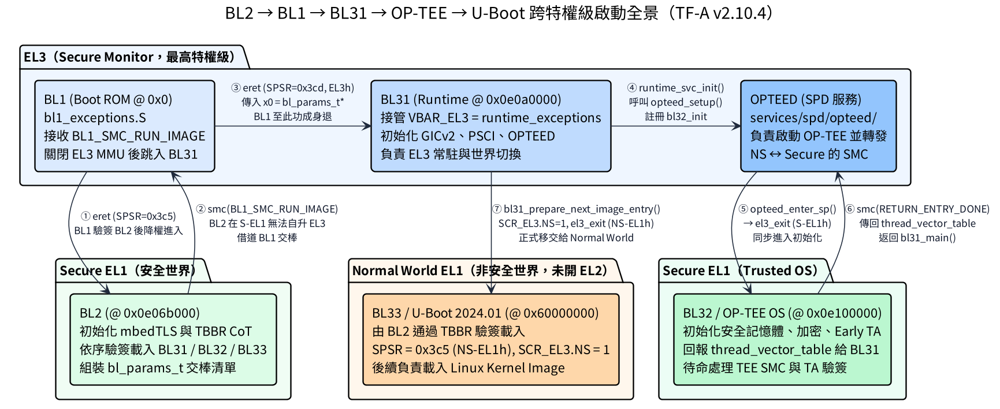
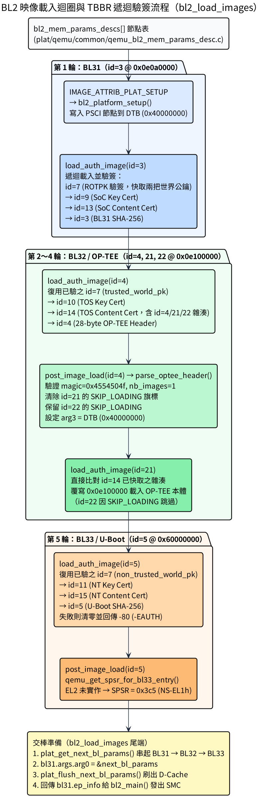
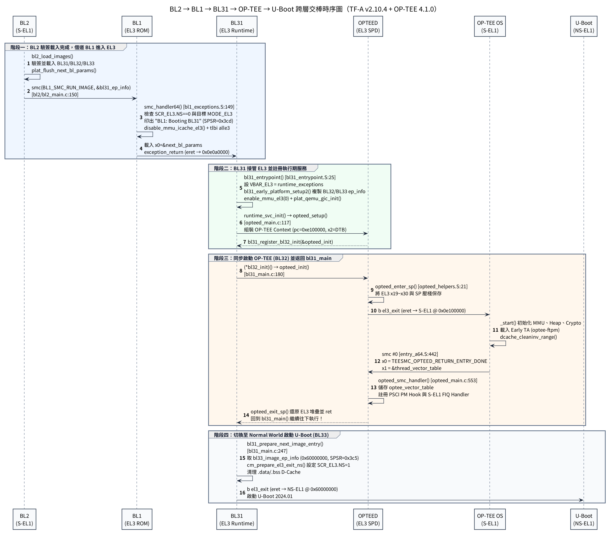

# TF-A BL2 到 BL33 啟動與驗簽全流程解析：BL2 → BL1 → BL31 → OP-TEE → U-Boot（QEMU ARMv8 / TF-A v2.10.4 + OP-TEE 4.1.0）

BL1 住在空間極小且無法更新的 Boot ROM 裡，只負責把 BL2 驗簽並放進 Secure EL1 就退場了；如果直接把所有作業系統與驅動都塞給 BL1，一旦未來要換演算法或修補漏洞，整顆晶片就報廢了。更麻煩的是，BL2 雖然接棒完成了 BL31、OP-TEE（BL32）與 U-Boot（BL33）的驗簽與載入，但它自己跑在權限較低的 **Secure EL1**，根本沒有權限把 CPU 升回 EL3 去啟動 BL31。**這正是 BL2 必須「驗完三份映像 → 透過 SMC 借道 BL1 切進 EL3 啟動 BL31 → 由 BL31 透過 OPTEED 同步喚醒 OP-TEE，最後才降權交給 U-Boot」的真正原因**。

---

## 1. 基本概念

開始追程式碼前，先把這一段跨越多個特權級的關鍵名詞對齊：

- **FIP 裡三條獨立的 TBBR 信任子鏈**：BL2 不會只用一把鑰匙簽所有映像；它先用 ROTPK 驗完 `id=7`（`TRUSTED_KEY_CERT`）取出 `trusted_world_pk` 與 `non_trusted_world_pk`，再分別走三條子鏈驗證 **BL31（SoC FW）**、**BL32（Trusted OS FW）** 與 **BL33（Non-Trusted FW）**，如此安全世界與非安全世界就能分開簽章與獨立升級。
- **`bl_mem_params_descs[]` 與 `bl_params_t`**：QEMU 平台用一張靜態陣列同時決定兩件事——陣列順序決定 **BL2 載入映像的順序**，而節點內的 `next_handoff_image_id` 決定 **交棒執行順序（`BL31 → BL32 → BL33`）**。
- **`BL1_SMC_RUN_IMAGE` 借道機制**：ARMv8 禁止低特權級（S-EL1）自行升回高特權級（EL3）。BL2 載完映像後，必須把 `bl_params_t` 刷出 D-Cache，再發出 `smc(BL1_SMC_RUN_IMAGE, ...)` 讓還在 `VBAR_EL3` 站崗的 BL1 幫它跳進 BL31。
- **OP-TEE 的三段式檔案結構（`id=4` / `id=21` / `id=22`）**：本環境將 OP-TEE 編為 `header_v2`（`id=4`，僅 28 bytes）與 `pager_v2`（`id=21`，核心本體）；BL2 先載入並解析 `id=4` 檔頭，才把 `id=21` 的 `IMAGE_ATTRIB_SKIP_LOADING` 旗標清掉並載入覆寫同一位址，至於未啟用 paging 的 `id=22` 則直接跳過。
- **OPTEED（Secure Payload Dispatcher）與「偽同步呼叫」**：BL31 裡有一個專屬外掛 `opteed`，負責在開機時把 EL3 自己的 C 堆疊暫存器壓棧、跳進 S-EL1 跑 OP-TEE 初始化，等 OP-TEE 發 `TEESMC_OPTEED_RETURN_ENTRY_DONE` SMC 回來後再把堆疊還原並 `ret`——讓 `bl31_main()` 感覺就像呼叫了一個普通 C 函式 `(*bl32_init)()`。

### 1.1 BL2 負責載入與驗簽的完整映像／憑證清單

| Image ID | 巨集名稱 | 類型 | 載入實體位址 | 驗證方式／上層父憑證 |
| :---: | :--- | :--- | :--- | :--- |
| `7` | `TRUSTED_KEY_CERT_ID` | X.509 憑證 | `0x0e0a0000`（暫存） | 由 **ROTPK Hash** 驗簽；解出 `trusted_world_pk` 與 `non_trusted_world_pk` 並快取 |
| `9` | `SOC_FW_KEY_CERT_ID` | X.509 憑證 | `0x0e0a0000`（暫存） | 父憑證 `id=7`（`trusted_world_pk`）→ 解出 `soc_fw_content_pk` |
| `13` | `SOC_FW_CONTENT_CERT_ID` | X.509 憑證 | `0x0e0a0000`（暫存） | 父憑證 `id=9` → 解出 BL31 的預期 SHA-256（`soc_fw_hash_buf`） |
| `3` | `BL31_IMAGE_ID` | **BL31 韌體** | `0x0e0a0000` | 父憑證 `id=13` → 比對 SHA-256（覆寫暫存憑證） |
| `10` | `TRUSTED_OS_FW_KEY_CERT_ID` | X.509 憑證 | `0x0e100000`（暫存） | 復用已驗之 `id=7`（`trusted_world_pk`）→ 解出 `tos_fw_content_pk` |
| `14` | `TRUSTED_OS_FW_CONTENT_CERT_ID` | X.509 憑證 | `0x0e100000`（暫存） | 父憑證 `id=10` → 一次解出 `id=4`、`id=21`、`id=22` 三份 SHA-256 |
| `4` | `BL32_IMAGE_ID` | **OP-TEE Header** | `0x0e100000` | 父憑證 `id=14` → 28 bytes 檔頭，解析後解鎖 `id=21` |
| `21` | `BL32_EXTRA1_IMAGE_ID` | **OP-TEE 本體** | `0x0e100000` | 直接比對 `id=14` 已快取之 `tos_fw_extra1_hash_buf`（覆寫 28-byte 檔頭） |
| `22` | `BL32_EXTRA2_IMAGE_ID` | OP-TEE Pageable | 未載入 | 本環境 `nb_images=1` 未啟用 paging，保留 `SKIP_LOADING` 跳過 |
| `11` | `NON_TRUSTED_FW_KEY_CERT_ID` | X.509 憑證 | `0x60000000`（暫存） | 復用已驗之 `id=7`（`non_trusted_world_pk`）→ 解出 `nt_fw_content_pk` |
| `15` | `NON_TRUSTED_FW_CONTENT_CERT_ID` | X.509 憑證 | `0x60000000`（暫存） | 父憑證 `id=11` → 解出 BL33 的預期 SHA-256（`nt_world_bl_hash_buf`） |
| `5` | `BL33_IMAGE_ID` | **U-Boot 2024.01** | `0x60000000` | 父憑證 `id=15` → 比對 SHA-256；失敗則清零並回傳 `-80`（`-EAUTH`） |

### 1.2 三次 `eret` 交棒的 `SPSR` 與特權級比較（對照實測 Log）

| 交棒階段 | 執行者 → 目標 | 入口位址 (`ELR_EL3`) | `SPSR` 數值 | 目標模式與安全狀態 |
| :--- | :--- | :--- | :---: | :--- |
| BL1 → BL2 | BL1 → BL2 | `0x0e06b000` | `0x3c5` | AArch64 **S-EL1h**（`SCR_EL3.NS = 0`，遮蔽 DAIF） |
| BL1 → BL31 | BL1（受 BL2 SMC 委託）→ BL31 | `0x0e0a0000` | `0x3cd` | AArch64 **EL3h**（`M[3:2] = 0b11`，最高特權級） |
| BL31 → BL32 | OPTEED → OP-TEE OS | `0x0e100000` | `0x3c5` | AArch64 **S-EL1h**（`SCR_EL3.NS = 0`，由 `opteed_init_optee_ep_state` 設定） |
| BL31 → BL33 | BL31 → U-Boot 2024.01 | `0x60000000` | `0x3c5` | AArch64 **NS-EL1h**（`SCR_EL3.NS = 1`；因本 QEMU 未啟用 EL2，見 `qemu_bl2_setup.c:188`） |

---

## 2. 全景架構與載入流程

### 2.1 跨特權級啟動全景



整段流程橫跨三個執行層級：

- **EL3 層（BL1 → BL31 + OPTEED）**：前期由 `BL1` 守住 `VBAR_EL3 = bl1_exceptions`，只為了接住 BL2 最後那道 `BL1_SMC_RUN_IMAGE`；一旦 `BL31` 啟動並把 `VBAR_EL3` 換成 `runtime_exceptions`，BL1 就徹底退場。從此 `BL31` 常駐 EL3，透過內建的 `OPTEED` 服務在開機時喚醒 OP-TEE，並在系統運作期負責 Normal World 與 Secure World 之間的 SMC 轉發與 PSCI 電源管理。
- **Secure EL1 層（BL2 → OP-TEE OS）**：開機初期由 `BL2` 佔用 `0x0e06b000` 負責載入與驗簽；BL2 退場後，Secure EL1 由 `OP-TEE OS`（`0x0e100000`）接手，初始化安全世界環境與 Early TA（本環境內建 `optee-ftpm`），並透過 SMC 把 `thread_vector_table` 交給 BL31 登記。
- **Normal World EL1 層（U-Boot 2024.01）**：BL31 在 `opteed_init()` 返回後，才將 `SCR_EL3.NS` 設為 `1`，透過最後一次 `el3_exit` 跳入 `0x60000000` 啟動已經由 BL2 通過驗簽的 U-Boot。

### 2.2 BL2 迴圈驗簽與載入流程



觀察上圖有兩個非常精妙的設計細節：

1. **憑證快取不重覆讀取**：第 1 輪載入 BL31（`id=3`）時，`load_auth_image()` 已經把 `id=7`（`TRUSTED_KEY_CERT`）驗過並把兩把世界公鑰存進靜態陣列（`trusted_world_pk_buf`、`non_trusted_world_pk_buf`）；因此第 2 輪載 OP-TEE（`id=4`）與第 5 輪載 U-Boot（`id=5`）時，**不會再重新讀取 `id=7`**。同理，`id=21` 也直接復用 `id=14` 已驗完的雜湊。
2. **動態解鎖 `id=21`**：在 `qemu_bl2_mem_params_desc.c` 裡，`id=21` 與 `id=22` 預設都掛著 `IMAGE_ATTRIB_SKIP_LOADING`；直到第 2 輪載入 28 bytes 的 `id=4`（OP-TEE header）並執行 `post_image_load` 裡的 `parse_optee_header()` 後，才依 `nb_images=1` 動態清掉 `id=21` 的跳過旗標。

### 2.3 檔案地圖（TF-A v2.10.4 + OP-TEE 4.1.0）

```text
# TF-A v2.10.4（build/tmp/work/.../trusted-firmware-a/2.10.4/git/）
bl2/aarch64/bl2_entrypoint.S              ---- BL2 組語入口：設 VBAR_EL1、清 .bss、建 Stack、呼叫 bl2_setup → bl2_main
bl2/bl2_main.c                            ---- BL2 主流程：初始化 mbedTLS/auth_mod、呼叫 bl2_load_images()、發 smc(BL1_SMC_RUN_IMAGE)
bl2/bl2_image_load_v2.c                   ---- bl2_load_images() 逐一迭代節點表、呼叫 load_auth_image() 與組裝 bl_params_t
plat/qemu/common/qemu_bl2_mem_params_desc.c ---- 定義 QEMU 平台要載入的映像表（BL31、BL32、BL32_EXTRA1/2、BL33）與交棒鏈
plat/qemu/common/qemu_bl2_setup.c         ---- QEMU BL2 平台設定：DTB 插入 PSCI 節點、post_image_load 解析 OP-TEE 檔頭與計算 BL33 SPSR
lib/optee/optee_utils.c                   ---- parse_optee_header() 驗證 OP-TEE magic 並清除 id=21 的 SKIP_LOADING 旗標
drivers/auth/tbbr/tbbr_cot_bl2.c          ---- 定義 BL2 階段的 TBBR Chain of Trust（id=7 → 9/13/3、10/14/4/21、11/15/5）
bl1/aarch64/bl1_exceptions.S              ---- BL1 EL3 例外向量表：smc_handler64() 接住 BL1_SMC_RUN_IMAGE 並關閉 MMU 後跳 BL31
bl31/aarch64/bl31_entrypoint.S            ---- BL31 組語入口：將 VBAR_EL3 換為 runtime_exceptions、呼叫 bl31_setup → bl31_main → el3_exit
plat/qemu/common/qemu_bl31_setup.c        ---- BL31 平台設定：從 arg0 複製 BL32/BL33 ep_info、開 EL3 MMU、初始化 GICv2
bl31/bl31_main.c                          ---- BL31 主流程：runtime_svc_init()、呼叫 (*bl32_init)()、bl31_prepare_next_image_entry()
common/runtime_svc.c                      ---- 掃描 DECLARE_RT_SVC 區段並執行各服務的 init()（包含 opteed_setup）
services/spd/opteed/opteed_main.c         ---- OPTEED 服務：opteed_setup()、opteed_init() 與接收 RETURN_ENTRY_DONE 的 opteed_smc_handler()
services/spd/opteed/opteed_common.c       ---- opteed_init_optee_ep_state() 與同步進出函式 opteed_synchronous_sp_entry/exit()
services/spd/opteed/opteed_helpers.S      ---- opteed_enter_sp / opteed_exit_sp：透過壓棧／還原 EL3 堆疊達成「同步呼叫 S-EL1」

# OP-TEE OS 4.1.0（build/tmp/work/.../optee-os/4.1.0/git/）
core/arch/arm/kernel/entry_a64.S          ---- OP-TEE 開機入口 _start：完成初始化後發 smc(TEESMC_OPTEED_RETURN_ENTRY_DONE) 回報 BL31
```

---

## 3. 總呼叫樹與時序圖

入口：BL1 執行 `el3_exit`（`ELR_EL3 = 0x0e06b000`，`SPSR_EL3 = 0x3c5`），CPU 以 **S-EL1** 跳進 `bl2_entrypoint`。

```text
bl2_entrypoint() (0x0e06b000, S-EL1)               ## 4.1 BL2 組語入口（bl2/aarch64/bl2_entrypoint.S:16）
├── bl2_setup()->                                  ##     bl2_early_platform_setup2(UART+FIP) + enable_mmu_el1(0)
└── bl2_main()->                                   ## 4.2 BL2 主控流程（bl2/bl2_main.c:87，重點關注）
    ├── crypto_mod_init() + auth_mod_init()        ##     初始化 mbed TLS 與 tbbr_cot_bl2.c 描述符
    ├── bl2_load_images()->                        ## 4.3 依序驗簽並載入所有映像（bl2/bl2_image_load_v2.c:25，重點關注）
    │   ├── bl2_platform_setup()                   ##     寫入 PSCI 節點到預載的 DTB (0x40000000)
    │   ├── load_auth_image(BL31_IMAGE_ID=3)       ##     遞迴驗簽 id=7 → id=9 → id=13 → id=3 (@ 0x0e0a0000)
    │   ├── load_auth_image(BL32_IMAGE_ID=4)       ##     遞迴驗簽 id=10 → id=14 → id=4 (28-byte header @ 0x0e100000)
    │   ├── qemu_bl2_handle_post_image_load(4)->   ## 4.4 解析 OP-TEE 檔頭（qemu_bl2_setup.c:246）
    │   │   └── parse_optee_header()               ##     驗證 magic=OPTE，清除 id=21 的 SKIP_LOADING（optee_utils.c:104）
    │   ├── load_auth_image(BL32_EXTRA1=21)        ##     比對 id=14 快取雜湊，載入 OP-TEE 本體覆寫 0x0e100000
    │   ├── Skip loading image id 22               ##     無 pageable 映像，保留 SKIP_LOADING 跳過
    │   ├── load_auth_image(BL33_IMAGE_ID=5)       ##     遞迴驗簽 id=11 → id=15 → id=5 (U-Boot @ 0x60000000)
    │   ├── qemu_bl2_handle_post_image_load(5)     ##     計算 BL33 SPSR = 0x3c5 (NS-EL1h)
    │   └── plat_flush_next_bl_params()            ##     組裝 BL31→BL32→BL33 的 bl_params_t 並刷出 D-Cache
    └── smc(BL1_SMC_RUN_IMAGE, &bl31_ep_info)      ##     S-EL1 無法自升 EL3，發 SMC 借道 BL1！
        └── [EL3] smc_handler64()->                ## 4.5 BL1 接住 SMC 並跳 BL31（bl1/aarch64/bl1_exceptions.S:143，重點關注）
            ├── bl1_print_next_bl_ep_info()        ##     印出 "BL1: Booting BL31" (0xe0a0000, SPSR=0x3cd)
            ├── disable_mmu_icache_el3() + tlbi    ##     關閉 BL1 MMU 與清 TLB，避免干擾 BL31
            └── exception_return (eret)            ##     帶入 x0=&next_bl_params 跳進 BL31 (EL3)！
                └── bl31_entrypoint() (0x0e0a0000) ## 4.6 BL31 接管 EL3（bl31/aarch64/bl31_entrypoint.S:25）
                    ├── el3_entrypoint_common      ##     將 VBAR_EL3 切換為 runtime_exceptions（BL1 正式退場）
                    ├── bl31_setup()->             ##     複製 BL32/BL33 ep_info 到 BL31 靜態區 + enable_mmu_el3(0)
                    ├── bl31_main()->              ## 4.7 BL31 主流程（bl31/bl31_main.c:119，重點關注）
                    │   ├── bl31_platform_setup()  ##     初始化 ARM GICv2 與 Secure GPIO
                    │   ├── runtime_svc_init()->   ##     掃描 DECLARE_RT_SVC 區段（common/runtime_svc.c:90）
                    │   │   └── opteed_setup()     ## 4.8 組裝 OP-TEE Context 並註冊 bl32_init（opteed_main.c:117）
                    │   ├── (*bl32_init)()->       ## 4.9 同步進入 OP-TEE 初始化（opteed_main.c:207，重點關注）
                    │   │   └── opteed_enter_sp()  ##     壓棧保存 EL3 x19-x30/SP → b el3_exit 進入 S-EL1
                    │   │       └── [S-EL1] _start ##     OP-TEE 初始化 MMU/Crypto/Early TA（entry_a64.S:439）
                    │   │           └── smc(RETURN_ENTRY_DONE, &thread_vector_table)
                    │   │               └── opteed_smc_handler()-> ## 登記 vector table + PSCI PM Hook（opteed_main.c:553）
                    │   │                   └── opteed_exit_sp()   ## 還原 EL3 堆疊並 ret → 回到 bl31_main()！
                    │   └── bl31_prepare_next_image_entry() ## 4.10 備妥 U-Boot Context 與 SCR_EL3.NS=1（bl31_main.c:247）
                    ├── clean_dcache_range(.data/.bss) ##  確保副核喚醒時能讀到主核初始化的全域資料
                    └── b el3_exit                 ##     eret 降權至 NS-EL1 @ 0x60000000 → 啟動 U-Boot 2024.01！
```



---

## 4. 詳細原始碼分析（TF-A v2.10.4 + OP-TEE 4.1.0）

### 4.1 `bl2_entrypoint`（`bl2/aarch64/bl2_entrypoint.S:16-141`）

```asm
func bl2_entrypoint
	// 1. 保留 BL1 透過 x0~x3 傳入的參數（其中 x1 指向 Trusted SRAM 記憶體佈局 meminfo_t）
	mov	x20, x0
	mov	x21, x1
	mov	x22, x2
	mov	x23, x3

	// 2. 設定 S-EL1 例外向量表並開啟 SError 中斷
	adr	x0, early_exceptions
	msr	vbar_el1, x0
	isb
	msr	daifclr, #DAIF_ABT_BIT

	// 3. 開啟指令快取 (I)、資料對齊檢查 (A) 與堆疊對齊檢查 (SA)
	mov	x1, #(SCTLR_I_BIT | SCTLR_A_BIT | SCTLR_SA_BIT)
	mrs	x0, sctlr_el1
	orr	x0, x0, x1
	bic	x0, x0, #SCTLR_DSSBS_BIT
	msr	sctlr_el1, x0
	isb

	// 4. 作廢 BL2 自己 RW 區的 D-Cache（防止殘留上一階段的 dirty cache line），並清零 .bss
	adr	x0, __RW_START__
	adr	x1, __RW_END__
	sub	x1, x1, x0
	bl	inv_dcache_range
	... // 略去 __BSS_START__..__BSS_END__ 與 coherent RAM 清零（bl2_entrypoint.S:75-89）

	// 5. 建立 S-EL1 Stack，並將 BL1 傳來的 x0~x3 交給 bl2_setup()（初始化 UART、FIP 與 S-EL1 MMU）
	bl	plat_set_my_stack
	mov	x0, x20
	mov	x1, x21
	mov	x2, x22
	mov	x3, x23
	bl	bl2_setup

	// 6. 進入 BL2 主流程（永遠不應返回，否則進入 plat_panic_handler）
	bl	bl2_main
	no_ret	plat_panic_handler
endfunc bl2_entrypoint
```

這段組語幫 BL2 在 S-EL1 搭好最基本的 C 執行環境：先保護好 BL1 傳進來的 `meminfo_t` 指標（`x1`），把先前階段可能殘留的 cache line 清乾淨，再呼叫 `bl2_setup()`（位於 `plat/qemu/common/qemu_bl2_setup.c:58-70, 141-159`）開啟 PL011 UART、掛載 `0x40000` 的 FIP 裝置與啟用 `enable_mmu_el1(0)`，最後進入 `bl2_main()`。

---

### 4.2 `bl2_main`（`bl2/bl2_main.c:87-151`）

```c
void bl2_main(void)
{
	entry_point_info_t *next_bl_ep_info;

	// 1. 印出 BL2 版本與建置時間（對應實測 log 第 14~15 行）
	NOTICE("BL2: %s\n", version_string);
	NOTICE("BL2: %s\n", build_message);

	bl2_arch_setup();

	// 2. 初始化 mbed TLS（印出 Using crypto library 'mbed TLS'）與 BL2 專用 TBBR 信任鏈表
	crypto_mod_init();
	auth_mod_init();

	bl2_plat_mboot_init();
	bl2_plat_preload_setup();

	// 3. 核心動作：依節點表逐一驗簽並載入 BL31、BL32 (OP-TEE)、BL33 (U-Boot)
	next_bl_ep_info = bl2_load_images();

	bl2_plat_mboot_finish();

#if !BL2_RUNS_AT_EL3
	... // 略去 AArch32 與 ENABLE_PAUTH 條件編譯（bl2/bl2_main.c:123-141）

	// 4. 在交棒前先沖洗 UART 緩衝區，避免 log 遺失
	console_flush();

	// 5. 關鍵！BL2 跑在 S-EL1 無法自己跳到 EL3，必須發 SMC 交回 BL1，
	//    把下一個映像（BL31）的 entry_point_info_t 指標當作 x1 傳入
	smc(BL1_SMC_RUN_IMAGE, (unsigned long)next_bl_ep_info, 0, 0, 0, 0, 0, 0);
#else
	... // 略去 BL2_RUNS_AT_EL3=1 分支（本 QEMU 平台未啟用）
#endif
}
```

`bl2_main()` 的邏輯非常乾淨：初始化密碼庫與 TBBR 框架（載入 `drivers/auth/tbbr/tbbr_cot_bl2.c` 裡的完整信任樹），把繁重的映像載入與驗簽全權交給 `bl2_load_images()`，最後執行 `smc(BL1_SMC_RUN_IMAGE, ...)` 結束 BL2 的任務。

---

### 4.3 `bl2_load_images`（`bl2/bl2_image_load_v2.c:25-110`）

```c
struct entry_point_info *bl2_load_images(void)
{
	bl_params_t *bl2_to_next_bl_params;
	bl_load_info_t *bl2_load_info;
	const bl_load_info_node_t *bl2_node_info;
	int plat_setup_done = 0;
	int err;

	// 1. 取得平台註冊的載入清單（來自 qemu_bl2_mem_params_desc.c 的 bl2_mem_params_descs[]）
	//    依序為：BL31(3) → BL32(4) → BL32_EXTRA1(21) → BL32_EXTRA2(22) → BL33(5)
	bl2_load_info = plat_get_bl_image_load_info();
	... // 略去 NULL 與 VERSION_2 斷言檢查（bl2_image_load_v2.c:37-40）
	bl2_node_info = bl2_load_info->head;

	while (bl2_node_info != NULL) {
		// 2. 第一個帶有 IMAGE_ATTRIB_PLAT_SETUP 的節點（BL31）會觸發 bl2_platform_setup()
		//    印出 "BL2: Doing platform setup"，並把 PSCI 節點寫進 0x40000000 的 DTB
		if ((bl2_node_info->image_info->h.attr &
		    IMAGE_ATTRIB_PLAT_SETUP) != 0U) {
			if (plat_setup_done != 0) {
				WARN("BL2: Platform setup already done!!\n");
			} else {
				INFO("BL2: Doing platform setup\n");
				bl2_platform_setup();
				plat_setup_done = 1;
			}
		}

		err = bl2_plat_handle_pre_image_load(bl2_node_info->image_id);
		if (err != 0) {
			ERROR("BL2: Failure in pre image load handling (%i)\n", err);
			plat_error_handler(err);
		}

		// 3. 若未標記 SKIP_LOADING，就呼叫 load_auth_image() 遞迴驗簽並載入！
		//    一旦任何憑證簽章或映像 SHA-256 不符，會回傳 -80 (-EAUTH) 並停機
		if ((bl2_node_info->image_info->h.attr &
		    IMAGE_ATTRIB_SKIP_LOADING) == 0U) {
			INFO("BL2: Loading image id %u\n", bl2_node_info->image_id);
			err = load_auth_image(bl2_node_info->image_id,
				bl2_node_info->image_info);
			if (err != 0) {
				ERROR("BL2: Failed to load image id %u (%i)\n",
				      bl2_node_info->image_id, err);
				plat_error_handler(err);
			}
		} else {
			INFO("BL2: Skip loading image id %u\n", bl2_node_info->image_id);
		}

		// 4. 載入後回呼：處理 OP-TEE header 解析（解鎖 id=21）與設定 BL33 的 SPSR
		err = bl2_plat_handle_post_image_load(bl2_node_info->image_id);
		if (err != 0) {
			ERROR("BL2: Failure in post image load handling (%i)\n", err);
			plat_error_handler(err);
		}

		bl2_node_info = bl2_node_info->next_load_info;
	}

	// 5. 依 next_handoff_image_id 串出「可執行映像交棒清單」：BL31 → BL32 → BL33
	bl2_to_next_bl_params = plat_get_next_bl_params();
	... // 略去斷言檢查（bl2_image_load_v2.c:95-99）

	// 6. 將整份 bl_params_t 指標塞進 BL31 的 arg0（未來成為 BL31 入口時的 x0 暫存器）
	if (bl2_to_next_bl_params->head->ep_info->args.arg0 == (u_register_t)0)
		bl2_to_next_bl_params->head->ep_info->args.arg0 =
					(u_register_t)bl2_to_next_bl_params;

	// 7. 關鍵！把交棒資料結構刷出 S-EL1 D-Cache 到實體記憶體，
	//    否則 BL31 剛啟動且 MMU 尚未打開前，會從記憶體讀到舊資料！
	plat_flush_next_bl_params();

	return bl2_to_next_bl_params->head->ep_info;
}
```

這個迴圈完整解釋了實測開機 log 中每一行 `BL2: Loading image id X` 的來龍去脈，也說明了為什麼竄改實驗中只改 U-Boot 的 1 個 byte，就會直接命中第 72 行印出 `ERROR: BL2: Failed to load image id 5 (-80)` 並進入 `plat_error_handler()` 停機。

---

### 4.4 `qemu_bl2_handle_post_image_load` 與 `parse_optee_header`（`plat/qemu/common/qemu_bl2_setup.c:246-373`、`lib/optee/optee_utils.c:104-211`）

BL2 每載入完一個映像就會觸發 `bl2_plat_handle_post_image_load()`，在 QEMU 平台有兩個最重要的 `case`：

```c
// plat/qemu/common/qemu_bl2_setup.c:264-316（保留本環境啟用的 SPD_opteed 路徑）
	switch (image_id) {
	case BL32_IMAGE_ID:
		// 1. 取得緊接在清單後面的 id=21 (pager) 與 id=22 (paged) 兩個節點
		pager_mem_params = get_bl_mem_params_node(BL32_EXTRA1_IMAGE_ID);
		paged_mem_params = get_bl_mem_params_node(BL32_EXTRA2_IMAGE_ID);

		// 2. 解析剛載入到 0x0e100000 的 28-byte OP-TEE header（見下方 parse_optee_header）
		err = parse_optee_header(&bl_mem_params->ep_info,
					 &pager_mem_params->image_info,
					 &paged_mem_params->image_info);

		// 3. 把 QEMU 預載的 DTB 實體位址 (0x40000000) 放進 arg3，
		//    後續 OPTEED 會幫它搬到 x2 交給 OP-TEE（opteed_common.c:59）
		bl_mem_params->ep_info.args.arg3 = ARM_PRELOADED_DTB_BASE;
		bl_mem_params->ep_info.spsr = qemu_get_spsr_for_bl32_entry(); // AArch64 回傳 0，交由 OPTEED 填寫
		break;

	case BL33_IMAGE_ID:
		// 4. 依硬體是否實作 EL2 決定 BL33 執行層級：
		//    mode = (el_implemented(2) != EL_IMPL_NONE) ? MODE_EL2 : MODE_EL1;
		//    本 QEMU 未開 virtualization=on → EL1h → SPSR = 0x3c5
		bl_mem_params->ep_info.spsr = qemu_get_spsr_for_bl33_entry();
		bl_mem_params->ep_info.args.arg0 = 0xffff & read_mpidr();
		break;
	}
```

接著看 `parse_optee_header()` 如何解鎖 `id=21` 並讓 `id=22` 被跳過：

```c
// lib/optee/optee_utils.c:104-211（節錄主幹）
int parse_optee_header(entry_point_info_t *header_ep,
		image_info_t *pager_image_info,
		image_info_t *paged_image_info)
{
	optee_header_t *header = (optee_header_t *)header_ep->pc;

	// 1. 印出檔頭欄位（完全對應實測 log 第 34~40 行：magic=0x4554504f, nb_images=0x1）
	INFO("OPTEE ep=0x%x\n", (unsigned int)header_ep->pc);
	INFO("OPTEE header info:\n");
	INFO("      magic=0x%x\n", header->magic);
	INFO("      version=0x%x\n", header->version);
	INFO("      arch=0x%x\n", header->arch);
	INFO("      flags=0x%x\n", header->flags);
	INFO("      nb_images=0x%x\n", header->nb_images);

	if (!tee_validate_header(header)) { ... } // 驗證 magic=="OPTE" 且 version==2

	// 2. 本環境 nb_images == 1，只有 OPTEE_PAGER_IMAGE_ID：
	//    parse_optee_image() 會檢查載入區間是否在 Secure DRAM (0x0e100000..0x0f000000)，
	//    並執行關鍵一行：image_info->h.attr &= ~IMAGE_ATTRIB_SKIP_LOADING;（optee_utils.c:91）
	for (num = 0U; num < header->nb_images; num++) {
		if (header->optee_image_list[num].image_id == OPTEE_PAGER_IMAGE_ID) {
			ret = parse_optee_image(pager_image_info, &header->optee_image_list[num]);
		} else if (header->optee_image_list[num].image_id == OPTEE_PAGED_IMAGE_ID) {
			ret = parse_optee_image(paged_image_info, &header->optee_image_list[num]);
		}
		...
	}

	// 3. 把 BL32 真正的進入點 pc 更新為 pager_image_info->image_base (0x0e100000)
	//    並把架構 (arch==1 → MODE_RW_64) 寫入 arg0 供 BL31 OPTEED 讀取
	header_ep->pc = pager_image_info->image_base;
	header_ep->args.arg1 = paged_image_info->image_base;
	header_ep->args.arg2 = paged_image_info->image_size;
	header_ep->args.arg0 = (header->arch == 0) ? MODE_RW_32 : MODE_RW_64;
	return 0;
}
```

這段程式碼解開了 log 中兩個常見疑問：第一，為什麼 `id=4` 只載了 `0x1c`（28 bytes）就被緊接著的 `id=21` 蓋掉（因為 `id=4` 只是描述檔頭，解析完就沒用了）；第二，為什麼 log 印出 `BL2: Skip loading image id 22`（因為 `nb_images=1`，迴圈只解鎖了 `id=21`，沒碰到 `id=22`）。

---

### 4.5 `smc_handler64`（`bl1/aarch64/bl1_exceptions.S:143-206`）

當 BL2 在 `bl2_main.c:150` 執行 `smc(BL1_SMC_RUN_IMAGE, &bl31_ep_info, ...)`，CPU 觸發同步例外切回 EL3，跳進 BL1 的 `VBAR_EL3` 例外向量 `SynchronousExceptionA64` → `smc_handler64`：

```asm
func smc_handler64
	// 1. 檢查 x0 是否為 BL1_SMC_RUN_IMAGE（否則走一般 BL1 SMC 處理流程）
	mov	x30, #BL1_SMC_RUN_IMAGE
	cmp	x30, x0
	b.ne	smc_handler

	// 2. 安全防線：確認發出此 SMC 的呼叫者一定來自 Secure World（SCR_EL3.NS == 0）
	//    絕不允許 Normal World 偽造 RUN_IMAGE 劫持 EL3！
	mrs	x30, scr_el3
	tst	x30, #SCR_NS_BIT
	b.ne	unexpected_sync_exception

	// 3. 還原 BL1 自己的 C runtime stack（SP_EL0）
	ldr	x30, [sp, #CTX_EL3STATE_OFFSET + CTX_RUNTIME_SP]
	msr	spsel, #MODE_SP_EL0
	mov	sp, x30

	// 4. x1 是 BL2 傳來的 bl31_ep_info 指標，先存到 x20 並印出
	//    "NOTICE: BL1: Booting BL31"、"Entry point address = 0xe0a0000"、"SPSR = 0x3cd"
	mov	x20, x1
	mov	x0, x20
	bl	bl1_print_next_bl_ep_info

	// 5. 將目標 pc (0xe0a0000) 寫入 ELR_EL3、spsr (0x3cd) 寫入 SPSR_EL3，
	//    並強制驗證目標特權級一定是 MODE_EL3（防呆）
	ldp	x0, x1, [x20, #ENTRY_POINT_INFO_PC_OFFSET]
	msr	elr_el3, x0
	msr	spsr_el3, x1
	ubfx	x0, x1, #MODE_EL_SHIFT, #2
	cmp	x0, #MODE_EL3
	b.ne	unexpected_sync_exception

	// 6. 關閉 BL1 的 EL3 MMU/ICache 並清空所有 EL3 TLB，把乾淨的硬體交給 BL31
	bl	disable_mmu_icache_el3
	tlbi	alle3
	dsb	ish

	mov	x0, x20
	bl	bl1_plat_prepare_exit

	// 7. 將 bl31_ep_info->args (arg0..arg7) 載入 x0..x7（其中 x0 = &next_bl_params）
	//    最後執行 eret（exception_return）正式跳入 BL31！
	ldp	x6, x7, [x20, #(ENTRY_POINT_INFO_ARGS_OFFSET + 0x30)]
	ldp	x4, x5, [x20, #(ENTRY_POINT_INFO_ARGS_OFFSET + 0x20)]
	ldp	x2, x3, [x20, #(ENTRY_POINT_INFO_ARGS_OFFSET + 0x10)]
	ldp	x0, x1, [x20, #(ENTRY_POINT_INFO_ARGS_OFFSET + 0x0)]
	exception_return
endfunc smc_handler64
```

這就是為什麼開機 log 第 52 行會突然又出現 **`NOTICE: BL1: Booting BL31`**（明明剛剛已經跑進 BL2 了）——BL1 就像電梯管理員，BL2 辦完事後得回來按一次電梯（`BL1_SMC_RUN_IMAGE`），由 BL1 把 MMU 關掉、把 `x0 = bl_params_t *` 遞好，再按 `eret` 把 CPU 送進 EL3 的 BL31。

---

### 4.6 `bl31_entrypoint` 與 `bl31_early_platform_setup2`（`bl31/aarch64/bl31_entrypoint.S:25-117`、`plat/qemu/common/qemu_bl31_setup.c:52-90`）

```asm
// bl31/aarch64/bl31_entrypoint.S:25-117（節錄冷開機主幹）
func bl31_entrypoint
	// 1. 保留 BL2→BL1 傳來的 x0~x3（x0 = &next_bl_params）
	mov	x20, x0
	mov	x21, x1
	mov	x22, x2
	mov	x23, x3

	// 2. 關鍵接管！將 VBAR_EL3 覆寫為 runtime_exceptions（BL1 永遠退場）並建立 BL31 Stack
	el3_entrypoint_common					\
		_init_sctlr=0					\
		_warm_boot_mailbox=0				\
		_secondary_cold_boot=0				\
		_init_memory=0					\
		_init_c_runtime=1				\
		_exception_vectors=runtime_exceptions		\
		_pie_fixup_size=BL31_LIMIT - BL31_BASE

	// 3. 把 x0~x3 交給 bl31_setup()（複製參數 + 啟用 BL31 EL3 MMU），再進 bl31_main()
	mov	x0, x20
	mov	x1, x21
	mov	x2, x22
	mov	x3, x23
	bl	bl31_setup
	bl	bl31_main

	// 4. bl31_main() 返回時，OP-TEE 已初始化完且 Normal World Context 已備妥；
	//    將 BL31 的 .data 與 .bss 刷回主記憶體，確保未來副核開啟 D-Cache 前能看到最新狀態
	... // clean_dcache_range(__DATA_START__..__DATA_END__) 與 __BSS_START__..__BSS_END__

	// 5. 執行 el3_exit → eret 正式離開 EL3 進入 U-Boot (BL33)！
	b	el3_exit
endfunc bl31_entrypoint
```

在 `bl31_setup()` 開頭，`bl31_early_platform_setup2()`（`plat/qemu/common/qemu_bl31_setup.c:52-90`）會趁 MMU 尚未開啟、BL2 記憶體還沒被回收前，趕緊走訪 `arg0` 指到的 `bl_params_t` 鏈結串列，把 **BL32（OP-TEE）** 與 **BL33（U-Boot）** 的 `entry_point_info_t` 拷貝到 BL31 自己的靜態變數 `bl32_image_ep_info` 與 `bl33_image_ep_info` 中保存；接著 `bl31_plat_arch_setup()` 才開啟 BL31 專屬的 `enable_mmu_el3(0)`。

---

### 4.7 `bl31_main`（`bl31/bl31_main.c:119-222`）

```c
void bl31_main(void)
{
	cm_manage_extensions_el3();
	manage_extensions_nonsecure_per_world();

	// 1. 印出 BL31 版本（對應實測 log 第 55~56 行）
	NOTICE("BL31: %s\n", version_string);
	NOTICE("BL31: %s\n", build_message);

	// 2. 初始化平台中斷控制器（印出 "INFO: ARM GICv2 driver initialized"）與 Secure GPIO
	bl31_platform_setup();
	bl31_lib_init(); // 呼叫 cm_init()

	// 3. 掃描編譯期用 DECLARE_RT_SVC 註冊的所有執行期服務（PSCI、OPTEED...）
	//    此處會呼叫 opteed_setup()，由它把 opteed_init 註冊到靜態指標 bl32_init
	INFO("BL31: Initializing runtime services\n");
	runtime_svc_init();

	// 4. 若 SPD 有註冊 bl32_init，現在同步進入 S-EL1 初始化 OP-TEE！
	//    （印出 "INFO: BL31: Initializing BL32"；OP-TEE 跑完後會發 SMC 神奇返回這裡）
	if (bl32_init != NULL) {
		INFO("BL31: Initializing BL32\n");
		console_flush();
		int32_t rc = (*bl32_init)();
		if (rc == 0) {
			WARN("BL31: BL32 initialization failed\n");
		}
	}

	// 5. OP-TEE 初始化完成並已待命；現在設定下一次 ERET 要進 Normal World (U-Boot)
	bl31_prepare_next_image_entry();
	console_flush();
	bl31_plat_runtime_setup();
}
```

`bl31_main()` 就像交響樂指揮：先讓 GICv2 與所有執行期服務（PSCI、OPTEED）就位，接著呼叫 `(*bl32_init)()` 等 OP-TEE 把安全世界整頓完畢並回來報到，最後再呼叫 `bl31_prepare_next_image_entry()` 把舞台讓給 U-Boot。

---

### 4.8 `opteed_setup` 與 `opteed_init_optee_ep_state`（`services/spd/opteed/opteed_main.c:117-174`、`opteed_common.c:22-60`）

`runtime_svc_init()`（`common/runtime_svc.c:108-137`）走訪 linker section `rt_svc_descs` 時，會找到 `DECLARE_RT_SVC(opteed_fast, ...)`（`opteed_main.c:676-684`）並呼叫 `opteed_setup()`：

```c
// services/spd/opteed/opteed_main.c:117-174（保留 !OPTEE_ALLOW_SMC_LOAD 主幹）
static int32_t opteed_setup(void)
{
	entry_point_info_t *optee_ep_info;
	uint32_t linear_id = plat_my_core_pos();

	// 1. 向 BL31 平台層取得剛剛從 BL2 複製過來的 bl32_image_ep_info
	optee_ep_info = bl31_plat_get_next_image_ep_info(SECURE);
	if (!optee_ep_info || !optee_ep_info->pc)
		return 1;

	// 2. 取出 BL2 parse_optee_header() 與 qemu_bl2_setup.c 填好的四個參數
	opteed_rw            = optee_ep_info->args.arg0; // MODE_RW_64 (AArch64)
	opteed_pageable_part = optee_ep_info->args.arg1; // 0x0e300000（本環境 size=0）
	opteed_mem_limit     = optee_ep_info->args.arg2; // 0
	dt_addr              = optee_ep_info->args.arg3; // 0x40000000 (DTB 位址)

	// 3. 設定 OP-TEE 的 cpu_context：
	//    pc = 0x0e100000、spsr = SPSR_64(MODE_EL1, MODE_SP_ELX, DISABLE_ALL_EXCEPTIONS) (0x3c5)
	//    並把 dt_addr 擺進 args.arg2（OP-TEE 啟動慣例：x2 = DTB）
	opteed_init_optee_ep_state(optee_ep_info, opteed_rw, optee_ep_info->pc,
				opteed_pageable_part, opteed_mem_limit,
				dt_addr, &opteed_sp_context[linear_id]);

	// 4. 向 BL31 登記延遲啟動函式，稍後由 bl31_main() 第 180 行呼叫
	bl31_register_bl32_init(&opteed_init);
	return 0;
}
```

這裡最值得注意的是參數搬移的細節：BL2 把 DTB 位址放在 `arg3`（避開 `parse_optee_header` 佔用的 `arg0..arg2`），而 `opteed_init_optee_ep_state()`（`opteed_common.c:57-59`）重新整理成 OP-TEE 核心約定的暫存器格式（`x0 = pageable_part`、`x1 = mem_limit`、`x2 = dt_addr`），並填上 `SPSR = 0x3c5`（S-EL1h）。

---

### 4.9 `opteed_init` → OP-TEE `_start` → `opteed_smc_handler`（同步進入與返回機制）

這是整篇最精巧的一段——**BL31 如何用 `eret` 跳去 S-EL1 跑完一整個作業系統的開機流程，還能像一般函式呼叫那樣「返回」到 `bl31_main()` 下一行？**

關鍵就在 `opteed_helpers.S` 的成對函式 `opteed_enter_sp` 與 `opteed_exit_sp`：

```asm
// services/spd/opteed/opteed_helpers.S:21-43（進入 OP-TEE）
func opteed_enter_sp
	// 1. 把目前的 EL3 Stack 指標存入 optee_ctx->c_rt_ctx，並壓棧保存 x19~x30（含返回位址 LR）
	mov	x3, sp
	str	x3, [x0, #0]
	sub	sp, sp, #OPTEED_C_RT_CTX_SIZE
	stp	x19, x20, [sp, #OPTEED_C_RT_CTX_X19]
	... // 保存 x21~x28
	stp	x29, x30, [sp, #OPTEED_C_RT_CTX_X29]

	// 2. 直接跳進 el3_exit → 執行 eret 降權進入 S-EL1 的 OP-TEE (0x0e100000)！
	b	el3_exit
endfunc opteed_enter_sp
```

CPU 跳進 OP-TEE OS 4.1.0 的 `_start`（`optee-os/core/arch/arm/kernel/entry_a64.S`）後，完成 Secure MMU、記憶體池、加密演算法、Early TA（`optee-ftpm`）初始化，最後把自己的執行期向量表位址透過 SMC 交回 BL31：

```asm
// optee-os/core/arch/arm/kernel/entry_a64.S:439-445（OP-TEE 初始化完畢回報 BL31）
	ldr	x0, boot_mmu_config + CORE_MMU_CONFIG_MAP_OFFSET
	adr	x1, thread_vector_table
	sub	x1, x1, x0
	// x0 = TEESMC_OPTEED_RETURN_ENTRY_DONE，x1 = OP-TEE 向量表實體位址
	mov	x0, #TEESMC_OPTEED_RETURN_ENTRY_DONE
	smc	#0
	panic_at_smc_return
```

這道 `smc #0` 把 CPU 送回 BL31 的 `runtime_exceptions` → `opteed_smc_handler()`：

```c
// services/spd/opteed/opteed_main.c:553-590
	case TEESMC_OPTEED_RETURN_ENTRY_DONE:
		// 1. 記下 OP-TEE 回報的向量表位址（未來 Linux 發 TEE SMC 時就是跳這裡！）
		assert(optee_vector_table == NULL);
		optee_vector_table = (optee_vectors_t *) x1;

		if (optee_vector_table) {
			set_optee_pstate(optee_ctx->state, OPTEE_PSTATE_ON);

			// 2. 註冊 PSCI 電源管理回呼（多核 CPU_ON / Suspend 時同步通知 OP-TEE）
			psci_register_spd_pm_hook(&opteed_pm);

			// 3. 註冊 S-EL1 FIQ 中斷路由（Normal World 執行期間收到安全中斷時轉交 OP-TEE）
			flags = 0;
			set_interrupt_rm_flag(flags, NON_SECURE);
			rc = register_interrupt_type_handler(INTR_TYPE_S_EL1,
						opteed_sel1_interrupt_handler, flags);
			if (rc)
				panic();
		}

		// 4. 保存 OP-TEE 的 S-EL1 系統暫存器，接著呼叫 opteed_exit_sp(c_rt_ctx, x1)
		//    還原剛剛壓棧的 EL3 sp 與 x19~x30 並執行 ret —— 直接回到 bl31_main() 第 181 行！
		opteed_synchronous_sp_exit(optee_ctx, x1);
		break;
```

這對 `opteed_enter_sp` / `opteed_exit_sp` 就像是硬體層級的 `setjmp` / `longjmp`：去程透過 `eret` 離開 EL3，回程透過 `smc #0` 進來再把舊堆疊與 `x30` 還原出來 `ret`，讓 BL31 的主流程完全不需要寫複雜的狀態機，就能優雅地等 OP-TEE 初始化完成。

---

### 4.10 `bl31_prepare_next_image_entry`（`bl31/bl31_main.c:247-286`）

```c
void __init bl31_prepare_next_image_entry(void)
{
	entry_point_info_t *next_image_info;
	uint32_t image_type;

	// 1. 取得下一個映像的安全狀態（預設即為 NON_SECURE，代表 BL33）
	image_type = bl31_get_next_image_type();

	// 2. 取出稍早在 bl31_early_platform_setup2 複製的 bl33_image_ep_info
	//    (pc = 0x60000000, spsr = 0x3c5)
	next_image_info = bl31_plat_get_next_image_ep_info(image_type);
	assert(next_image_info != NULL);
	assert(image_type == GET_SECURITY_STATE(next_image_info->h.attr));

	// 3. 印出 "INFO: BL31: Preparing for EL3 exit to normal world" 與入口位址／SPSR
	//    （完全對應實測 log 第 60~62 行）
	INFO("BL31: Preparing for EL3 exit to %s world\n",
		(image_type == SECURE) ? "secure" : "normal");
	print_entry_point_info(next_image_info);

	// 4. 依 next_image_info 初始化 NON_SECURE 的 cpu_context（填入 ELR_EL3、SPSR_EL3、SCR_EL3.NS=1）
	cm_init_my_context(next_image_info);

	// 5. 載入 Non-secure EL1 系統暫存器，並指定下一次 el3_exit 使用 NON_SECURE context
	if (image_type == NON_SECURE) {
		cm_prepare_el3_exit_ns();
	} else {
		cm_prepare_el3_exit(image_type);
	}
}
```

接著 `bl31_main()` 返回到 `bl31_entrypoint.S:102-116`，將 `.data` 與 `.bss` 刷回主記憶體後執行 `b el3_exit`。`eret` 指令一落下，CPU 切換成 **Normal World EL1**（`SCR_EL3.NS = 1`），PC 跳至 `0x60000000`，螢幕上緊接著印出 `U-Boot 2024.01`，TF-A 的開機交棒大戲正式落幕！

---

## 5. 實機驗證對照

以下將上述每一段原始碼，直接對照我們在 QEMU `qemuarm64-secureboot` 上實測擷取的開機與竄改紀錄：

| 實驗／階段 | 關鍵原始碼位置 | 實測 Log 觀察結果 | Log 證據 |
| :--- | :--- | :--- | :--- |
| BL2 啟動與 mbedTLS | `bl2/bl2_main.c:95-105` | `BL2: v2.10.4` → `Using crypto library 'mbed TLS'` → `BL2: Doing platform setup` | [boot-and-optee-verify.log:14-17](logs/boot-and-optee-verify.log#L14-L17) |
| BL2 驗簽載入 BL31 | `bl2_image_load_v2.c:69`、`tbbr_cot_bl2.c:90-297` | 依序載入 `id=7 → 9 → 13 → 3`，全部落在 `0xe0a0000`（BL31 最終大小 `0xd06c`） | [boot-and-optee-verify.log:18-26](logs/boot-and-optee-verify.log#L18-L26) |
| BL2 驗簽 OP-TEE 與跳過 `id=22` | `qemu_bl2_setup.c:273`、`optee_utils.c:118-179` | 未重讀 `id=7`；載入 `id=10 → 14 → 4`（28B）→ 印出 `magic=0x4554504f, nb_images=0x1` → 載入 `id=21`（`0xe100000..0xe1b0348`）→ `Skip loading image id 22` | [boot-and-optee-verify.log:27-44](logs/boot-and-optee-verify.log#L27-L44) |
| BL2 驗簽載入 U-Boot | `bl2_image_load_v2.c:69`、`tbbr_cot_bl2.c:461-545` | 復用 `id=7`；載入 `id=11 → 15 → 5` 至 `0x60000000..0x600ffdd8` | [boot-and-optee-verify.log:45-51](logs/boot-and-optee-verify.log#L45-L51) |
| BL2 借道 BL1 啟動 BL31 | `bl2_main.c:150` → `bl1_exceptions.S:149-205` | `NOTICE: BL1: Booting BL31`、`Entry point address = 0xe0a0000`、`SPSR = 0x3cd` | [boot-and-optee-verify.log:52-55](logs/boot-and-optee-verify.log#L52-L55) |
| BL31 啟動 OP-TEE 並交棒 U-Boot | `bl31_main.c:146-208`、`opteed_main.c:553` | `ARM GICv2 driver initialized` → `Initializing runtime services` → `Initializing BL32` → `Preparing for EL3 exit to normal world`（`0x60000000`, `SPSR = 0x3c5`）→ `U-Boot 2024.01` | [boot-and-optee-verify.log:57-65](logs/boot-and-optee-verify.log#L57-L65) |
| 竄改 BL33 觸發 BL2 拒載 | `bl2_image_load_v2.c:72`、`common/bl_common.c:177` | 翻轉 `flash.bin` 偏移 `0x10FD09` 1 byte 後，BL2 印出 `ERROR: BL2: Failed to load image id 5 (-80)` 並停機 | [tbbr-tamper-test.log](logs/tbbr-tamper-test.log) |

---

## 6. 重點整理

- **BL2 只驗 FIP 裡的下一階韌體（BL31、BL32、BL33），不驗 Linux Kernel**：信任鏈在 TF-A 層終止於已驗證的 U-Boot（`id=5`），Kernel 與 RootFS 的驗證責任屬於後續的 U-Boot Verified Boot 與 Linux `dm-verity`。
- **三條子鏈共用 `id=7` 根憑證且會快取**：`id=7`（`TRUSTED_KEY_CERT`）只在載入 BL31 時由 ROTPK 驗證一次，後續載入 OP-TEE 與 U-Boot 直接復用快取的兩把世界公鑰，節省 I/O 與 RSA 驗簽時間。
- **OP-TEE 載入是「先看目錄、再載正文」**：BL2 先驗簽並解析 28 bytes 的 `id=4` 檔頭，確認 `nb_images=1` 後才動態解鎖並載入 `id=21` 覆寫 `0x0e100000`，同時跳過 `id=22`。
- **BL2 無法自升特權級，必須靠 `BL1_SMC_RUN_IMAGE` 借道 BL1**：這是開機 log 在 BL2 跑完後竟又出現 `BL1: Booting BL31` 的根本原因；BL1 幫忙跳進 BL31 後，才由 BL31 換掉 `VBAR_EL3` 讓 BL1 徹底退休。
- **BL31 透過 `opteed_enter_sp` / `opteed_exit_sp` 同步啟動 OP-TEE**：壓棧保存 EL3 堆疊後 `eret` 進 S-EL1，待 OP-TEE 發 `TEESMC_OPTEED_RETURN_ENTRY_DONE` 交出 `thread_vector_table` 後還原堆疊 `ret` 回 `bl31_main()`，才降權切到 NS-EL1 啟動 U-Boot。
- 一句話總結這段多層交棒：**「各人自掃門前雪，接力棒不能越級傳」**——每一層只驗自己該載的下一棒，跨特權級一定走規範的 `SMC` 與 `eret`。

---

## 參考

- 前篇：[TF-A BL1 啟動全流程解析（bl1-boot-flow.md）](bl1-boot-flow.md)
- 實驗紀錄：[TBBR 安全開機驗證與竄改實驗（tbbr-verify-experiment.md）](tbbr-verify-experiment.md)
- 實作手冊：[手動操作實驗手冊（hands-on-lab-manual.md）](hands-on-lab-manual.md)
- Trusted Firmware-A v2.10.4 官方設計文件：[Firmware Design — Trusted Firmware-A](https://trustedfirmware-a.readthedocs.io/en/lts-v2.10/design/firmware-design.html)
- OP-TEE OS 4.1.0 官方文件：[OP-TEE Architecture / Boot Flow](https://optee.readthedocs.io/en/4.1.0/architecture/core.html)
