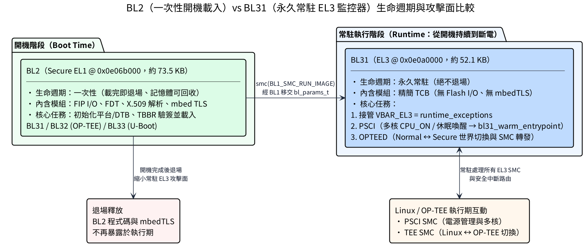

# TF-A 問答筆記：BL2 與 BL31 的角色差異（QEMU ARMv8 / TF-A v2.10.4）

> **問題**：TF-A plays role as BL2 and BL31. What are the differences between them?（TF-A 同時扮演 BL2 與 BL31，兩者之間有什麼差異？）

如果把開機時才用得到的 Flash 驅動、X.509 憑證解析與整套 `mbed TLS` 密碼庫全部塞進最高權限的 EL3 永久常駐，系統運作期間只要出現一個漏洞，攻擊者就有機會直接接管整顆晶片，同時還會白白佔用珍貴的片上 Secure SRAM。**TF-A 因此刻意將自己拆成「開機完就退場的 BL2」與「極度精簡、永久常駐 EL3 的 BL31」兩個獨立映像**。

---

## 1. 一句話直覺區分

- **BL2（Trusted Boot Firmware）＝一次性的「開機搬運＋安檢員」**：負責開機時讀 Flash/FIP、跑 `mbed TLS` 驗簽、把下一階段韌體載到定位，**任務完成就退場**。
- **BL31（EL3 Runtime Firmware）＝永久常駐的「EL3 安全監控器（Secure Monitor）」**：從開機一直活到關機，不讀 Flash 也不做 TBBR 驗簽，專心負責 **Normal World ↔ Secure World 世界切換、SMC 分派與 PSCI 電源管理**。

---

## 2. 生命週期與攻擊面（TCB）全景

---

## 3. 核心差異對照表（QEMU ARMv8 / TF-A v2.10.4）

| 比較項目 | BL2（Trusted Boot Firmware） | BL31（EL3 Runtime Firmware） |
| :--- | :--- | :--- |
| **生命週期** | **一次性**：載完 BL31/32/33 並發出 `BL1_SMC_RUN_IMAGE` 後即退場，所佔記憶體可回收 | **永久常駐**：直到系統斷電關機都留在 Secure SRAM 中 |
| **執行特權級** | **Secure EL1**（部分無 BL1 平台可設 `RESET_TO_BL2=1` 跑在 EL3） | 永遠在最高權限 **EL3**，接管 `VBAR_EL3 = runtime_exceptions` |
| **核心職責** | 初始化平台／安全邊界、修改 DTB（插入 PSCI 節點）、**TBBR 憑證驗簽與 FIP 映像載入** | **不做驗簽、不讀 Flash**；負責 GIC 中斷初始化、**PSCI**（多核喚醒／休眠／關機）、**OPTEED**（啟動 OP-TEE 並在執行期轉發 Linux ↔ OP-TEE 的 SMC 與切換 CPU Context） |
| **內含主要模組** | FIP I/O 驅動、FDT 函式庫、X.509 憑證解析器、`mbed TLS` 密碼庫 | Context Management、Runtime Service 分派表、PSCI、SPD（OPTEED）、GIC 驅動 |
| **本環境載入位址與大小** | `0x0e06b000`（`0x125d1` ≈ **73.5 KB**） | `0x0e0a0000`（`0xd06c` ≈ **52.1 KB**） |
| **暖開機／多核喚醒（Warm Boot）** | **不會再執行** | 副核啟動或休眠喚醒時，直接進入 `bl31_warm_entrypoint`（`bl31/aarch64/bl31_entrypoint.S:125`） |
| **主要原始碼位置** | `bl2/bl2_main.c`、`bl2/bl2_image_load_v2.c`、`plat/qemu/common/qemu_bl2_setup.c` | `bl31/bl31_main.c`、`bl31/aarch64/bl31_entrypoint.S`、`services/spd/opteed/opteed_main.c` |

---

## 4. 為什麼 TF-A 要刻意拆成 BL2 與 BL31，而不是合寫成一支？

1. **最小化常駐 EL3 的信任運算基（TCB, Trusted Computing Base）**
   EL3 的特權高過 Linux Kernel 甚至 OP-TEE。如果把儲存裝置驅動、X.509 ASN.1 解析器與整套 `mbed TLS` 留在 EL3 常駐，等於在系統運作期間大幅擴張高權限攻擊面。拆開後，開機完成 **BL2 的複雜解析與載入程式碼直接退場消失**，常駐 EL3 的 BL31 只保留最精簡的 SMC 路由、PSCI 與 Context Switch。
2. **節省昂貴的片上 Secure SRAM**
   真實 SoC 的片上安全 SRAM 通常只有數百 KB；讓一次性的 BL2 在開機後把空間讓出來，才能留給常駐的 BL31 與其他安全緩衝區使用。
3. **配合 BootROM（BL1）架構的升級彈性**
   燒死在唯讀記憶體裡的 BL1 只需要懂得驗證並載入 BL2；至於後續要帶起哪個 Trusted OS（OP-TEE / Hafnium）、哪個 Non-Secure Bootloader（U-Boot / EDK2）以及是否啟用 TBBR，全由可更新的 BL2 處理，讓 BL31 專心扮演標準化的 EL3 執行期監控器。

---

## 5. 本環境實測證據對照

| 觀察點 | 實測 Log 紀錄 | 檔案位置 |
| :--- | :--- | :--- |
| BL2 載入位址與大小（73.5 KB，含 mbedTLS） | `Image id=1 loaded: 0xe06b000 - 0xe07d5d1`、`Using crypto library 'mbed TLS'` | [boot-and-optee-verify.log:9-16](logs/boot-and-optee-verify.log#L9-L16) |
| BL31 載入位址與大小（52.1 KB，無 mbedTLS） | `Image id=3 loaded: 0xe0a0000 - 0xe0ad06c` | [boot-and-optee-verify.log:25-26](logs/boot-and-optee-verify.log#L25-L26) |
| BL2 退場並借道 BL1 移交 BL31 | `NOTICE: BL1: Booting BL31`、`SPSR = 0x3cd`（EL3h） | [boot-and-optee-verify.log:52-55](logs/boot-and-optee-verify.log#L52-L55) |
| BL31 初始化執行期服務（GICv2 / PSCI / OPTEED） | `ARM GICv2 driver initialized` → `Initializing runtime services` → `Initializing BL32` | [boot-and-optee-verify.log:57-59](logs/boot-and-optee-verify.log#L57-L59) |
| Linux 執行期呼叫 BL31 的 PSCI 服務 | `psci: PSCIv1.1 detected in firmware.` | [boot-and-optee-verify.log:120](logs/boot-and-optee-verify.log#L120) |

---

## 6. 重點整理

- **BL2 管「開機搬運與驗簽」，BL31 管「執行期監控與切換」**，兩者職責完全不重疊。
- **BL2 是一次性的，BL31 是永久常駐的**：開機完成後 BL2 連同 `mbed TLS` 與 X.509 解析器一起退場，確保常駐 EL3 的攻擊面降到最低。
- **副核喚醒與休眠回復不會再經過 BL2**，而是由 Linux 透過 PSCI SMC 直接喚起 BL31 的 `bl31_warm_entrypoint`。
- 一句話記住兩者差別：**「過河拆橋保安全」**——BL2 是開機時搭起來運兵安檢的臨時橋，等 BL31 在 EL3 站穩陣腳就拆掉退場，不留給敵人可乘之機。

---

## 參考

- 完整交棒與原始碼追蹤：[TF-A BL2 到 BL33 啟動與驗簽全流程解析（bl2-to-bl33-boot-flow.md）](bl2-to-bl33-boot-flow.md)
- 前篇：[TF-A BL1 啟動全流程解析（bl1-boot-flow.md）](bl1-boot-flow.md)
- Trusted Firmware-A v2.10.4 官方設計文件：[Firmware Design — Trusted Firmware-A](https://trustedfirmware-a.readthedocs.io/en/lts-v2.10/design/firmware-design.html)
