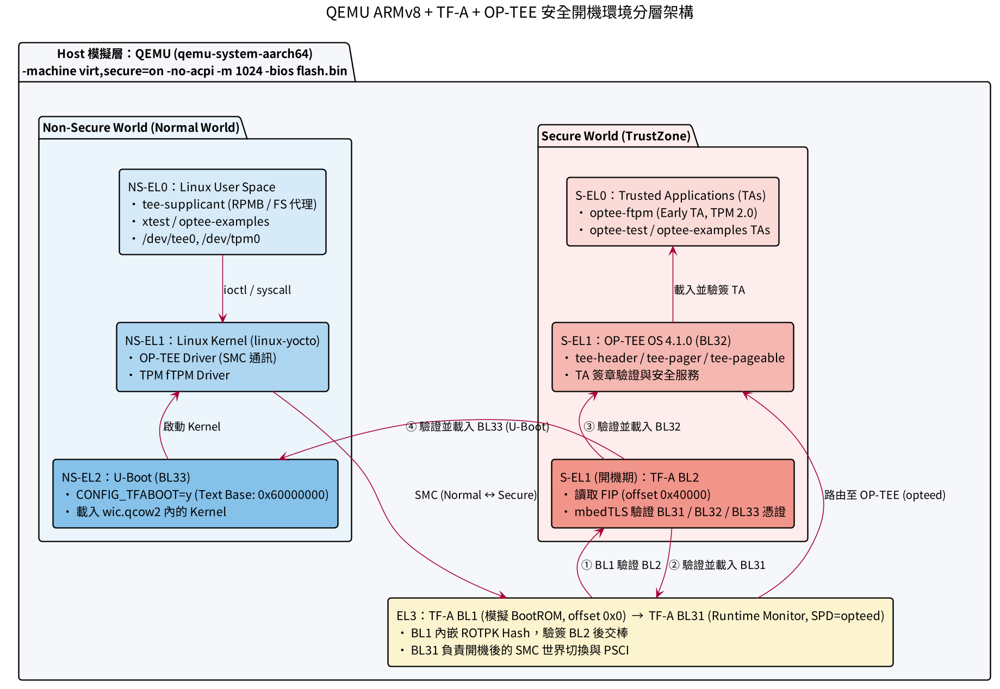
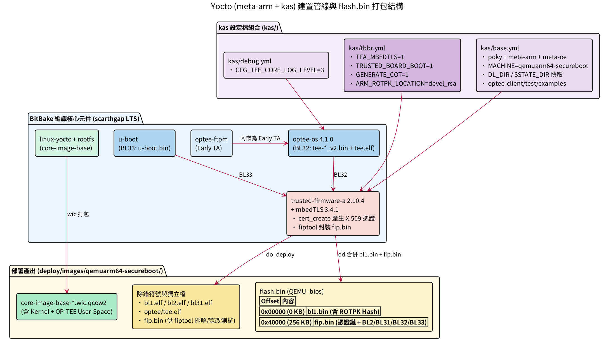
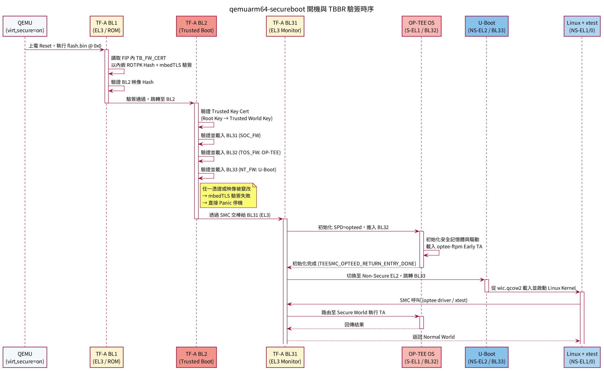

# QEMU ARMv8 + TF-A + OP-TEE 安全開機環境建置（Yocto Scarthgap / meta-arm + kas）

研究安全開機最痛的兩件事，一是實體開發板燒錄慢、一旦寫錯 eFuse 或 ROTPK 就直接變磚，二是手動把 TF-A、mbedTLS、OP-TEE、U-Boot、Linux 與 QEMU 湊在一起時，版本與記憶體位址經常對不上。這套環境改用 **QEMU ARMv8 (`virt,secure=on`)** 搭配 **Yocto `scarthgap` LTS + `meta-arm` (`qemuarm64-secureboot`) + `kas`**，讓你能在一條指令內重現從 BootROM 到 Linux 的完整信任鏈，並隨時竄改映像、更換金鑰或掛上 GDB 單步追蹤，完全沒有變磚風險。

---

## 1. 基本概念

開始動手前，先把環境裡反覆出現的名詞對齊：

- **TrustZone（Secure World / Non-Secure World）**：ARMv8 硬體隔離機制，QEMU 透過 `-machine virt,secure=on` 開啟 EL3 與 Secure EL1/EL0。
- **TF-A（Trusted Firmware-A）**：ARMv8 標準安全韌體，包含 `BL1`（模擬不可變 BootROM）、`BL2`（Trusted Boot Firmware，負責驗簽與載入後續映像）、`BL31`（EL3 Runtime Monitor，負責開機後的 SMC 世界切換）。
- **TBBR / Chain of Trust（CoT）**：TF-A 的安全開機規範，編譯時由 `cert_create` 簽發 X.509 憑證鏈並由 `fiptool` 封裝進 `fip.bin`，開機時由 BL1/BL2 透過 `mbedTLS` 逐級驗證。
- **OP-TEE（BL32）**：跑在 Secure EL1 的開源 Trusted OS，負責隔離並驗簽各類 Trusted Application（TA），本環境預設連同 `optee-ftpm`（TPM 2.0 Early TA）一起編進映像。
- **`kas`**：用宣告式 YAML 管理 Yocto layers、commit 鎖定與 `local.conf` 覆蓋的工具，方便透過疊加 YAML 片段快速切換「有無開啟 TBBR」等實驗組合。

### 1.1 本環境核心元件與鎖定版本

| 元件 | 來源 / 版本 | 角色與用途 |
| :--- | :--- | :--- |
| **Yocto / Poky** | `scarthgap` 5.0 LTS (`1397cd85032d`) | BitBake 建置系統、交叉編譯工具鏈、Linux Kernel (`linux-yocto`)、QEMU (`qemu-system-native`) |
| **meta-arm** | `scarthgap` (`0a4b911d9fd6`) | 提供 `qemuarm64-secureboot` 機器設定、TF-A、OP-TEE、U-Boot 整合配方 |
| **meta-openembedded** | `scarthgap` (`96c2c78e13ff`) | 提供 `meta-oe` / `meta-python`（如 `python3-pycryptodome-native` 等建置相依） |
| **Trusted Firmware-A** | `v2.10.4` (`lts-v2.10`) + `mbedTLS 3.4.1` | BL1/BL2/BL31、TBBR 憑證生成、FIP 封裝與開機驗簽 |
| **OP-TEE** | `4.1.0` (`optee-os`, `optee-client`, `optee-test`, `optee-examples`) + `optee-ftpm` | Secure OS (BL32)、Early TA (fTPM)、User-Space daemon (`tee-supplicant`) 與 `xtest` |
| **U-Boot** | Poky `scarthgap` 預設版本 (`CONFIG_TFABOOT=y`) | Non-Secure Bootloader (BL33)，從 `wic.qcow2` 載入 Linux Kernel |

---

## 2. 環境架構



整套系統分為四個層次，各司其職：

- **Host 模擬層（QEMU）**：以 `-machine virt,secure=on -no-acpi -m 1024 -bios flash.bin` 啟動，將 `flash.bin` 掛載在安全 Flash 起點供 CPU Reset 後執行。
- **EL3 信任根與監控層（TF-A BL1 → BL31）**：BL1 模擬不可變 BootROM 並內嵌開發用 RSA ROTPK Hash，驗簽 BL2 後交棒；系統初始化完成後由 BL31 常駐 EL3，負責 `SPD=opteed` 的 SMC 路由與 PSCI。
- **Secure World（TF-A BL2 / OP-TEE OS / TAs）**：開機階段由 BL2 讀取 `fip.bin` 並用 mbedTLS 逐一驗證 BL31/BL32/BL33 憑證與映像；進入執行期後由 OP-TEE OS (S-EL1) 管理安全記憶體、驗簽並執行 `optee-ftpm` 等 TA。
- **Non-Secure World（U-Boot / Linux / User Space）**：U-Boot (NS-EL2) 啟動 `linux-yocto` (NS-EL1)，使用者空間透過 `tee-supplicant`、`/dev/tee0`、`/dev/tpm0` 與 `xtest` 驗證整個 TrustZone 通道。

### 2.1 檔案地圖

```text
kas/base.yml                                                        ---- 基礎 kas 設定（layers、鎖定 commit、cache、OP-TEE 套件）
kas/tbbr.yml                                                        ---- TF-A TBBR overlay（開啟 mbedTLS + CoT 驗簽 + ELF 部署）
kas/debug.yml                                                       ---- OP-TEE debug log overlay（CFG_TEE_CORE_LOG_LEVEL=3）
layers/meta-arm/meta-arm/conf/machine/qemuarm64-secureboot.conf     ---- QEMU 旗標、flash.bin、wic 與 optee-ftpm 設定
layers/meta-arm/meta-arm/recipes-bsp/trusted-firmware-a/            ---- TF-A 2.10.4 主配方與 qemuarm64-secureboot 的 flash.bin 打包規則
layers/meta-arm/meta-arm/recipes-security/optee/                    ---- OP-TEE 4.1.0 (OS / Client / Test / Examples) 配方
layers/meta-arm/meta-arm/recipes-security/optee-ftpm/               ---- fTPM Early TA 注入 OP-TEE OS 的 bbappend
yocto-cache/downloads/ & yocto-cache/sstate-cache/                  ---- 跨實驗共用的 Yocto 下載與編譯快取
build/tmp/deploy/images/qemuarm64-secureboot/                       ---- 最終產出（flash.bin、fip.bin、*.elf、wic.qcow2）
```

---

## 3. 建置管線與 `flash.bin` 組成



整個建置與開機驗簽的對應關係可以用一棵流程樹總覽（編號對應後面的操作小節）：

```text
環境建置與啟動流程
├── 1. 主機前置與 .venv/kas 安裝               ## 4.1 隔離工具環境，不汙染系統 Python
├── 2. kas checkout kas/base.yml               ## 4.2 拉取並鎖定 poky / meta-arm / meta-oe
├── 3. kas build base:tbbr:debug               ## 4.3 觸發 BitBake 建置管線（重點關注）
│   ├── optee-ftpm → optee-os (BL32)           ## 編譯 fTPM 並內嵌成 OP-TEE Early TA
│   ├── u-boot (BL33)                          ## 編譯 CONFIG_TFABOOT=y 之 u-boot.bin
│   ├── trusted-firmware-a + mbedTLS           ## cert_create 簽發憑證 → fiptool 打包 fip.bin
│   │   └── dd 合併 bl1.bin + fip.bin          ## 產出 flash.bin（0x00000 與 0x40000）
│   └── linux-yocto + core-image-base          ## 打包成可開機 wic.qcow2
└── 4. runqemu qemuarm64-secureboot            ## 5. 啟動 QEMU 並於 Linux 內執行 xtest 驗證
```

在 `layers/meta-arm/meta-arm/recipes-bsp/trusted-firmware-a/trusted-firmware-a_%.bbappend:58-63` 中，`flash.bin` 的組裝方式非常單純：

```bash
# bl1.bin 放在 offset 0x00000（模擬 BootROM，上限 256 KB）
dd if=${BUILD_DIR}/bl1.bin of=${BUILD_DIR}/flash.bin bs=4096 conv=notrunc
# fip.bin 放在 offset 0x40000（seek=64 * 4096 = 256 KB）
dd if=${BUILD_DIR}/fip.bin of=${BUILD_DIR}/flash.bin seek=64 bs=4096 conv=notrunc
```

因此日後做安全開機破壞性測試（例如竄改 FIP 內單一 byte 看 BL1/BL2 驗簽攔截），只要知道 `0x40000` 以後就是 `fip.bin` 即可直接動手。

---

## 4. 抓程式碼與建置步驟

### 4.1 主機前置準備與安裝 `kas`

本環境建置於 **Ubuntu 22.04 LTS (x86_64)**，建議保留至少 **60–80 GB** 可用磁碟空間。

確認系統具備 Yocto `scarthgap` 必要工具（缺少時再以 `apt` 補裝）：

```bash
sudo apt update && sudo apt install -y \
  gawk wget git diffstat unzip texinfo gcc g++ build-essential \
  chrpath socat cpio python3 python3-pip python3-pexpect \
  xz-utils debianutils iputils-ping python3-git python3-jinja2 \
  zstd liblz4-tool file locales
```

建立專案隔離虛擬環境並安裝 `kas`：

```bash
cd /home/awe/disk/qemu-trustzone

# 使用 virtualenv 建立 .venv（若系統有 python3.10-venv 亦可用 python3 -m venv .venv）
virtualenv .venv

# 安裝 kas
.venv/bin/pip install kas
.venv/bin/kas --version
```

### 4.2 `kas` 設定檔設計與抓程式碼

專案把設定拆成三個獨立 YAML，利用 `kas` 的冒號語法疊加：

| 設定檔 | 負責內容 | 關鍵參數 |
| :--- | :--- | :--- |
| `kas/base.yml` | Layers 來源與 commit 鎖定、快取、基本映像 | `MACHINE=qemuarm64-secureboot`、`DL_DIR`/`SSTATE_DIR`、`RM_WORK_EXCLUDE` 保留 TF-A/OP-TEE/U-Boot、`optee-test`/`optee-client`/`optee-examples` |
| `kas/tbbr.yml` | 開啟 TF-A TBBR 驗簽與 ELF 符號部署 | `TFA_MBEDTLS=1`、`TRUSTED_BOARD_BOOT=1`、`GENERATE_COT=1`、`CREATE_KEYS=1`、`ARM_ROTPK_LOCATION=devel_rsa`、`LOG_LEVEL=40`、`TFA_INSTALL_TARGET="bl1 bl2 bl31 fip flash.bin"` |
| `kas/debug.yml` | 調整 OP-TEE 開機日誌等級 | `CFG_TEE_CORE_LOG_LEVEL=3` |

> **為什麼要拆出 `kas/tbbr.yml`？**  
> 檢查 `layers/meta-arm/meta-arm/recipes-bsp/trusted-firmware-a/trusted-firmware-a.inc:46` 會發現 `TFA_MBEDTLS ?= "0"`，代表 `meta-arm` 預設的 `qemuarm64-secureboot` 其實沒有打開 TBBR 驗簽。獨立成 overlay 後，你可以隨時拿掉 `kas/tbbr.yml` 對照「有驗簽 vs 無驗簽」的開機行為差異，而且共用 `sstate-cache` 只需數秒重編 TF-A。

執行 `kas checkout` 抓取 `poky`、`meta-arm`、`meta-openembedded` 至 `layers/`：

```bash
cd /home/awe/disk/qemu-trustzone
.venv/bin/kas checkout kas/base.yml
```

### 4.3 檢查參數並執行完整建置

建置前建議先用 `bitbake -e` 確認 `kas/tbbr.yml` 的 override 正確生效（特別是 `TFA_INSTALL_TARGET:pn-trusted-firmware-a:qemuarm64-secureboot`，避免被 `meta-arm` 原本的 `:qemuarm64-secureboot` 蓋掉）：

```bash
.venv/bin/kas shell kas/base.yml:kas/tbbr.yml:kas/debug.yml -c \
  'bitbake -e trusted-firmware-a | grep -E "^(TFA_MBEDTLS|TFA_INSTALL_TARGET|TFA_SPD|TFA_UBOOT|EXTRA_OEMAKE)="'
```

確認參數無誤後，啟動完整建置（20 核心首次從頭編譯約需 25–45 分鐘）：

```bash
cd /home/awe/disk/qemu-trustzone
.venv/bin/kas build kas/base.yml:kas/tbbr.yml:kas/debug.yml
```

### 4.4 日常單一元件重編與改碼工作流

首次編完後，修改 TF-A / OP-TEE / U-Boot 不需要整包重跑，進入 `kas shell` 即可增量編譯：

```bash
.venv/bin/kas shell kas/base.yml:kas/tbbr.yml:kas/debug.yml

# 快速單獨重編 TF-A（產出新的 bl1/fip/flash.bin）
bitbake -c compile -f trusted-firmware-a && bitbake -c deploy trusted-firmware-a

# 需要長期改碼時，用 devtool 抽出到本機 workspace/sources/
devtool modify trusted-firmware-a
bitbake trusted-firmware-a
```

### 4.5 產出檔案一覽

編譯結果集中在 `build/tmp/deploy/images/qemuarm64-secureboot/`：

| 檔案 | 說明 |
| :--- | :--- |
| `flash.bin` | QEMU `-bios` 直接載入的完整安全開機韌體（`bl1.bin` + `fip.bin`） |
| `fip.bin` | 獨立的 FIP 封裝檔，供 `fiptool info` 拆解檢視憑證鏈或做竄改測試 |
| `bl1.elf` / `bl2.elf` / `bl31.elf` | TF-A 各階段除錯符號，供 GDB 單步追蹤 |
| `optee/tee.elf` & `optee/tee-*_v2.bin` | OP-TEE OS 映像與除錯符號 |
| `u-boot.bin` | BL33 Non-Secure Bootloader |
| `core-image-base-qemuarm64-secureboot.rootfs.wic.qcow2` | 含 Linux Kernel 與 OP-TEE User-Space 的磁碟映像 |

---

## 5. 啟動 QEMU 與開機驗簽時序



透過 `kas shell` 呼叫 Yocto 內建的 `runqemu`（自動帶入 `-machine virt,secure=on -bios flash.bin` 與剛編好的新版 QEMU）：

```bash
cd /home/awe/disk/qemu-trustzone
.venv/bin/kas shell kas/base.yml:kas/tbbr.yml:kas/debug.yml -c \
  'runqemu qemuarm64-secureboot nographic slirp'
```

> 退出 QEMU 快捷鍵：先按 `Ctrl-A`，放開後按 `X`。

### 5.1 實機驗證項目（建置完成後補齊實測 Log）

進入 Linux 後（預設帳號 `root`，無密碼），依序驗證各層是否正常工作：

| 驗證層級 | 執行指令 / 觀察方式 | 預期結果 | 實測 Log |
| :--- | :--- | :--- | :--- |
| **TF-A BL1 / BL2 TBBR** | 觀察開機初期 Console 輸出 | 顯示 `Booting Trusted Firmware` 與 BL1/BL2 透過 mbedTLS 驗簽 FIP 憑證與各映像 | *(建置完成後補入 `logs/`)* |
| **OP-TEE OS & fTPM** | 觀察 BL32 啟動訊息與 Linux `dmesg \| grep -i -E "optee\|tpm"` | OP-TEE 4.1.0 初始化完成，存在 `/dev/tee0`、`/dev/teepriv0`、`/dev/tpm0` | *(建置完成後補入 `logs/`)* |
| **OP-TEE User-Space** | `optee_example_hello_world` 與 `xtest` | Hello World 數值遞增成功，`xtest` 測試通過 | *(建置完成後補入 `logs/`)* |
| **TBBR 竄改攔截實驗** | 竄改 `flash.bin` 中 `fip.bin` 區段 1 byte 後開機 | BL1/BL2 驗簽失敗並直接 Panic 停機 | *(建置完成後補入 `logs/`)* |

---

## 6. 重點整理

- **分層隔離建置**：以 `.venv` 隔離 `kas`，搭配 `yocto-cache/` 共用 `DL_DIR` 與 `SSTATE_DIR`，切換不同安全實驗組合時不會重編整套系統。
- **預設不含 TBBR，需顯式開啟**：`meta-arm` 的 `qemuarm64-secureboot` 預設 `TFA_MBEDTLS="0"`，必須透過 `kas/tbbr.yml` 補上 `TRUSTED_BOARD_BOOT=1`、`GENERATE_COT=1`、`ARM_ROTPK_LOCATION=devel_rsa` 才會有真正的開機驗簽。
- **保留原始碼與 ELF**：透過 `RM_WORK_EXCLUDE` 與 `TFA_INSTALL_TARGET` 保留 TF-A / OP-TEE / U-Boot 原始碼與 `.elf`，後續可直接做 `fiptool` 解析與 GDB 雙世界除錯。
- **`flash.bin` 結構單純**：`0x00000` 是 `bl1.bin`、`0x40000`（256 KB）起是 `fip.bin`，非常適合做各種竄改與換鑰實驗。
- 俗話說「**工欲善其事，必先利其器**」，先把這套可重現、可拆解、不怕變磚的 Yocto 基準環境立穩，後面研究 TBBR、U-Boot FIT、UEFI Secure Boot 或 fTPM Measured Boot 都能像疊積木一樣一路往上加。

## 參考

- `layers/meta-arm/meta-arm/conf/machine/qemuarm64-secureboot.conf`
- `layers/meta-arm/meta-arm/recipes-bsp/trusted-firmware-a/trusted-firmware-a.inc`
- `layers/meta-arm/meta-arm/recipes-bsp/trusted-firmware-a/trusted-firmware-a_%.bbappend`
- `layers/meta-arm/ci/qemuarm64-secureboot.yml`
