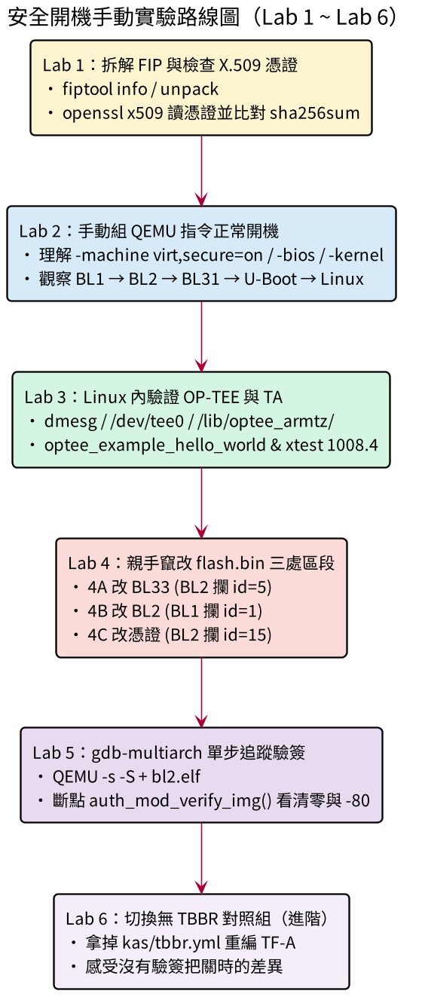
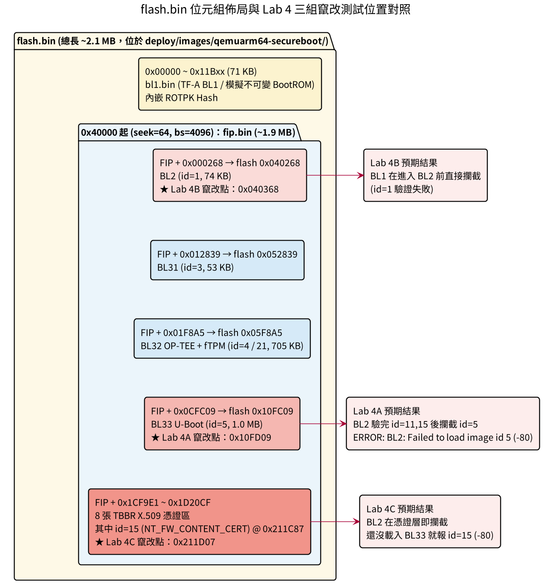

# QEMU ARMv8 + TF-A + OP-TEE 安全開機手動實驗手冊（Hands-On Lab Manual）

直接執行包裝好的腳本雖然方便，但安全開機最核心的細節全藏在 `fiptool` 拆包、X.509 憑證裡的雜湊值、`flash.bin` 的位元組偏移、QEMU 啟動參數與 GDB 斷點追蹤裡。這份手冊刻意**不依賴專案封裝腳本**，帶你一條一條親手操作，從零驗證整條信任鏈（所有暫存檔案都放在 `/tmp/sb-lab`，絕不會弄壞原本編譯好的映像）。

---

## 0. 實驗前置：設定共用環境變數

打開一個終端機，先設定這組環境變數（後續 Lab 1 ~ Lab 6 都會直接引用）：

```bash
export ROOT=/home/awe/disk/qemu-trustzone
export DEPLOY=$ROOT/build/tmp/deploy/images/qemuarm64-secureboot
export QEMU=$ROOT/build/tmp/work/x86_64-linux/qemu-helper-native/1.0/recipe-sysroot-native/usr/bin/qemu-system-aarch64
export FIPTOOL=$ROOT/build/tmp/work/qemuarm64_secureboot-poky-linux/trusted-firmware-a/2.10.4/git/tools/fiptool/fiptool
export LAB=/tmp/sb-lab

mkdir -p "$LAB"
```

先做一次快速確認，確保所有工具與映像都就緒：

```bash
ls -lh "$QEMU" "$FIPTOOL" "$DEPLOY/flash.bin" "$DEPLOY/fip.bin" "$DEPLOY/Image" "$DEPLOY/bl2.elf"
which openssl gdb-multiarch python3
```

---

## 1. 實驗路線圖與檔案地圖



### 1.1 實驗會用到的關鍵檔案

```text
$DEPLOY/flash.bin                                       ---- QEMU -bios 載入的完整韌體（BL1 + FIP）
$DEPLOY/fip.bin                                         ---- 獨立 FIP 封裝檔（Lab 1 拆包與檢查憑證用）
$DEPLOY/bl1.elf / bl2.elf / bl31.elf                    ---- TF-A 各階段除錯符號（Lab 5 GDB 用）
$DEPLOY/optee/tee.elf                                   ---- OP-TEE OS 4.1.0 除錯符號（進階 GDB 用）
$DEPLOY/Image                                           ---- Linux 6.6.160 ARM64 Kernel
$DEPLOY/core-image-base-qemuarm64-secureboot.rootfs.wic.qcow2 ---- RootFS 磁碟映像（會複製到 /tmp/sb-lab 再跑）
```

---

## Lab 1：拆解 `fip.bin` 並用 OpenSSL 核對 X.509 憑證裡的雜湊值

**實驗目的**：親眼確認 `fip.bin` 裡面真的包了 8 張 X.509 憑證，而且憑證裡面記錄的 SHA-256 雜湊值，真的跟 `u-boot.bin` 一模一樣。

### 步驟 1.1：列出 `fip.bin` 內所有映像與憑證

```bash
"$FIPTOOL" info "$DEPLOY/fip.bin"
```

你應該會看到 5 份韌體映像（`--tb-fw`、`--soc-fw`、`--tos-fw`、`--tos-fw-extra1`、`--nt-fw`）與 8 張憑證（`--trusted-key-cert`、`--tb-fw-cert`、`--soc/tos/nt-fw-key-cert`、`--soc/tos/nt-fw-cert`）。記下 `Non-Trusted Firmware BL33` 的 offset（`0xCFC09`）與 `BL2` 的 offset（`0x268`），Lab 4 會用到。

### 步驟 1.2：把 `fip.bin` 完整解包到暫存目錄

```bash
mkdir -p "$LAB/fip-unpack"
"$FIPTOOL" unpack --force --out "$LAB/fip-unpack" "$DEPLOY/fip.bin"
ls -lh "$LAB/fip-unpack"
```

### 步驟 1.3：用 `openssl` 讀取 BL33 憑證，並與 `u-boot.bin` 雜湊人工比對

TF-A 的憑證是 DER 格式的 X.509 憑證。先檢視 `nt-fw-cert.bin`（即 `id=15` `NON_TRUSTED_FW_CONTENT_CERT`）：

```bash
openssl x509 -inform DER -in "$LAB/fip-unpack/nt-fw-cert.bin" -text -noout
```

觀察輸出的 `X509v3 extensions` 區塊——最後一段會看到一個 32-byte 的 SHA-256 摘要（OID `1.3.6.1.4.1.4128.2100.1001` 對應 `NonTrustedWorldBootloaderHash`）。現在直接算 `nt-fw.bin`（也就是 U-Boot）的 SHA-256 來對照：

```bash
sha256sum "$LAB/fip-unpack/nt-fw.bin"
```

你會發現 `sha256sum` 算出的 64 個十六進位字元，與剛剛 `openssl x509` 印出的 extension 雜湊值**逐字完全一致**！這就是 BL2 執行 `auth_hash()` 時比對的標準答案。

*(選作)* 你也可以用同樣指令看看根金鑰憑證 `trusted-key-cert.bin`（`id=7`）和金鑰憑證 `nt-fw-key-cert.bin`（`id=11`）的 `Issuer` 與 `Subject` 串接關係：

```bash
for cert in trusted-key-cert.bin nt-fw-key-cert.bin nt-fw-cert.bin; do
  echo "=== $cert ==="
  openssl x509 -inform DER -in "$LAB/fip-unpack/$cert" -subject -issuer -noout
done
```

---

## Lab 2：手動組合 QEMU 指令完成正常安全開機

**實驗目的**：理解每一個 QEMU 參數的作用，親眼走完從 BL1 Reset 到 Linux Login 的完整安全開機流程。

### 步驟 2.1：建立一份可丟棄的磁碟副本

避免直接改動 Yocto 產出的原始 `.wic.qcow2`：

```bash
cp "$DEPLOY/core-image-base-qemuarm64-secureboot.rootfs.wic.qcow2" "$LAB/rootfs.qcow2"
```

### 步驟 2.2：手動啟動 QEMU

```bash
"$QEMU" \
  -machine virt,secure=on,acpi=off \
  -cpu cortex-a57 \
  -smp 4 \
  -m 1024 \
  -nographic \
  -bios "$DEPLOY/flash.bin" \
  -kernel "$DEPLOY/Image" \
  -append "root=/dev/vda2 rw console=ttyAMA0,115200 swiotlb=0" \
  -drive "id=disk0,file=$LAB/rootfs.qcow2,if=none,format=qcow2" \
  -device virtio-blk-device,drive=disk0 \
  -netdev user,id=net0 \
  -device virtio-net-pci,netdev=net0 \
  -object rng-random,filename=/dev/urandom,id=rng0 \
  -device virtio-rng-pci,rng=rng0
```

| 參數 | 作用說明 |
| :--- | :--- |
| `-machine virt,secure=on,acpi=off` | 啟用 ARMv8 TrustZone（EL3 + Secure World），停用 ACPI 改用 Device Tree |
| `-cpu cortex-a57` | 模擬 ARMv8.0-A 處理器（與 `qemuarm64-secureboot.conf` 一致） |
| `-bios "$DEPLOY/flash.bin"` | 將 `bl1.bin + fip.bin` 映射為安全開機 Flash，CPU Reset 從 `0x0` 執行 BL1 |
| `-kernel` + `-append` | 讓 QEMU 把 `root=/dev/vda2 ...` 寫進 DTB `/chosen/bootargs` 傳給 U-Boot → Linux |
| `-nographic` | 把 UART (`ttyAMA0`) 直接接到目前終端；退出快捷鍵為 `Ctrl-A` 放開後按 `X` |

### 步驟 2.3：開機過程檢查點（邊看邊對照）

1. **BL1**：看到 `NOTICE: BL1: v2.10.4` → `INFO: Using crypto library 'mbed TLS'` → `Loading image id=6` (憑證) → `Loading image id=1` (BL2)。
2. **BL2**：看到依序載入：
   - BL31：`id=7` → `id=9` → `id=13` → `id=3`
   - BL32 (OP-TEE)：`id=10` → `id=14` → `id=4` → `id=21`
   - BL33 (U-Boot)：`id=11` → `id=15` → `id=5` (載入位址 `0x60000000`)
3. **BL31 → U-Boot → Linux**：看到 `U-Boot 2024.01` → `Starting kernel ...` → 最後停在 `qemuarm64-secureboot login:`。

輸入帳號 **`root`**（無密碼）登入，直接接續 Lab 3！

---

## Lab 3：在 Linux 內手動驗證 OP-TEE、TA 簽章與 fTPM

**實驗目的**：確認 Normal World Linux 透過 BL31 SMC 與 Secure World OP-TEE 溝通正常，並實測 OP-TEE 攔截損毀 TA。

在剛剛登入的 QEMU Linux Shell 內依序執行：

### 步驟 3.1：檢查核心驅動、安全記憶體配置與裝置節點

```bash
# 查看 OP-TEE 保留記憶體 (0x0e100000)、共享記憶體 (0x42000000) 與驅動版本
dmesg | grep -i -E "optee|tee|tpm"

# 確認裝置節點與背景 tee-supplicant 守護行程
ls -l /dev/tee* /dev/tpm* 2>&1
ps | grep tee-supplicant

# 檢視已安裝且簽過章的 User TA 檔案
ls -l /lib/optee_armtz/
```

### 步驟 3.2：執行官方 Hello World TA（跨世界呼叫）

```bash
optee_example_hello_world
```

預期輸出：
```text
Invoking TA to increment 42
TA incremented value to 43
```

### 步驟 3.3：執行 `xtest` 並特別觀察「損毀 TA 驗簽攔截」

先跑核心回歸群組（約 10–15 秒）：

```bash
xtest -t regression 1001 1004 1008
```

特別留意 **`regression_1008.4 Load corrupt TA`**：這個測項會刻意嘗試載入被破壞的 TA，唯有 OP-TEE Core 驗簽拒絕載入才會顯示 `OK`。

*(選作)* 如果想跑完整 OP-TEE 測試套件（約 1–2 分鐘），可直接輸入 `xtest`。

測試完畢後輸入 `poweroff` 關閉 QEMU（關機過程中會看到 `tpm tpm0` 的 fTPM 訊息），回到 Host 終端機進行 Lab 4！

---

## Lab 4：親手竄改 `flash.bin` 三處不同區段，實測各關卡攔截



**實驗目的**：體驗「改不同位置，會由不同層級的信任鏈抓包」。我們用一段 5 行 Python 腳本精準翻轉目標 offset 的 1 個 byte（XOR `0xFF`），不更動任何其他資料。

先在 Host 終端機定義一個小函式方便重複使用：

```bash
flip_byte() {
  local src="$1" dst="$2" offset="$3"
  cp "$src" "$dst"
  python3 - "$dst" "$offset" <<'PY'
import sys
path, off = sys.argv[1], int(sys.argv[2], 0)
with open(path, "r+b") as f:
    f.seek(off)
    b = f.read(1)
    nb = bytes([b[0] ^ 0xFF])
    f.seek(off)
    f.write(nb)
print(f"[TAMPER] {path} @ {hex(off)}: 0x{b.hex()} -> 0x{nb.hex()}")
PY
}
```

### 實驗 4A：竄改 BL33（U-Boot）1 byte → 看 BL2 攔截 `id=5`

`fip.bin` 位於 `flash.bin` 的 `0x40000`，BL33 位於 `fip.bin` 的 `0xCFC09`，我們挑內部 `+0x100` 處（`0x40000 + 0xCFC09 + 0x100 = 0x10FD09`）：

```bash
flip_byte "$DEPLOY/flash.bin" "$LAB/flash-tamper-bl33.bin" 0x10FD09

"$QEMU" -machine virt,secure=on,acpi=off -cpu cortex-a57 -smp 4 -m 1024 \
  -nographic -bios "$LAB/flash-tamper-bl33.bin"
```

**觀察重點**：BL1→BL2、BL31、BL32 全部過關，但載入 BL33 時印出：
```text
ERROR:   BL2: Failed to load image id 5 (-80)
```
系統直接停機（按 `Ctrl-A` 再按 `X` 退出 QEMU）。

### 實驗 4B：竄改 BL2 本體 1 byte → 看 BL1 (BootROM) 攔截 `id=1`

BL2 位於 `fip.bin` 的 `0x268`，翻轉 `0x40000 + 0x268 + 0x100 = 0x40368`：

```bash
flip_byte "$DEPLOY/flash.bin" "$LAB/flash-tamper-bl2.bin" 0x40368

"$QEMU" -machine virt,secure=on,acpi=off -cpu cortex-a57 -smp 4 -m 1024 \
  -nographic -bios "$LAB/flash-tamper-bl2.bin"
```

**觀察重點**：這次**連 BL2 都還沒啟動**，就在 BL1 階段直接失敗並停機（`id=1` 驗證不通過）。按 `Ctrl-A` 再按 `X` 退出。

### 實驗 4C：竄改 BL33 內容憑證 (`nt-fw-cert`) 1 byte → 看 BL2 在憑證層攔截 `id=15`

`nt-fw-cert` 位於 `fip.bin` 的 `0x1D1C87`，翻轉 `0x40000 + 0x1D1C87 + 0x80 = 0x211D07`：

```bash
flip_byte "$DEPLOY/flash.bin" "$LAB/flash-tamper-cert.bin" 0x211D07

"$QEMU" -machine virt,secure=on,acpi=off -cpu cortex-a57 -smp 4 -m 1024 \
  -nographic -bios "$LAB/flash-tamper-cert.bin"
```

**觀察重點**：對比實驗 4A！這次 BL2 甚至**還沒去讀 `id=5` (BL33)**，在遞迴驗證父憑證 `id=15` 時（X.509 格式或 RSA 簽章失敗）就立刻中止並印出 `ERROR: BL2: Failed to load image id 5 (-80)`（因為外層 `bl2_load_images` 是針對 `id=5` 呼叫，而內層在 `id=15` 就提早回傳 `-EAUTH`）。

| 實驗 | 竄改偏移 (`flash.bin`) | 破壞目標 | 攔截者 | 最後載入的 ID |
| :---: | :--- | :--- | :--- | :--- |
| **4A** | `0x10FD09` | BL33 (U-Boot) 本體 | BL2 (`auth_hash`) | `id=5` 載入後雜湊不符 |
| **4B** | `0x40368` | BL2 本體 | BL1 (BootROM) | `id=1` 載入後雜湊不符 |
| **4C** | `0x211D07` | `NT_FW_CONTENT_CERT` 憑證 | BL2 (`img_parser` / `auth_signature`) | 停在 `id=15`，未載入 `id=5` |

---

## Lab 5：用 `gdb-multiarch` 雙終端單步追蹤 BL2 驗簽與記憶體清零

**實驗目的**：用 GDB 親眼看到 `load_auth_image_recursive()` 如何一層層遞迴驗簽，並在竄改實驗中親眼抓到 `auth_mod_verify_img()` 回傳錯誤、呼叫 `zero_normalmem()` 清空 `0x60000000` 再回傳 `-80`。

### 步驟 5.1：在【終端機 1】啟動 QEMU 並暫停在 Reset Vector

使用 Lab 4A 產生的 `$LAB/flash-tamper-bl33.bin`，加上 `-s`（開啟 GDB server 於 TCP 1234）與 `-S`（上電立即暫停 CPU）：

```bash
"$QEMU" -machine virt,secure=on,acpi=off -cpu cortex-a57 -smp 1 -m 1024 \
  -nographic -bios "$LAB/flash-tamper-bl33.bin" -s -S
```

*(註：GDB 單步追蹤時建議用 `-smp 1`，避免多核切換干擾視線。)*

### 步驟 5.2：在【終端機 2】啟動 `gdb-multiarch` 並掛上 BL2 符號

```bash
gdb-multiarch /home/awe/disk/qemu-trustzone/build/tmp/deploy/images/qemuarm64-secureboot/bl2.elf
```

在 `(gdb)` 提示字元內依序輸入：

```gdb
# 1. 連線到 QEMU GDB server
target remote localhost:1234

# 2. 告訴 GDB TF-A 原始碼所在目錄（讓 list / tui 可以直接看程式碼）
directory /home/awe/disk/qemu-trustzone/build/tmp/work/qemuarm64_secureboot-poky-linux/trusted-firmware-a/2.10.4/git

# 3. 在遞迴驗簽與驗證核心設下硬體斷點（因 BL2 還沒從 FIP 載進 RAM，先用 hbreak！）
hbreak load_auth_image_recursive
hbreak auth_mod_verify_img

# 4. 放行 CPU（BL1 會先跑完並把 BL2 載入 0xe06b000，接著停在 BL2 的第一個斷點）
continue
```

### 步驟 5.3：追蹤 `id=5` (BL33) 驗證失敗的瞬間

每次停在斷點時，可以用以下指令觀察狀態：

```gdb
# 查看目前正在驗證哪一個 image_id（對應第 1 節的 ID 表：3=BL31, 4=BL32, 5=BL33, 11/15=憑證）
p image_id
bt

# 若想直接跳到 BL33 (id=5) 再停下來，可以設條件斷點：
delete breakpoints
hbreak auth_mod_verify_img if img_id == 5
continue
```

停在 `auth_mod_verify_img(img_id=5, img_ptr=0x60000000, ...)` 後：

```gdb
# 1. 先偷看剛被載入 DRAM 0x60000000 的前幾個 word（確認 U-Boot 確實在記憶體裡）
x/8wx 0x60000000

# 2. 讓 auth_mod_verify_img 跑完回到 load_auth_image_recursive
finish
# 觀察回傳值：應該是非 0（驗證失敗！）

# 3. 單步執行（n）跨過 zero_normalmem() 與 flush_dcache_range()
n
n
n

# 4. 再看一次 0x60000000 —— 原本的 U-Boot 映像已經被 TF-A 全部清成 0x00000000！
x/8wx 0x60000000
```

看完這一步，你對 TF-A TBBR 驗證與記憶體防殘留機制的理解就已經完全扎根了！輸入 `quit` 離開 GDB，回終端機 1 按 `Ctrl-A` 再按 `X` 關閉 QEMU。

---

## Lab 6（進階對照）：拿掉 `kas/tbbr.yml` 編一版「無驗簽」TF-A

**實驗目的**：做對照實驗，體會沒有 `TRUSTED_BOARD_BOOT=1` 時發生什麼事。

```bash
cd /home/awe/disk/qemu-trustzone

# 1. 不帶 kas/tbbr.yml，僅重編 trusted-firmware-a（利用 sstate 快取，數十秒內完成）
.venv/bin/kas shell kas/base.yml:kas/debug.yml -c 'bitbake trusted-firmware-a'

# 2. 檢查新的 fip.bin —— 會發現 8 張憑證全部消失了！
"$FIPTOOL" info "$DEPLOY/fip.bin"

# 3. 試著翻轉新 flash.bin 內 BL33 結尾附近的 1 byte 再開機，觀察 TF-A 完全不會報錯！
```

實驗完畢後，別忘了切回含 TBBR 的正式版本：

```bash
cd /home/awe/disk/qemu-trustzone
.venv/bin/kas shell kas/base.yml:kas/tbbr.yml:kas/debug.yml -c 'bitbake trusted-firmware-a'
```

---

## 2. 常見問題排除（Troubleshooting）

| 現象 | 原因 | 解法 |
| :--- | :--- | :--- |
| QEMU 報 `Could not open temporary file '/var/tmp/...'` | 使用了 `snapshot=on` 且 `/var/tmp` 不可寫 | 改用本手冊的作法：先把 `.wic.qcow2` 複製到 `/tmp/sb-lab/rootfs.qcow2` 再掛載 |
| Linux 開機報 `VFS: Cannot open root device ""` | 手動跑 QEMU 時漏加 `-kernel` 與 `-append "root=/dev/vda2 ..."` | 補齊 Lab 2 步驟 2.2 的 `-kernel` 與 `-append` 參數 |
| GDB 設 `break` 停不到 BL2 函式 | CPU 停在 BL1 時，BL2 尚未被載入 RAM (`0xe06b000`)，軟體斷點會被覆寫 | 一律改用硬體斷點 **`hbreak`** |
| 卡在 QEMU 無法用 `Ctrl-C` 退出 | `-nographic` 把 `Ctrl-C` 轉送給 Guest | 先按 **`Ctrl-A`**，放開後再按 **`X`** |

---

## 3. 重點整理

- **Lab 1** 用 `fiptool unpack` + `openssl x509` + `sha256sum`，把「憑證鏈」從抽象名詞變成你親眼核對過的 64 碼 SHA-256。
- **Lab 2 & 3** 把 QEMU 參數、TrustZone 世界切換、OP-TEE Driver、`tee-supplicant` 與 `xtest` 串成一條可觀察的端到端通路。
- **Lab 4** 透過翻轉 BL33 / BL2 / 憑證三個位置的 1 byte，實證 BL1 與 BL2 各自負責的防護邊界。
- **Lab 5** 用 `gdb-multiarch` 的 `hbreak` 停在 `auth_mod_verify_img()`，親眼驗證驗簽失敗後 `0x60000000` 被 `zero_normalmem()` 瞬間清零。
- 俗話說「**百聞不如一見，百見不如一練**」，把這六個 Lab 親手走完一輪，之後要延伸研究 U-Boot Signed FIT、UEFI Secure Boot 或自訂 ROTPK 就會非常得心應手。
