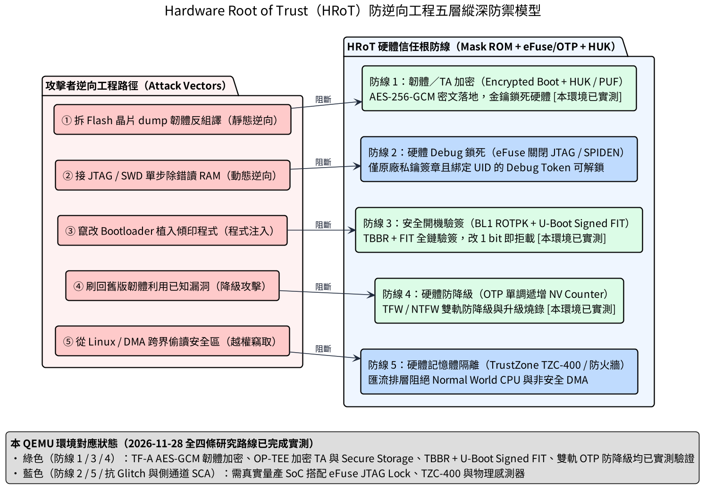

# TF-A 問答筆記：Hardware Root of Trust（HRoT）如何防止裝置被逆向工程？（QEMU ARMv8 / TF-A v2.10.4 + OP-TEE 4.1.0）

> **問題**：How hardware root of trust protects device from reverse engineering?（硬體信任根如何保護裝置不被逆向工程？）

很多人以為只要開了 Secure Boot 驗簽，別人就沒辦法逆向分析自己的韌體——其實剛好相反。**單靠簽章驗簽（ROTPK + TBBR）只保證「完整性與來源合法」（防竄改），並不提供「機密性」（防靜態反組譯）**。像我們 QEMU 環境裡的 `flash.bin`，雖然改 1 個 byte 就會觸發 `-80 (-EAUTH)` 拒載，但裡面的 `bl2.bin`、`optee` 與 `u-boot.bin` 全是**明文**，把 Flash 拆下來就能直接丟進 Ghidra / IDA Pro 反組譯。真正的 **Hardware Root of Trust（硬體信任根，HRoT）** 是把「靜態加密、鎖除錯口、防竄改、防降級、記憶體隔離」五道防線一起綁死在不可改寫的硬體上，才能真正擋住逆向工程。

---

## 1. 五層縱深防禦全景

---

## 2. HRoT 封鎖逆向工程的五大防線

| 逆向工程手法 | HRoT 對應硬體防線 | 防護原理（為什麼繞不過去） |
| :--- | :--- | :--- |
| **1. 拆 Flash dump 韌體反組譯**（靜態逆向） | **韌體／TA 加密（Encrypted Boot）＋ HUK / PUF** | 外部 Flash 只放密文；解密用的 **HUK（Hardware Unique Key）** 燒死在晶片內部 OTP/eFuse 或由 **PUF（實體不可複製功能）** 產生，且僅限硬體加密引擎（Keyladder）內部存取，**連 CPU 軟體都讀不到原始金鑰**。解密只在安全區 SRAM 進行，把 Flash 拆到別台機器上看到的只是亂碼。 |
| **2. 接 JTAG / SWD 單步追蹤或 dump RAM 明文**（動態逆向） | **硬體 Debug 鎖死（eFuse JTAG Lock / Authenticated Debug）** | 量產時燒斷 eFuse 關閉 JTAG/SWD 與 ARM CoreSight 的安全除錯訊號（`SPIDEN` / `SPNIDEN`）。即使韌體在 RAM 中已解密成明文，外部探針也接不進去；原廠維修必須出示「綁定該晶片 UID 與私鑰簽章」的 Debug Token，經 HRoT 驗證通過才可暫時解鎖。 |
| **3. 刷入自製程式把記憶體明文印出來**（程式注入） | **Secure Boot（Mask ROM + eFuse ROTPK）** | 因為 BL1 寫死在不可改的 Mask ROM、ROTPK Hash 燒死在 eFuse，攻擊者無法竄改 Bootloader 或塞入傾印程式；只要改動 1 bit 就會驗簽失敗並立即清零停機。 |
| **4. 刷回有漏洞的舊版韌體來提權 dump**（降級攻擊） | **防降級機制（OTP Monotonic NV Counter）** | 晶片內部設有只能 `0 → 1` 單向遞增的硬體計數器；TBBR 憑證裡的 `nv_ctr` 若低於硬體值（`drivers/auth/auth_mod.c:379` 呼叫 `plat_get_nv_ctr()`），HRoT 直接拒載，堵死「靠舊版漏洞破防再 dump」的路。 |
| **5. 從 Linux 側或利用 DMA 偷讀安全區明文**（跨世界竊取） | **硬體記憶體防火牆（TrustZone TZC / 防火牆）** | 在將解密後的 OP-TEE / TA 載入 Secure SRAM/DRAM 前，先設定好硬體匯流排隔離（如 ARM TZC-400），使 Normal World CPU 與任何非安全 DMA 引擎在硬體層面直接被拒絕存取。 |

---

## 3. 誠實的邊界：HRoT 擋得住與擋不住的攻擊

- **HRoT 擋得住**：拆 Flash 讀取明文、JTAG/SWD 動態除錯、竄改 Bootloader/Kernel/TA 植入傾印程式、韌體降級攻擊、Normal World 跨界讀取與惡意 DMA。
- **需要額外物理防禦的進階攻擊**：
  - **錯誤注入（Fault Injection / Voltage & Laser Glitching）**：在 BL1/BL2 執行簽章比對 `if (rc != 0)` 的瞬間對供電或時脈打毛刺，企圖讓 CPU 跳過判斷。
  - **側通道分析（Side-Channel Analysis, SCA）**：透過量測晶片功耗（DPA/CPA）或電磁輻射（EMA），在多次加密／驗簽中反推出內部金鑰。
  - **晶片開蓋微探針（Decapsulation & Microprobing）**：以化學／雷射去封裝後直接探測晶片內部金屬層。
  - 面對這類高成本攻擊，高安全等級 SoC（如金融支付、車規 HSM、手機 Secure Enclave）還會額外整合防篡改金屬網格（Active Mesh）、電壓/溫度異常感測器與常數時間／遮罩加密硬體。

---

## 4. 本 QEMU 環境防逆向工程四部曲（均已完成實作、追碼與實機驗證）

我們已在本機 **TF-A v2.10.4 + OP-TEE 4.1.0 + U-Boot 2024.01 + Linux 6.6.160** 環境完成全部四條防逆向實戰路線，並先記錄明文基線逆向證據（[baseline-plaintext-re.log](logs/baseline-plaintext-re.log)）作為前後對照：

| 路線 | 實驗／研究主題 | 狀態與核心實測結論 | 對應 `kas` Overlay 與專題筆記 |
| :---: | :--- | :--- | :--- |
| **1** | **TF-A 韌體加密（Firmware Encryption）** | ✅ 已完成：`BL31` / `OP-TEE` 熵值由 `4.435` / `7.108` 升至 **`~7.997` bits/byte**，`strings` 歸零、`objdump` 全為亂碼；竄改密文／標頭／Tag 均在 `io_encrypted` 觸發 `-2 (-ENOENT)` 停機。 | `kas/fw-enc.yml` → [tfa-firmware-encryption.md](tfa-firmware-encryption.md) |
| **2** | **OP-TEE TA 加密（`CFG_ENCRYPT_TA`）** | ✅ 已完成：`/lib/optee_armtz/*.ta` 轉為 `SHDR_ENCRYPTED_TA`（熵值 `~7.999`，ELF 魔術數消失）；驗證 `HUK → HUK_SUBKEY_TA_ENC` 數學衍生；Linux `root` 竄改密文 1 byte 立即回傳 **`0xffff000f` (`TEE_ERROR_SECURITY`)**。 | `kas/ta-enc.yml` → [optee-encrypted-ta.md](optee-encrypted-ta.md) |
| **3** | **防降級機制（Anti-Rollback / NV Counter）** | ✅ 已完成：透過本地層 `layers/meta-anti-re` 模擬雙軌 OTP (`TFW=2, NTFW=2`)，實測合法舊版 `fip_v0` 被 BL1 攔截、單獨降級 BL33 被 BL2 攔截 (`-80`)、新版 `v3` 驗簽後自動單調燒錄 `2 -> 3`。 | `kas/anti-rollback.yml` → [tfa-anti-rollback-nvctr.md](tfa-anti-rollback-nvctr.md) |
| **4** | **延伸信任鏈（U-Boot Signed FIT + `dm-verity`）與 OP-TEE Secure Storage** | ✅ 已完成：將 RSA-2048 FIT 公鑰編入受 BL2 保護的 `u-boot.bin`（`.dtb.init.rodata`），實測拒載未簽章與 1-byte 竄改 Kernel FIT、合法驗簽啟動 Linux 6.6.160；並實測 `/var/lib/tee/` 加密雜湊樹竄改回傳 **`0xf0100001` (`TEE_ERROR_CORRUPT_OBJECT`)**。 | `kas/uboot-fit.yml` → [uboot-fit-and-secure-storage.md](uboot-fit-and-secure-storage.md) |

> **補充（真實 SoC 延伸課題）**：若之後轉到實體開發板（如 STM32MP、NXP i.MX8/9、MediaTek Genio），可進一步對照各家硬體手冊研究 **eFuse/OTP 燒錄流程**、**JTAG Authenticated Debug（Debug Token 驗簽解鎖）** 與 **TZC-400 安全區段暫存器設定**。

---

## 5. 重點整理

- **驗簽 ≠ 防逆向**：Secure Boot（ROTPK 簽章）防的是「改程式」，防靜態反組譯必須靠 **Encrypted Boot / TA Encryption + 硬體不可讀的 HUK**。
- **靜態與動態必須一起鎖**：只加密 Flash 卻沒用 eFuse 鎖 JTAG，攻擊者只要等開機解密進 RAM 再用除錯器 dump 一樣會破功。
- **防降級（NV Counter）是防逆向的關鍵拼圖**：沒有防降級，攻擊者可以刷回多年前有提權漏洞的舊版韌體來間接傾印機密。
- 一句話記住 HRoT 防逆向的精神：**「密文落地、金鑰鎖芯、關門上鎖、不走回頭路」**——外部存密文、金鑰不出硬體引擎、鎖死 JTAG 除錯口、用 NV Counter 禁止降級。

---

## 參考

- 本環境 TBBR 驗簽與竄改實測：[TBBR 安全開機驗證與竄改實驗（tbbr-verify-experiment.md）](tbbr-verify-experiment.md)
- BL1 / BL2 驗簽原始碼流程：[bl1-boot-flow.md](bl1-boot-flow.md)、[bl2-to-bl33-boot-flow.md](bl2-to-bl33-boot-flow.md)
- TF-A v2.10.4 Firmware Encryption 文件：[Firmware Encryption Design — Trusted Firmware-A](https://trustedfirmware-a.readthedocs.io/en/lts-v2.10/design/firmware-design.html)
- OP-TEE 4.1.0 TA Encryption 文件：[Encrypted TAs — OP-TEE Documentation](https://optee.readthedocs.io/en/4.1.0/architecture/trusted_applications.html#encrypted-tas)
