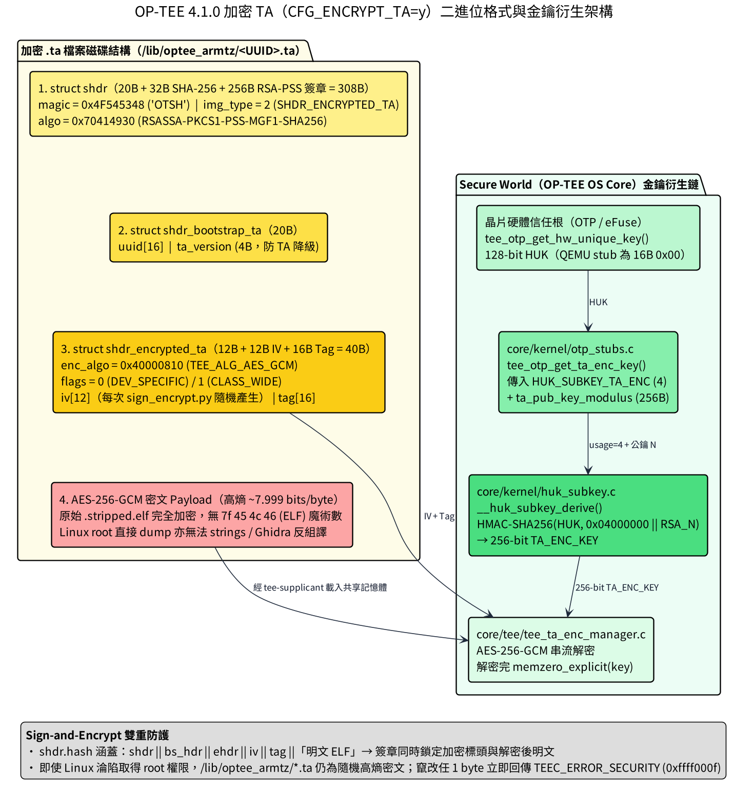
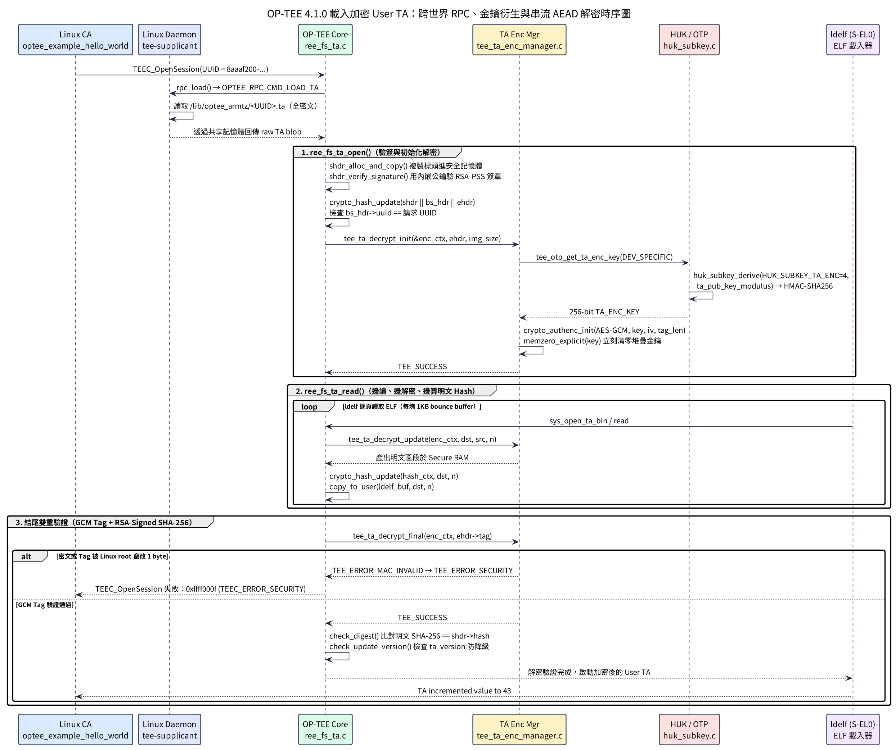

# OP-TEE 加密 TA 實戰：`CFG_ENCRYPT_TA` 與 `HUK_SUBKEY_TA_ENC` 金鑰衍生（QEMU ARMv8 / OP-TEE 4.1.0）

就算我們在 Track 1 已經把外部 Flash 裡的 TF-A BL31 與 OP-TEE Core 加密成密文，商業機密往往還藏在另一個最常被忽略的檔案裡：**放在 Linux 檔案系統 `/lib/optee_armtz/*.ta` 的 User TA（Trusted Application）**。預設編譯出的 `.ta` 檔只有簽章、沒有加密——只要攻擊者拿到裝置的 Linux `root` 權限（或把 SD/eMMC 拔下來讀 ext4），就能直接看到標準 ELF 標頭 `7f 45 4c 46`、函式名稱與原始碼路徑，把你的 DRM、AI 模型權重或專有演算法原封不動反組譯出來。**OP-TEE 的 `CFG_ENCRYPT_TA=y`（Encrypted TA）**透過 `sign_encrypt.py` 將 User TA 以 **AES-256-GCM** 加密並搭配 **RSA-PSS 雙重簽章**，開機後僅由 Secure World 透過晶片專屬的 **HUK（Hardware Unique Key）** 衍生金鑰即時解密，讓 Linux 就算被全面攻破取得 `root` 也只能看到一團高熵亂碼。

---

## 1. 基本概念

開始追碼前，先對齊 OP-TEE 加密 TA 的核心結構與金鑰類型：

- **Sign-and-Encrypt（雙重保護）**：OP-TEE 對加密 TA 同時做兩層防護——用 **AES-256-GCM** 加密整個 `.stripped.elf`（提供機密性與密文完整性），再由開發者私鑰（`default_ta.pem`）以 **RSASSA-PKCS1-PSS-MGF1-SHA256** 簽章覆蓋「所有標頭（含 `ehdr`、IV、Tag）＋**明文 ELF**」的 SHA-256 雜湊（提供來源認證與不可否認性）。
- **三個串接標頭（`core/include/signed_hdr.h`）**：
  1. `struct shdr`（`magic=0x4F545348`，`img_type=2` 即 `SHDR_ENCRYPTED_TA`）＋ 32B `hash` ＋ 256B `sig`（共 308 bytes）。
  2. `struct shdr_bootstrap_ta`（16B `uuid` ＋ 4B `ta_version`，共 20 bytes，支援 TA 版本防降級）。
  3. `struct shdr_encrypted_ta`（`enc_algo=0x40000810` 即 `TEE_ALG_AES_GCM`、`flags`、`iv_size=12`、`tag_size=16` ＋ 12B 隨機 IV ＋ 16B GCM Tag，共 40 bytes）。
- **兩種 TA 加密金鑰模式（`enum shdr_enc_key_type`）**：
  - `SHDR_ENC_KEY_DEV_SPECIFIC (0)`：以晶片唯一 **HUK** 衍生金鑰（一機一密，預設模式）。
  - `SHDR_ENC_KEY_CLASS_WIDE (1)`：以產線同型號共用的 Class Key 解密（適合大量量產統一 OTA 發布，需在平台覆寫 `tee_otp_get_ta_enc_key()`）。
- **每次編譯自動隨機 Nonce**：`scripts/sign_encrypt.py:397` 呼叫 `os.urandom(12)` 為每支 `.ta` 產生獨立 12-byte IV，避免重用 `(Key, IV)` 導致 AES-GCM 崩潰。

### 1.1 `enum shdr_img_type` 與 `enum huk_subkey_usage` 對照表

| 類型 / 列舉 | 數值 | 定義位置 | 用途說明 |
| :--- | :---: | :--- | :--- |
| `SHDR_TA` | `0` | `core/include/signed_hdr.h:14` | 舊版僅簽章明文 TA（無 bootstrap 標頭） |
| `SHDR_BOOTSTRAP_TA` | `1` | `core/include/signed_hdr.h:15` | 預設明文簽章 TA（含 UUID 與 `ta_version`，ELF 明文外露） |
| `SHDR_ENCRYPTED_TA` | `2` | `core/include/signed_hdr.h:16` | **加密＋簽章 TA**（本實驗啟用，含 `shdr_encrypted_ta` 與密文 ELF） |
| `SHDR_SUBKEY` | `3` | `core/include/signed_hdr.h:17` | 支援次級金鑰委派簽署的憑證標頭 |
| `HUK_SUBKEY_RPMB` / `SSK` | `0` / `1` | `core/include/kernel/huk_subkey.h` | RPMB 認證金鑰與 Secure Storage 主金鑰（Track 4 會再用到） |
| `HUK_SUBKEY_TA_ENC` | `4` | `core/include/kernel/huk_subkey.h:34` | **TA 加密專用子金鑰用途常數**，與 `ta_pub_key_modulus` 一起送入 HMAC-SHA256 |

---

## 2. 整體架構與分層說明



整個加密與解密流程跨過編譯期工具鏈、Normal World 與 Secure World 三層：

- **第一層（編譯期 `ta/link.mk` + `scripts/sign_encrypt.py`）**：當 `CFG_ENCRYPT_TA=y` 時，`ta/link.mk:107-119` 會在打包 `.ta` 時自動附加 `--enc-key $(TA_ENC_KEY)`，以 AES-256-GCM 加密 `.stripped.elf` 並寫入 `SHDR_ENCRYPTED_TA` 標頭，同時計算覆蓋標頭與明文 ELF 的 SHA-256 並用 RSA 私鑰簽章。
- **第二層（Normal World REE：`tee-supplicant` + `/lib/optee_armtz/*.ta`）**：Linux 端的 `tee-supplicant` 只負責把磁碟上的密文 `.ta` 透過共享記憶體交給 OP-TEE，本身沒有任何解密金鑰；即使攻擊者拿下 Linux `root` 權限直接讀寫檔案，也無法反組譯或無聲竄改。
- **第三層（Secure World OP-TEE Core：`ree_fs_ta.c` → `tee_ta_enc_manager.c` → `huk_subkey.c`）**：OP-TEE Core 在 `ree_fs_ta_open()` 先驗證 RSA-PSS 簽章，再從晶片硬體 HUK 透過 `HMAC-SHA256(HUK, HUK_SUBKEY_TA_ENC || ta_pub_key_modulus)` 衍生出 256-bit 解密金鑰，於 `ree_fs_ta_read()` 串流解密進 Secure RAM 給 `ldelf` 載入，結尾同時驗過 GCM Tag 與明文 SHA-256 才放行執行。

### 2.1 檔案地圖（OP-TEE 4.1.0 與本專案 Overlay）

```text
kas/ta-enc.yml                          ---- 本專案新增的 kas overlay（對 optee-os/examples/test 開啟 CFG_ENCRYPT_TA=y）
ta/link.mk                              ---- TA 連結規則：CFG_ENCRYPT_TA=y 時帶入 --enc-key 與預設開發用 TA_ENC_KEY
scripts/sign_encrypt.py                 ---- Host 端簽章與 AES-256-GCM 加密腳本（亦提供 display/verify 工具）
core/include/signed_hdr.h               ---- 定義 struct shdr、shdr_bootstrap_ta、shdr_encrypted_ta 與 SHDR_MAGIC
core/kernel/ree_fs_ta.c                 ---- REE 檔案系統 TA 載入器（open 驗簽初始化、read 串流解密與結尾雙重驗證）
core/tee/tee_ta_enc_manager.c           ---- TA 解密管理器（tee_ta_decrypt_init / update / final 與金鑰清零）
core/kernel/otp_stubs.c                 ---- 平台 OTP 弱函式：tee_otp_get_hw_unique_key() 與 tee_otp_get_ta_enc_key()
core/kernel/huk_subkey.c                ---- HUK 子金鑰衍生引擎 __huk_subkey_derive()（HMAC-SHA256）
```

---

## 3. 總流程

入口：透過 `kas/ta-enc.yml` 重編 OP-TEE 套件與 RootFS（`.venv/bin/kas shell kas/base.yml:kas/tbbr.yml:kas/debug.yml:kas/fw-enc.yml:kas/ta-enc.yml:kas/offline.yml -c 'bitbake core-image-base'`），開機進入 Linux 後執行 `optee_example_hello_world`。

當 Client Application 呼叫 `TEEC_OpenSession(8aaaf200-2450-11e4-abe2-0002a5d5c51b)` 時，OP-TEE Core 載入並解密 User TA 的完整呼叫樹如下（編號對應第 4 節原始碼）：

```text
TEEC_OpenSession(UUID)->                                ## Normal World CA 發起 SMC
    tee_ta_open_session()->
        ldelf_init_with_ldelf()->                       ## 啟動 S-EL0 ELF 載入器 ldelf
            ldelf_syscall_open_bin() -> ree_fs_ta_open()  ## 4.1 載入加密 .ta 並初始化解密（重點關注，ree_fs_ta.c:235）
                rpc_load()                              ##     透過 tee-supplicant 讀 /lib/optee_armtz/<UUID>.ta
                shdr_verify_signature(shdr)             ##     用內嵌公鑰驗證 RSA-PSS 簽章
                crypto_hash_update(shdr/bs_hdr/ehdr)    ##     將三段標頭納入明文 SHA-256 雜湊計算
                tee_ta_decrypt_init(&enc_ctx, ehdr)->   ## 4.2 初始化 AES-256-GCM 解密上下文（tee_ta_enc_manager.c:12）
                    tee_otp_get_ta_enc_key()->          ## 4.3 請求 TA 解密金鑰（otp_stubs.c:44）
                        huk_subkey_derive(HUK_SUBKEY_TA_ENC=4, ta_pub_key_modulus)  ## 4.4 HMAC-SHA256 衍生金鑰（huk_subkey.c:61）
                    crypto_authenc_init(AES_GCM, key, iv)
                    memzero_explicit(key)               ##     ★ 立即清零堆疊上的 TA 解密金鑰
            ree_fs_ta_read()->                          ## 4.5 ldelf 逐塊讀取並即時解密（ree_fs_ta.c:546）
                tee_ta_decrypt_update(enc_ctx, dst, src, n)  ## 串流解密成明文進 Secure RAM bounce buffer
                crypto_hash_update(hash_ctx, dst, n)    ##     對解密後的明文 ELF 更新 SHA-256
                copy_to_user(ldelf_buf, dst, n)         ##     將明文頁複製進 S-EL0 TA 空間
                tee_ta_decrypt_final(enc_ctx, ehdr->tag) ##    ★ 最後一塊驗證 AES-GCM 16B Tag（失敗回 TEE_ERROR_SECURITY）
                check_digest(handle)                    ##     ★ 再比對明文 SHA-256 == RSA 簽過的 shdr->hash
                check_update_version(ta_ver_db, ...)    ##     ★ 檢查 ta_version 防止舊版 TA 降級
```



---

## 4. 詳細分析（OP-TEE 4.1.0）

### 4.1 `ree_fs_ta_open`（`core/kernel/ree_fs_ta.c:415-467`，加密分支主幹）

```c
	// 判斷 signed header 的 img_type 是否為 SHDR_ENCRYPTED_TA (2)
	if (shdr->img_type == SHDR_ENCRYPTED_TA) {
		struct shdr_encrypted_ta img_ehdr = { };
		size_t sz = shdr_sz;
		size_t ehdr_sz = 0;

		// 檢查檔案邊界與整數溢位，防止惡意 REE 傳入畸形大小觸發越界讀取
		if (ADD_OVERFLOW(sz, sizeof(struct shdr_bootstrap_ta), &sz) ||
		    ADD_OVERFLOW(sz, sizeof(img_ehdr), &sz) ||
		    ta_size < sz) {
			res = TEE_ERROR_SECURITY;
			goto error_free_hash;
		}

		// 先把固定長度的 struct shdr_encrypted_ta 拷貝進安全記憶體，算出含 IV+Tag 的總長度
		memcpy(&img_ehdr, ((uint8_t *)ta + offs), sizeof(img_ehdr));
		ehdr_sz = SHDR_ENC_GET_SIZE(&img_ehdr);
		...
		if (ta_size != offs + ehdr_sz + shdr->img_size) {
			res = TEE_ERROR_SECURITY;
			goto error_free_hash;
		}

		// 配置安全記憶體複製完整的 ehdr（含 IV 與 Tag），避免 Normal World 發動 TOCTOU 雙重讀取攻擊
		ehdr = malloc(ehdr_sz);
		...
		*ehdr = img_ehdr;
		memcpy((uint8_t *)ehdr + sizeof(img_ehdr),
		       (uint8_t *)ta + offs + sizeof(img_ehdr),
		       ehdr_sz - sizeof(img_ehdr));

		// ★ 將整個加密標頭（含 IV 與 Tag）納入 RSA 簽章保護的雜湊計算中
		res = crypto_hash_update(hash_ctx, (uint8_t *)ehdr, ehdr_sz);
		if (res != TEE_SUCCESS)
			goto error_free_hash;

		// 初始化 AES-256-GCM 解密器（內部會從 HUK 衍生 TA_ENC_KEY）
		res = tee_ta_decrypt_init(&handle->enc_ctx, ehdr,
					  shdr->img_size);
		if (res != TEE_SUCCESS)
			goto error_free_hash;

		offs += ehdr_sz;
		handle->ehdr = ehdr;
	}
```

這段程式碼有個非常細膩的安全防禦：先將 `ehdr`（含 IV 與 Tag）完整拷貝進 Secure World 記憶體後才計算雜湊並送進解密器，能徹底阻斷惡意 Linux 核心在共享記憶體發動 **TOCTOU（Time-of-Check to Time-of-Use）** 置換攻擊。

### 4.2 `tee_ta_decrypt_init`（`core/tee/tee_ta_enc_manager.c:12-37`）

```c
TEE_Result tee_ta_decrypt_init(void **enc_ctx, struct shdr_encrypted_ta *ehdr,
			       size_t len)
{
	TEE_Result res = TEE_SUCCESS;
	uint8_t key[TEE_TA_ENC_KEY_SIZE] = {0};

	// 配置認證加密上下文（ehdr->enc_algo = TEE_ALG_AES_GCM = 0x40000810）
	res = crypto_authenc_alloc_ctx(enc_ctx, ehdr->enc_algo);
	if (res != TEE_SUCCESS)
		return res;

	// 依旗標（DEV_SPECIFIC 或 CLASS_WIDE）向平台 OTP 層索取 256-bit 解密金鑰
	res = tee_otp_get_ta_enc_key(ehdr->flags & SHDR_ENC_KEY_TYPE_MASK,
				     key, sizeof(key));
	if (res != TEE_SUCCESS)
		goto out_init;

	// 以 key、12-byte IV、16-byte Tag 長度初始化 AES-256-GCM 解密狀態機
	res = crypto_authenc_init(*enc_ctx, TEE_MODE_DECRYPT, key, sizeof(key),
				  SHDR_ENC_GET_IV(ehdr), ehdr->iv_size,
				  ehdr->tag_size, 0, len);

out_init:
	if (res != TEE_SUCCESS)
		crypto_authenc_free_ctx(*enc_ctx);

	// ★ 立即用不會被編譯器優化掉的 memzero_explicit() 清除堆疊上的金鑰
	memzero_explicit(key, sizeof(key));
	return res;
}
```

`tee_ta_decrypt_init()` 負責橋接 `shdr_encrypted_ta` 與 OP-TEE 底層密碼庫，並在初始化完成後第一時間呼叫 `memzero_explicit(key, sizeof(key))` 銷毀明文金鑰。

### 4.3 `tee_otp_get_ta_enc_key`（`core/kernel/otp_stubs.c:44-54`）

```c
// 弱函式預設實作：選擇裝置唯一金鑰（DEV_SPECIFIC），透過 HUK 衍生
__weak TEE_Result tee_otp_get_ta_enc_key(uint32_t key_type __maybe_unused,
					 uint8_t *buffer, size_t len)
{
	assert(key_type == SHDR_ENC_KEY_DEV_SPECIFIC);

	// 將用途常數 HUK_SUBKEY_TA_ENC (4) 與 TA 驗證公鑰模數（256 bytes RSA-2048 N）
	// 一起送入 HUK 子金鑰衍生引擎，確保「不同簽章公鑰」衍生出的解密金鑰彼此隔離
	if (huk_subkey_derive(HUK_SUBKEY_TA_ENC, ta_pub_key_modulus,
			      ta_pub_key_modulus_size, buffer, len))
		return TEE_ERROR_SECURITY;

	return TEE_SUCCESS;
}
```

把 `ta_pub_key_modulus` 混入 KDF（Key Derivation Function）輸入非常巧妙：這把解密金鑰同時綁定了「這顆晶片的 HUK」與「簽發者的 RSA 公鑰」，即使同一顆晶片上有多組開發者金鑰也不會互相撞鑰。

### 4.4 `__huk_subkey_derive`（`core/kernel/huk_subkey.c:61-107`）

```c
TEE_Result __huk_subkey_derive(enum huk_subkey_usage usage,
			       const void *const_data, size_t const_data_len,
			       uint8_t *subkey, size_t subkey_len)
{
	void *ctx = NULL;
	struct tee_hw_unique_key huk = { };
	TEE_Result res = TEE_SUCCESS;
	...
	// 使用 HMAC-SHA256 作為金鑰衍生演算法
	res = crypto_mac_alloc_ctx(&ctx, TEE_ALG_HMAC_SHA256);
	if (res)
		return res;

	// 從晶片硬體 OTP/eFuse 讀取 128-bit HUK（QEMU stub 為 16 bytes 0x00）
	res = tee_otp_get_hw_unique_key(&huk);
	if (res)
		goto out;

	// 以 HUK 當作 HMAC 金鑰
	res = crypto_mac_init(ctx, huk.data, sizeof(huk.data));
	if (res)
		goto out;

	// 混入 32-bit little-endian 用途常數（HUK_SUBKEY_TA_ENC = 4 → 04 00 00 00）
	res = huk_compat(ctx, usage); // 對非 RPMB/SSK 直接執行 mac_usage(ctx, usage)
	if (res)
		goto out;

	// 混入 const_data（即 256-byte ta_pub_key_modulus）
	if (const_data) {
		res = crypto_mac_update(ctx, const_data, const_data_len);
		if (res)
			goto out;
	}

	// 輸出 32-byte (256-bit) 子金鑰
	res = crypto_mac_final(ctx, subkey, subkey_len);
out:
	if (res)
		memzero_explicit(subkey, subkey_len);
	// ★ 立刻清除堆疊中的 HUK
	memzero_explicit(&huk, sizeof(huk));
	crypto_mac_free_ctx(ctx);
	return res;
}
```

我們也在 Host 端用 Python 手動重現了這條數學公式（詳見 [ta-enc-static-analysis.log](logs/ta-enc-static-analysis.log)），確認 `HMAC-SHA256(0x00*16, 0x04000000 || default_ta.pem_modulus)` 算出的 64 碼十六進位結果 **`b64d239b1f3c7d3b06506229cd8ff7c8af2bb4db2168621ac62c84948468c4f4`**，與 `ta/link.mk:16` 內建的 `TA_ENC_KEY` **逐位元完全一致**！

### 4.5 `ree_fs_ta_read`（`core/kernel/ree_fs_ta.c:580-636`，串流解密與結尾雙驗）

```c
	while (num_bytes < len) {
		size_t n = MIN(dst_len, len - num_bytes);

		if (handle->shdr->img_type == SHDR_ENCRYPTED_TA) {
			// ★ 將共享記憶體的密文解密進 Secure RAM 的 1KB bounce buffer (dst)
			res = tee_ta_decrypt_update(handle->enc_ctx, dst,
						    src + num_bytes, n);
			if (res) {
				res = TEE_ERROR_SECURITY;
				goto out;
			}
		} else {
			memcpy(dst, src + num_bytes, n);
		}

		// ★ 對解密後的「明文」更新 SHA-256，並安全複製給 S-EL0 的 ldelf
		res = crypto_hash_update(handle->hash_ctx, dst, n);
		...
		if (data_user) {
			res = copy_to_user((uint8_t *)data_user + num_bytes, dst, n);
			...
		}
		num_bytes += n;
	}

	handle->offs = next_offs;
	// 讀到檔案尾端時，同時執行兩道最終驗證
	if (handle->offs == handle->nw_ta_size) {
		if (handle->shdr->img_type == SHDR_ENCRYPTED_TA) {
			// 1. 驗證 AES-GCM 16-byte Tag（密文或 Tag 改動 1 bit 立即回傳 TEE_ERROR_SECURITY）
			res = tee_ta_decrypt_final(handle->enc_ctx,
						   handle->ehdr, NULL, NULL, 0);
			if (res != TEE_SUCCESS) {
				res = TEE_ERROR_SECURITY;
				goto out;
			}
		}
		// 2. 驗證整份明文 ELF + 三段標頭的 SHA-256 == RSA 簽過的 shdr->hash
		res = check_digest(handle);
		if (res != TEE_SUCCESS)
			goto out;

		// 3. 檢查並記錄 ta_version（防止刷回舊版有漏洞的 TA）
		if (handle->bs_hdr)
			res = check_update_version(ta_ver_db,
						   handle->bs_hdr->uuid,
						   handle->bs_hdr->ta_version);
	}
```

可以看到 OP-TEE 連串流解密都兼顧防 Fault Injection 與記憶體安全：密文 never 解回共享記憶體，只在 Secure RAM 的 `bb`（1 KB bounce buffer）中解密後直接交給 S-EL0 `ldelf`，且最後必須同時通過 AES-GCM Tag 與 RSA-PSS 明文雜湊驗證，缺一不可。

---

## 5. 實機驗證：加密前後對照與 Linux `root` 竄改實測

### 5.1 靜態逆向工程前後對照（`pkcs11` 與 `hello_world` TA）

| 檢驗項目 | 加密前（Baseline `SHDR_BOOTSTRAP_TA`） | 加密後（`kas/ta-enc.yml` `SHDR_ENCRYPTED_TA`） | 防逆向效果 |
| :--- | :--- | :--- | :--- |
| **`shdr.img_type`** | `1` (`SHDR_BOOTSTRAP_TA`) | **`2` (`SHDR_ENCRYPTED_TA`)** | 多出 40B `shdr_encrypted_ta`（AES-GCM + IV + Tag） |
| **`pkcs11.ta` 大小 / 熵值** | `424,168` B / **`6.1400`** bits/byte | `424,208` B（**`+40B`**）/ **`7.9996`** bits/byte | 密文區段分布接近完美隨機 |
| **`hello_world.ta` 熵值** | 明文 ELF | **`7.9982`** bits/byte（獨立隨機 IV `c7b3bb71...`） | 每次編譯不同 IV，杜絕密文特徵比對 |
| **ELF 魔術數（`7f 45 4c 46`）** | 清楚出現在 offset `0x148` | **NOT FOUND** | `readelf` / Ghidra 無法辨識為 ELF 檔案 |
| **`strings` 搜尋敏感字串** | 直接露出 `OP-TEE PKCS11 TA`、`CKA_VALUE`、`/usr/src/...` | **0 筆符合** | Linux `root` 直接 dump 也看不到任何字串 |

### 5.2 QEMU 實機執行與 `root` 竄改攔截結果

| 編號 | 實驗項目 | 操作方式 | 實測關鍵輸出 | 完整 Log |
| :---: | :--- | :--- | :--- | :--- |
| **Exp 1** | HUK 子金鑰衍生驗證 | Python 計算 `HMAC-SHA256(0x00*16, 4 \|\| RSA_N)` | 輸出 `b64d239b...8468c4f4` 與 `ta/link.mk` **Exact match = True** | [ta-enc-static-analysis.log](logs/ta-enc-static-analysis.log) |
| **Exp 2** | 加密 TA 正常跨世界呼叫 | Linux 內以 `root` 檢查 `.ta` 無明文後執行 `optee_example_hello_world` | `hexdump` 見 `img_type=02`、`strings` 0 筆；執行成功輸出 **`TA incremented value to 43`** | [ta-enc-runtime-verify.log](logs/ta-enc-runtime-verify.log) |
| **Exp 3** | 加密 TA 跑 `xtest` 回歸 | `xtest -t regression 1001 1004 1008` | **3 test cases / 88 subtests 全數通過（0 failed）**，含 `1008.4 Load corrupt TA OK` | [ta-enc-runtime-verify.log](logs/ta-enc-runtime-verify.log) |
| **Exp 4** | Linux `root` 竄改加密 TA 密文 1 byte | `root` 修改 `/lib/optee_armtz/8aaaf200...ta` 偏移 `0x200` 1 byte（標頭完好）後執行 | Normal World：`TEEC_Opensession failed with code 0xffff000f origin 0x3`；Secure World UART1：`open_bin res=0`（標頭驗簽通過）→ 讀到尾端 `copy_section_headers` 觸發 **`ldelf failed with res: 0xffff000f`**（`TEE_ERROR_SECURITY`） | [ta-enc-runtime-verify.log](logs/ta-enc-runtime-verify.log) |

關鍵雙世界攔截日誌節錄（摘自 [ta-enc-runtime-verify.log](logs/ta-enc-runtime-verify.log)）：

```text
# Normal World（Linux root 竄改加密 .ta 偏移 0x200 的 1 byte 後再次執行）
=== 4. Negative Test: Tamper EXACTLY 1 byte at offset 0x200 (ciphertext payload) ===
513  24 252
optee_example_hello_world: TEEC_Opensession failed with code 0xffff000f origin 0x3
exit_code=1

# Secure World UART1（標頭驗簽通過 res=0，串流解密至檔尾時被 AES-GCM Tag 攔截）
D/TC:? 0 ldelf_syscall_open_bin:163 Lookup user TA ELF 8aaaf200-2450-11e4-abe2-0002a5d5c51b (REE)
D/TC:? 0 ldelf_syscall_open_bin:167 res=0
E/LD:  copy_section_headers:1132 sys_copy_from_ta_bin
E/TC:? 0 ldelf_init_with_ldelf:152 ldelf failed with res: 0xffff000f
D/TC:? 0 tee_ta_open_session:689 init session failed 0xffff000f
```

---

## 6. 重點整理

- **就算 Linux 淪陷成 `root`，商業邏輯依然安全**：開啟 `CFG_ENCRYPT_TA=y` 後，`/lib/optee_armtz/*.ta` 成為熵值 `~7.999` 的 AES-256-GCM 密文，完全消除 ELF 標頭與字串，從根源切斷 REE 側靜態反組譯。
- **Sign-and-Encrypt + TOCTOU 防禦**：OP-TEE 先把 `shdr`、`bs_hdr`、`ehdr` 複製進安全記憶體再驗證 RSA-PSS 簽章，讀取時串流解密進 Secure RAM bounce buffer，最後同時驗證 GCM Tag 與明文 SHA-256，改動 1 byte 立即回傳 `TEE_ERROR_SECURITY (0xffff000f)`。
- **HUK 衍生金鑰落實「金鑰鎖芯」**：`TA_ENC_KEY = HMAC-SHA256(HUK, HUK_SUBKEY_TA_ENC=4 || ta_pub_key_modulus)`；量產時只要覆寫 `tee_otp_get_hw_unique_key()` 讀取晶片不可匯出的 OTP/eFuse HUK（或改用 `CLASS_WIDE` 產線金鑰搭配硬體 Keyladder），即可防止跨裝置複製。
- **同時內建 TA 版本防降級**：`ree_fs_ta_read()` 在解密驗簽完還會呼叫 `check_update_version()` 把 `ta_version` 寫進加密的 Secure Storage，堵死刷回舊版有漏洞 TA 的路。
- 俗話說「**狡兔三窟不如金庫上鎖**」，把核心演算法放進 TA 再上 `CFG_ENCRYPT_TA` 這把 HUK 金庫鎖，就算外面的 Linux 房子被闖空門，金庫裡的程式依然拿不走、看不懂。

## 參考

- 本專案設定：[kas/ta-enc.yml](../kas/ta-enc.yml)
- OP-TEE 4.1.0 原始碼：`core/kernel/ree_fs_ta.c`、`core/tee/tee_ta_enc_manager.c`、`core/kernel/otp_stubs.c`、`core/kernel/huk_subkey.c`、`core/include/signed_hdr.h`、`ta/link.mk`、`scripts/sign_encrypt.py`
- 實測日誌：[baseline-plaintext-re.log](logs/baseline-plaintext-re.log)、[ta-enc-static-analysis.log](logs/ta-enc-static-analysis.log)、[ta-enc-runtime-verify.log](logs/ta-enc-runtime-verify.log)
- OP-TEE 官方文件：[Encrypted TAs — OP-TEE 4.1.0 Documentation](https://optee.readthedocs.io/en/4.1.0/architecture/trusted_applications.html#encrypted-tas)
