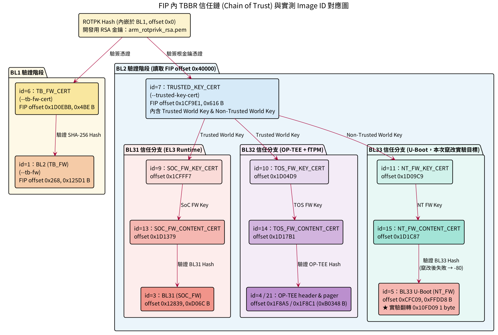
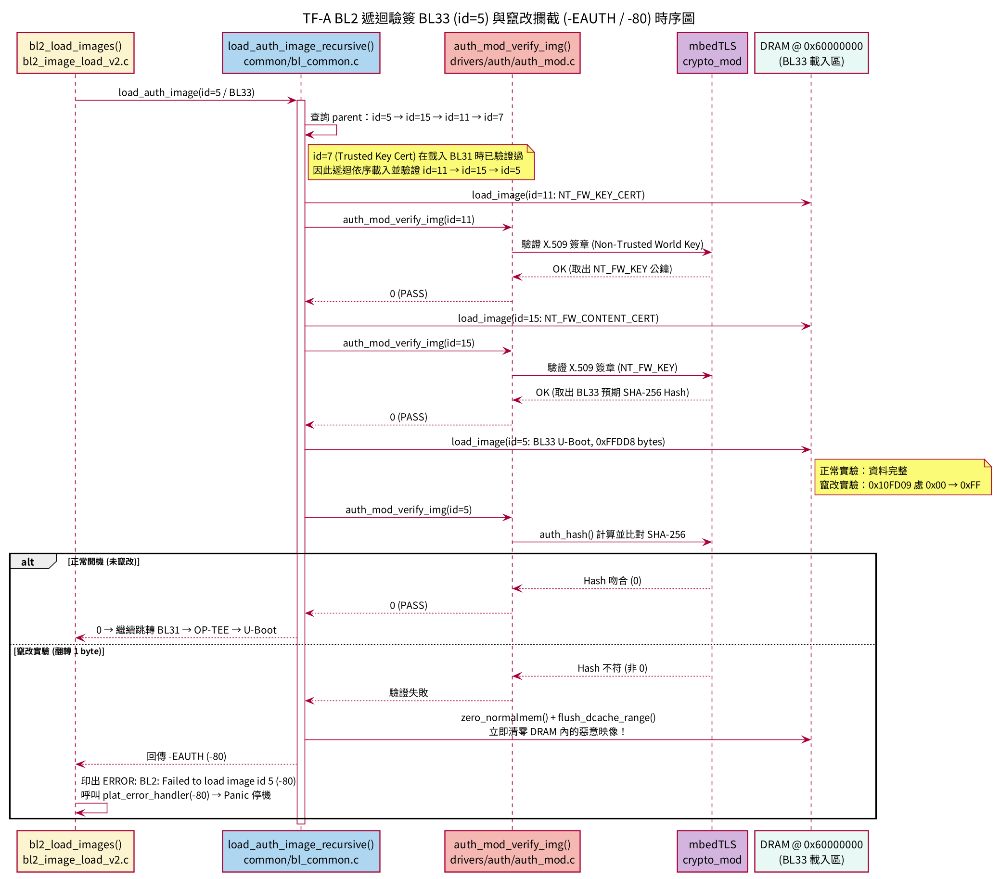
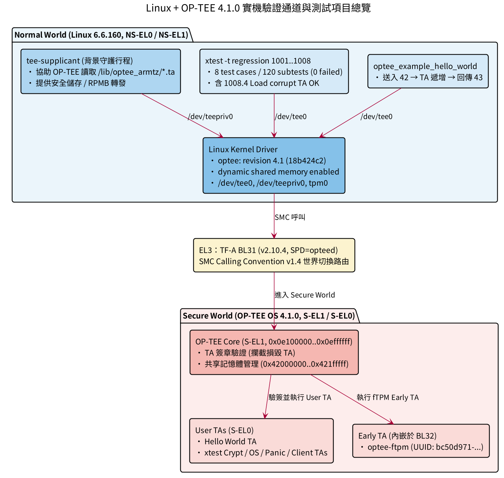

# QEMU ARMv8 安全開機實測報告：TBBR 驗簽、OP-TEE 與竄改攔截實驗（TF-A v2.10.4 / OP-TEE 4.1.0 / Linux 6.6.160）

只把映像編譯成功並不能證明安全開機真的有生效——如果設定漏掉一個旗標，系統照樣能開進 Linux，但底下的憑證鏈與雜湊驗證其實根本沒跑。本文針對我們在 `qemuarm64-secureboot` 建好的環境做四組端到端實機驗證：從檢查 FIP 憑證結構、追蹤正常開機的逐級驗簽、在 Linux 內跑 OP-TEE `xtest`（含損毀 TA 攔截），到親手翻轉 `flash.bin` 裡 BL33 的 1 個 byte，對照 TF-A v2.10.4 原始碼確認 BL2 如何抓出竄改並回傳 `-80` (`-EAUTH`) 停機。

---

## 1. 基本概念與 Image ID 對照

在 TF-A 的 TBBR（Trusted Board Boot Requirements）設計裡，每一個韌體映像與 X.509 憑證都有固定的整數編號（定義於 `include/export/common/tbbr/tbbr_img_def_exp.h:15-65`）。開機日誌只會印出 `image id=X`，先把本次實測出現的所有 ID 對齊，讀 log 才會一目了然：

| Image ID | 巨集名稱（`tbbr_img_def_exp.h`） | 對應檔案 / 角色 | 本次 FIP Offset / Size |
| :---: | :--- | :--- | :--- |
| `1` | `BL2_IMAGE_ID` | TF-A BL2（Trusted Boot Firmware） | `0x268` / `0x125D1` |
| `3` | `BL31_IMAGE_ID` | TF-A BL31（EL3 Runtime Monitor, `SPD=opteed`） | `0x12839` / `0xD06C` |
| `4` | `BL32_IMAGE_ID` | OP-TEE Header v2 (`tee-header_v2.bin`) | `0x1F8A5` / `0x1C` |
| `5` | `BL33_IMAGE_ID` | U-Boot 2024.01（本次竄改實驗目標） | `0xCFC09` / `0xFFDD8` |
| `6` | `TRUSTED_BOOT_FW_CERT_ID` | BL2 內容憑證（由 BL1 驗證） | `0x1D0EBB` / `0x4BE` |
| `7` | `TRUSTED_KEY_CERT_ID` | 根金鑰憑證（載出 Trusted / Non-Trusted World Key） | `0x1CF9E1` / `0x616` |
| `9` / `13` | `SOC_FW_KEY_CERT_ID` / `SOC_FW_CONTENT_CERT_ID` | BL31 金鑰與內容憑證 | `0x1CFFF7` / `0x1D1379` |
| `10` / `14` | `TRUSTED_OS_FW_KEY_CERT_ID` / `TRUSTED_OS_FW_CONTENT_CERT_ID` | OP-TEE (BL32) 金鑰與內容憑證 | `0x1D04D9` / `0x1D17B1` |
| `11` / `15` | `NON_TRUSTED_FW_KEY_CERT_ID` / `NON_TRUSTED_FW_CONTENT_CERT_ID` | U-Boot (BL33) 金鑰與內容憑證 | `0x1D09C9` / `0x1D1C87` |
| `21` | `BL32_EXTRA1_IMAGE_ID` | OP-TEE Pager 映像（內含 `optee-ftpm` Early TA） | `0x1F8C1` / `0xB0348` |

---

## 2. FIP 憑證鏈架構與檔案地圖



整條信任鏈分成三層把關：

- **第一層（信任根：BL1 + ROTPK Hash）**：開發用私鑰 `arm_rotprivk_rsa.pem` 對應的公鑰雜湊直接寫死在 `bl1.bin`（`flash.bin` 偏移 `0x0`）。BL1 只驗證 `id=6` (`TB_FW_CERT`) 與 `id=1` (`BL2`)，確認 BL2 沒被動過手腳才交棒。
- **第二層（分枝授權：BL2 + 7 張 X.509 憑證）**：BL2 先用同一把 ROTPK 驗過 `id=7` (`TRUSTED_KEY_CERT`)，拆出 Trusted World Key（保護 BL31/BL32）與 Non-Trusted World Key（保護 BL33），再各自驗過 Key Cert → Content Cert → 映像 SHA-256 雜湊。
- **第三層（執行期隔離：BL31 + OP-TEE OS）**：進到 Linux 後，任何透過 `/dev/tee0` 觸發的 User TA 都會再由 OP-TEE Core 驗簽一次，損毀或未授權的 TA 一律拒絕載入。

### 2.1 檔案地圖（TF-A v2.10.4 原始碼與本次實測 Log）

```text
bl2/bl2_image_load_v2.c                      ---- BL2 依序走訪映像清單，呼叫 load_auth_image()；失敗印出 ERROR 並停機
common/bl_common.c                           ---- load_auth_image() 與遞迴驗簽 load_auth_image_recursive()，失敗清零記憶體並回傳 -EAUTH
drivers/auth/auth_mod.c                      ---- auth_mod_verify_img() 依 CoT 描述符分派雜湊 / 簽章 / NV Counter 驗證
include/export/common/tbbr/tbbr_img_def_exp.h ---- 定義所有 TBBR Image ID (1 ~ 22)
include/lib/libc/errno.h                     ---- 定義 EAUTH = 80（本次實測看到的錯誤碼 -80）
logs/fiptool-info.log                        ---- fiptool info fip.bin 原始輸出
logs/boot-and-optee-verify.log               ---- 正常開機 + Linux dmesg + optee_example_hello_world + xtest 完整日誌
logs/tbbr-tamper-test.log                    ---- 竄改 BL33 1 byte 後的 BL2 攔截實測日誌
```

---

## 3. TBBR 驗簽與竄改攔截總流程



入口：執行 `./scripts/tamper-test.sh`（將 `flash.bin` 偏移 `0x10FD09`——即 `fip.bin` 偏移 `0x40000` + BL33 偏移 `0xCFC09` + `0x100` 處的 `0x00` 翻轉為 `0xFF`，再以 `-bios /tmp/flash-tampered.bin` 啟動 QEMU）。

BL2 載入 BL33（`image id=5`）時的呼叫鏈如下（編號對應第 4 節的原始碼分析）：

```text
bl2_main()->
    bl2_load_images()->                         ## 4.1 逐一載入 BL31 / BL32 / BL33（bl2_image_load_v2.c:43）
        load_auth_image(id=5)->                 ## 4.2 載入並驗簽通用入口（common/bl_common.c:209）
            load_auth_image_internal(id=5)->
                load_auth_image_recursive(5)->  ## 4.3 遞迴驗證父憑證再驗證自己（重點關注，bl_common.c:151）
                    auth_mod_get_parent_id(5)   ##     查出 parent = 15 (NT_FW_CONTENT_CERT)
                    load_auth_image_recursive(15)->
                        load_auth_image_recursive(11)  ## 先驗 id=11 (NT_FW_KEY_CERT) → PASS
                        load_image(15) + auth_mod_verify_img(15) ## 再驗 id=15 → PASS，取出 BL33 預期 Hash
                    load_image(5)               ##     將 BL33 載入 DRAM 0x60000000
                    auth_mod_verify_img(5)->    ## 4.4 呼叫 mbedTLS 比對 SHA-256（auth_mod.c:452）
                        auth_hash()             ##     ★ 竄改後 Hash 不符，回傳非 0
                    zero_normalmem()            ##     ★ 立即清零 DRAM 中的惡意映像並 flush cache
                    return -EAUTH (-80)         ##     include/lib/libc/errno.h:146
        ERROR("BL2: Failed to load image id 5 (-80)")
        plat_error_handler(-80)                 ##     直接中止開機，不交棒給 BL31 / BL33
```

---

## 4. 關鍵原始碼詳細分析（TF-A v2.10.4）

### 4.1 `bl2_load_images`（`bl2/bl2_image_load_v2.c:66-78`）

```c
// 若映像未標記跳過，依清單順序載入並驗證（依序為 BL31=3、BL32=4/21、BL33=5）
if ((bl2_node_info->image_info->h.attr &
    IMAGE_ATTRIB_SKIP_LOADING) == 0U) {
    INFO("BL2: Loading image id %u\n", bl2_node_info->image_id);
    // 呼叫通用載入＋驗簽入口
    err = load_auth_image(bl2_node_info->image_id,
        bl2_node_info->image_info);
    if (err != 0) {
        // 本次竄改實驗印出的錯誤訊息正是這一行（err = -80）
        ERROR("BL2: Failed to load image id %u (%i)\n",
              bl2_node_info->image_id, err);
        // 交給平台錯誤處理函式直接停機，不允許繼續啟動
        plat_error_handler(err);
    }
} else {
    INFO("BL2: Skip loading image id %u\n", bl2_node_info->image_id);
}
```

這段迴圈保證只要清單中任何一個映像驗證失敗（`err != 0`），BL2 會立刻呼叫 `plat_error_handler(err)` 終止開機，絕不會帶著未通過驗證的 BL33 繼續往下跑。

### 4.2 `load_auth_image`（`common/bl_common.c:209-225`）

```c
int load_auth_image(unsigned int image_id, image_info_t *image_data)
{
    int err;
    ... // 略去 PSA_FWU_SUPPORT 分支
    do {
        // 呼叫內部載入函式；當 TRUSTED_BOARD_BOOT=1 時會進入遞迴驗簽
        err = load_auth_image_internal(image_id, image_data);
    } while ((err != 0) && (plat_try_next_boot_source() != 0));
    ... // 若 err == 0 且有開 MEASURED_BOOT，接著記錄量測值
```

`load_auth_image()` 是 BL1 與 BL2 共用的載入入口；在沒有備援開機來源時，驗證失敗的錯誤碼 `-EAUTH` 會直接往上傳回給 `bl2_load_images()`。

### 4.3 `load_auth_image_recursive`（`common/bl_common.c:151-187`）

```c
static int load_auth_image_recursive(unsigned int image_id,
                    image_info_t *image_data,
                    int is_parent_image)
{
    int rc;
    unsigned int parent_id;

    // 1. 先查出這份映像的父憑證 ID，遞迴把整條憑證鏈從上往下驗完
    rc = auth_mod_get_parent_id(image_id, &parent_id);
    if (rc == 0) {
        rc = load_auth_image_recursive(parent_id, image_data, 1);
        if (rc != 0) {
            return rc;
        }
    }

    // 2. 將目標憑證或映像從 FIP 讀入記憶體
    rc = load_image(image_id, image_data);
    if (rc != 0) {
        return rc;
    }

    // 3. 呼叫 auth_mod_verify_img() 以 mbedTLS 執行簽章／雜湊驗證
    rc = auth_mod_verify_img(image_id,
                 (void *)image_data->image_base,
                 image_data->image_size);
    if (rc != 0) {
        // ★ 安全關鍵：驗簽失敗時立刻把剛載進 DRAM 的惡意資料清零並 flush D-cache
        zero_normalmem((void *)image_data->image_base,
                   image_data->image_size);
        flush_dcache_range(image_data->image_base,
                   image_data->image_size);
        // 回傳 -EAUTH（include/lib/libc/errno.h:146 定義 EAUTH = 80）
        return -EAUTH;
    }

    return 0;
}
```

這個函式把整個 TBBR 的精髓寫得很俐落：先遞迴驗父憑證（所以日誌會看到 `id=11` → `id=15` 排在 `id=5` 前面載入），再驗自己；而且萬一驗簽失敗，**不等停機就先執行 `zero_normalmem()` + `flush_dcache_range()` 清除記憶體殘留**，防止攻擊者利用殘留在 DRAM 的惡意 payload。

### 4.4 `auth_mod_verify_img`（`drivers/auth/auth_mod.c:452-513`，主幹）

```c
int auth_mod_verify_img(unsigned int img_id,
            void *img_ptr,
            unsigned int img_len)
{
    ... // 略去區域變數宣告
    // 從 CoT 表格取得此 img_id 對應的驗證規則描述符
    img_desc = FCONF_GET_PROPERTY(tbbr, cot, img_id);

    // 檢查格式完整性（例如 X.509 DER 結構是否合法）
    rc = img_parser_check_integrity(img_desc->img_type, img_ptr, img_len);
    if (rc != 0)
        return rc;

    // 逐一執行 CoT 規定的驗證方法（憑證走 SIG + NV_CTR；韌體映像走 HASH）
    for (i = 0 ; i < AUTH_METHOD_NUM ; i++) {
        auth_method = &img_desc->img_auth_methods[i];
        switch (auth_method->type) {
        case AUTH_METHOD_HASH:
            // BL33 (id=5) 走這條路徑：用 mbedTLS 計算 SHA-256 並比對 id=15 內的雜湊值
            rc = auth_hash(&auth_method->param.hash,
                    img_desc, img_ptr, img_len);
            break;
        case AUTH_METHOD_SIG:
            // 憑證 (id=6,7,9,10,11,13,14,15) 走這條路徑：用上層公鑰驗證 RSA 簽章
            rc = auth_signature(&auth_method->param.sig,
                    img_desc, img_ptr, img_len);
            sig_auth_done = true;
            break;
        case AUTH_METHOD_NV_CTR:
            rc = auth_nvctr(nv_ctr_param, img_desc, img_ptr, img_len,
                    &cert_nv_ctr, &need_nv_ctr_upgrade);
            break;
        ...
        }
        if (rc != 0)
            return rc;
    }
    ... // 驗證通過後，若為憑證則萃取出下層需要的公鑰或預期雜湊值（authenticated_data）
}
```

`auth_mod_verify_img()` 把「驗證憑證（RSA 簽章 + NV Counter）」與「驗證韌體本體（SHA-256 雜湊）」統一收在同一個框架裡。我們竄改 BL33 內容後，`id=11`、`id=15` 的簽章依然合法，但輪到 `id=5` 進 `AUTH_METHOD_HASH` 時雜湊值對不上，立刻返回非零觸發清零與 `-EAUTH`。

---

## 5. Linux + OP-TEE 執行期驗證架構



開機通過 TF-A TBBR 驗證進入 Linux 6.6.160 後，我們進一步驗證 Normal World ↔ EL3 (BL31) ↔ Secure World (OP-TEE 4.1.0) 的完整執行期通道，包括：

- Kernel OP-TEE 驅動自動探測與動態共享記憶體（`0x42000000..0x421fffff`）掛載。
- `tee-supplicant` 背景服務就緒，支援 User TA 動態載入。
- `optee_example_hello_world` 跨世界參數傳遞與回傳。
- `xtest` 核心回歸測試（`1001`–`1008`），其中 **`regression_1008.4 Load corrupt TA`** 直接驗證了 OP-TEE Core 層的 TA 簽章防護。

---

## 6. 實機驗證總表與關鍵 Log 節錄

### 6.1 四組實驗結果總覽

| 編號 | 實驗項目 | 執行方式 | 關鍵實測現象 | 完整 Log |
| :---: | :--- | :--- | :--- | :--- |
| **Exp 1** | FIP 憑證鏈檢查 | `fiptool info fip.bin` | 確認 5 份韌體（BL2/BL31/BL32 header+pager/BL33）與 8 張 X.509 TBBR 憑證齊全 | [fiptool-info.log](logs/fiptool-info.log) |
| **Exp 2** | 正常 TBBR 安全開機 | `./scripts/run-qemu.sh` | BL1/BL2 啟用 `mbed TLS` 逐一載入憑證與映像（`id=6→1`, `7→9→13→3`, `10→14→4→21`, `11→15→5`），順利進入 U-Boot 2024.01 與 Linux 6.6.160 | [boot-and-optee-verify.log](logs/boot-and-optee-verify.log) |
| **Exp 3** | Linux + OP-TEE 與 `xtest` | `dmesg`、`optee_example_hello_world`、`xtest -t regression 1001..1008` | `optee: revision 4.1 (18b424c2)`；Hello World `42 → 43`；`xtest` **8 test cases / 120 subtests 全數通過（0 failed）**，含 `1008.4 Load corrupt TA OK`；關機日誌亦見 `tpm0` (`ftpm_tee`) | [boot-and-optee-verify.log](logs/boot-and-optee-verify.log) |
| **Exp 4** | TBBR 竄改攔截測試 | `./scripts/tamper-test.sh`（翻轉 `0x10FD09` 處 1 byte：`0x00 → 0xFF`） | BL1→BL2、BL31、BL32 皆通過；載入 BL33 (`id=5`) 時觸發 **`ERROR: BL2: Failed to load image id 5 (-80)`** 直接停機 | [tbbr-tamper-test.log](logs/tbbr-tamper-test.log) |

### 6.2 關鍵實測 Log 對照

#### (A) 正常開機 vs 竄改 BL33 1 byte 對照（摘自 `logs/boot-and-optee-verify.log` 與 `logs/tbbr-tamper-test.log`）

正常開機（`BL2` 驗證 `id=5` 通過並進入 `BL31` → `U-Boot`）：

```text
INFO:    BL2: Loading image id 5
INFO:    Loading image id=11 at address 0x60000000
INFO:    Image id=11 loaded: 0x60000000 - 0x600004f2
INFO:    Loading image id=15 at address 0x60000000
INFO:    Image id=15 loaded: 0x60000000 - 0x60000448
INFO:    Loading image id=5 at address 0x60000000
INFO:    Image id=5 loaded: 0x60000000 - 0x600ffdd8
NOTICE:  BL1: Booting BL31
...
U-Boot 2024.01 (Jan 08 2024 - 15:37:48 +0000)
```

竄改 `flash.bin` 偏移 `0x10FD09` 1 byte 後（`BL2` 在 `id=5` 直接攔截）：

```text
# Tamper offset: 0x10fd09 (1 byte flipped inside BL33 U-Boot payload in fip.bin)
INFO:    BL2: Loading image id 5
INFO:    Loading image id=11 at address 0x60000000
INFO:    Image id=11 loaded: 0x60000000 - 0x600004f2
INFO:    Loading image id=15 at address 0x60000000
INFO:    Image id=15 loaded: 0x60000000 - 0x60000448
INFO:    Loading image id=5 at address 0x60000000
INFO:    Image id=5 loaded: 0x60000000 - 0x600ffdd8
ERROR:   BL2: Failed to load image id 5 (-80)
```

#### (B) Linux 內 OP-TEE 與 `xtest` 驗證輸出（摘自 `logs/boot-and-optee-verify.log:362-479`）

```text
=== DMESG TEE/TPM ===
[    0.000000] OF: reserved mem: 0x000000000e100000..0x000000000effffff (15360 KiB) nomap non-reusable optee_core@e100000
[    0.000000] OF: reserved mem: 0x0000000042000000..0x00000000421fffff (2048 KiB) nomap non-reusable optee_shm@42000000
[    0.951060] optee: revision 4.1 (18b424c2)
[    0.953765] optee: dynamic shared memory is enabled
[    0.961367] optee: initialized driver

=== OPTEE HELLO WORLD ===
Invoking TA to increment 42
TA incremented value to 43

=== XTEST CORE REGRESSION ===
o regression_1008.4 Load corrupt TA
  regression_1008.4 OK
+-----------------------------------------------------
120 subtests of which 0 failed
8 test cases of which 0 failed
TEE test application done!
```

---

## 7. 重點整理

- **TBBR 真的有在把關**：`fiptool info` 與開機日誌確認 8 張 X.509 憑證全數生效，且翻轉 BL33 任意 1 byte 立即觸發 `BL2: Failed to load image id 5 (-80)`（`-EAUTH`）。
- **失敗不只停機，還會清零記憶體**：從 `common/bl_common.c:177-184` 可見，驗簽失敗時 TF-A 會立刻對剛載入 DRAM 的映像執行 `zero_normalmem()` 與 `flush_dcache_range()`，防止惡意程式碼殘留。
- **遞迴驗簽對應日誌順序**：因為 `load_auth_image_recursive()` 先驗證父憑證再驗證子映像，所以開機 log 總是先看到 Key Cert (`id=11`)、Content Cert (`id=15`)，最後才是本體 (`id=5`)。
- **OP-TEE 與 TA 防護一併就緒**：Linux 端 `optee_example_hello_world` 與 `xtest` 120 個子測試全過，包含 `1008.4 Load corrupt TA`，代表從 BootROM 到 User TA 的兩層簽章驗證都已打通。
- **順手記一個開機細節**：直接呼 QEMU 跑 `qemuarm64-secureboot` 時，必須同時帶 `-kernel Image -append "root=/dev/vda2 ..."`，讓 QEMU 透過 DTB `/chosen/bootargs` 把 root 裝置傳給 U-Boot → Linux（已整合進 `scripts/run-qemu.sh`）。
- 俗話說「**真金不怕火煉**」，安全開機機制唯有親手破壞一個 byte、親眼看到它報 `-EAUTH` 停機，才算真正驗證過關。

## 參考

- TF-A v2.10.4：`bl2/bl2_image_load_v2.c`、`common/bl_common.c`、`drivers/auth/auth_mod.c`、`include/export/common/tbbr/tbbr_img_def_exp.h`、`include/lib/libc/errno.h`
- 實測日誌：[fiptool-info.log](logs/fiptool-info.log)、[boot-and-optee-verify.log](logs/boot-and-optee-verify.log)、[tbbr-tamper-test.log](logs/tbbr-tamper-test.log)
- 環境建置筆記：[environment-setup.md](environment-setup.md)
