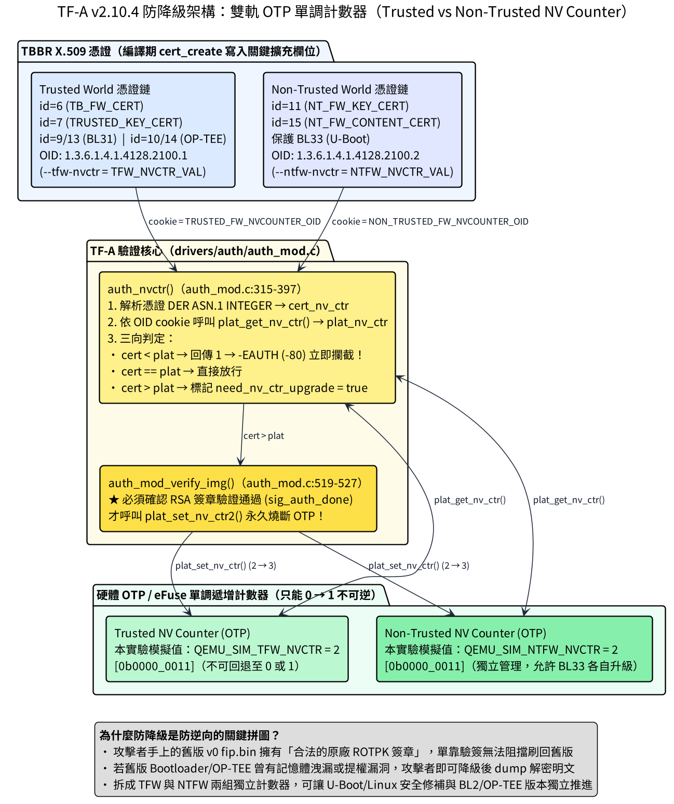
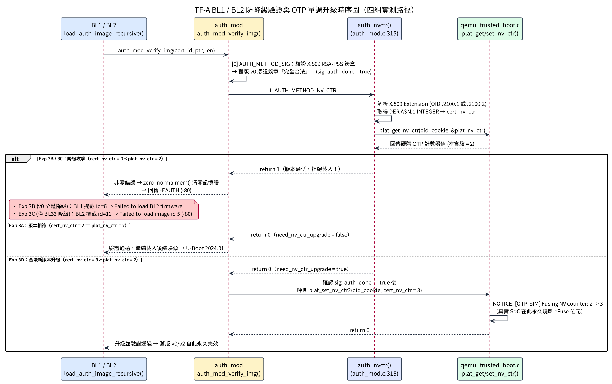

# TF-A 防降級機制實戰：TBBR 憑證 `nv_ctr` 與 OTP 單調遞增計數器（QEMU ARMv8 / TF-A v2.10.4）

就算你把 Secure Boot 驗簽（ROTPK）和韌體加密（AES-GCM）全都開滿了，逆向工程師還有一招最經典的繞過手法：**降級攻擊（Rollback Attack）**。想像兩年前你曾釋出過一版韌體 `v0`，當時 U-Boot 或 OP-TEE 有個緩衝區溢位漏洞，雖然你在 `v2` 修好了，但 **`v0` 的 `fip.bin` 依然擁有原廠真正私鑰簽出的合法 X.509 憑證**！攻擊者只要把這份「完全合法、沒竄改半個 bit」的舊版 `fip.bin` 寫回外部 Flash，裝置就會乖乖開進有漏洞的 `v0`，讓攻擊者提權後從 RAM 直接傾印機密。**TF-A Anti-Rollback（防降級）**透過在每張 TBBR X.509 憑證中強制嵌入安全版本號（`nv_ctr`），並在晶片硬體端配置只能 `0 → 1` 不可逆遞增的 **OTP Monotonic NV Counter**，只要憑證版本低於硬體計數器就立刻回傳 `-EAUTH (-80)` 拒載，徹底封死回頭路。

---

## 1. 基本概念

開始追碼與實作模擬 OTP 前，先對齊 TF-A TBBR 防降級的四個核心要素：

- **Monotonic NV Counter（非揮發單調計數器）**：燒死在晶片 OTP / eFuse 裡的一組位元（例如 64-bit 或 256-bit，常以漢明權重編碼 `0000 → 0001 → 0011 → 0111`），只能由 `0` 燒斷成 `1`、永遠無法歸零或減小。
- **雙軌獨立計數器（Trusted vs Non-Trusted）**：TF-A 將安全版本號拆成兩組獨立的 X.509 OID，避免 Non-Secure 端頻繁更新耗盡安全核心的 eFuse 位元：
  - **Trusted World NV Counter（`TFW_NVCTR_VAL`）**：OID `1.3.6.1.4.1.4128.2100.1`，保護 BL2、BL31、OP-TEE（BL32）與根金鑰憑證（`id=6, 7, 9, 13, 10, 14`）。
  - **Non-Trusted World NV Counter（`NTFW_NVCTR_VAL`）**：OID `1.3.6.1.4.1.4128.2100.2`，專門保護 Non-Secure Bootloader BL33（U-Boot）的憑證鏈（`id=11, 15`）。
- **先驗簽、再燒錄（Verify-before-Burn）**：`auth_mod_verify_img()` 嚴格要求 `need_nv_ctr_upgrade && sig_auth_done` 同時成立才呼叫 `plat_set_nv_ctr2()`，防止攻擊者偽造一張帶超大 `nv_ctr = 9999` 的假憑證把所有 eFuse 一次燒滿（Denial-of-Service 變磚攻擊）。
- **PSA FWU Trial Run 保護**：當系統整合 A/B 分區試跑機制（`PSA_FWU_SUPPORT`）時，新版本在確認能成功開進 OS 前屬於 Trial State，`auth_nvctr()` 會刻意暫緩燒錄 OTP，避免有 bug 的新版把板子鎖死在無法回滾的狀態。

### 1.1 TBBR 憑證與對應 NV Counter OID 一覽

| Image ID | 憑證名稱 | 驗證階段 | 使用的 NV Counter OID | 編譯期參數 |
| :---: | :--- | :---: | :--- | :--- |
| `6` | `TRUSTED_BOOT_FW_CERT_ID` (`tb-fw-cert`) | **BL1** | `1.3.6.1.4.1.4128.2100.1` (`TRUSTED_FW_NVCOUNTER_OID`) | `TFW_NVCTR_VAL` |
| `7` | `TRUSTED_KEY_CERT_ID` (`trusted-key-cert`) | **BL2** | `1.3.6.1.4.1.4128.2100.1` (`TRUSTED_FW_NVCOUNTER_OID`) | `TFW_NVCTR_VAL` |
| `9` / `13` | `SOC_FW_KEY/CONTENT_CERT_ID` (BL31) | **BL2** | `1.3.6.1.4.1.4128.2100.1` (`TRUSTED_FW_NVCOUNTER_OID`) | `TFW_NVCTR_VAL` |
| `10` / `14` | `TRUSTED_OS_FW_KEY/CONTENT_CERT_ID` (OP-TEE) | **BL2** | `1.3.6.1.4.1.4128.2100.1` (`TRUSTED_FW_NVCOUNTER_OID`) | `TFW_NVCTR_VAL` |
| `11` / `15` | `NON_TRUSTED_FW_KEY/CONTENT_CERT_ID` (U-Boot) | **BL2** | `1.3.6.1.4.1.4128.2100.2` (`NON_TRUSTED_FW_NVCOUNTER_OID`) | `NTFW_NVCTR_VAL` |

---

## 2. 整體架構與分層說明



整套防降級機制分為三個層次：

- **第一層（編譯期憑證簽發：`cert_create` + `make_helpers/tbbr/tbbr_tools.mk`）**：透過 `--tfw-nvctr` 與 `--ntfw-nvctr` 把版本號編碼成 DER `ASN1_INTEGER` 寫入 X.509 Critical Extension，並一起被 RSA 私鑰簽章鎖死，攻擊者無法竄改憑證內的數字。
- **第二層（TF-A 驗證引擎：`drivers/auth/auth_mod.c` + `tbbr_cot_*.c`）**：每張憑證的 CoT 描述符都同時掛了 `AUTH_METHOD_SIG` 與 `AUTH_METHOD_NV_CTR`；`auth_nvctr()` 解析出憑證版本號後，將對應 OID 字串當作 `cookie` 傳給平台層讀取硬體值，比對出 `<`（拒載）、`==`（放行）或 `>`（驗簽成功後觸發升級）。
- **第三層（平台硬體抽象層：`plat/qemu/common/qemu_trusted_boot.c`）**：上游 QEMU 預設實作的 `plat_get_nv_ctr()` 永遠回傳 `0`、`plat_set_nv_ctr()` 永遠回傳 `1`。我們透過本專案新增的本地 Yocto 層 `layers/meta-anti-re` 與 `kas/anti-rollback.yml` 加入可選的模擬 OTP 計數器（`QEMU_SIM_TFW_NVCTR` / `QEMU_SIM_NTFW_NVCTR` / `QEMU_SIM_NVCTR_UPGRADE`），在不改動任何上游 layer 的前提下完整重現真實 SoC 的 eFuse 讀取、拒載與單調燒錄行為。

### 2.1 檔案地圖（TF-A v2.10.4 與本專案 Local Layer）

```text
kas/anti-rollback.yml                                                 ---- 啟用 meta-anti-re 與模擬 OTP=2 / 憑證 v2 建置
layers/meta-anti-re/recipes-bsp/trusted-firmware-a/files/             ---- 0001-qemu-sim-otp-nv-counter.patch（模擬雙軌 OTP）
include/tools_share/tbbr_oid.h                                        ---- 定義 TRUSTED_FW_NVCOUNTER_OID 與 NON_TRUSTED_FW_NVCOUNTER_OID
make_helpers/tbbr/tbbr_tools.mk                                       ---- 將 TFW_NVCTR_VAL / NTFW_NVCTR_VAL 傳給 cert_create
drivers/auth/tbbr/tbbr_cot_common.c & tbbr_cot_bl2.c                  ---- 為每張憑證掛載 AUTH_METHOD_NV_CTR 與 OID cookie
drivers/auth/auth_mod.c                                               ---- auth_nvctr() 三向比對 與 auth_mod_verify_img() 驗簽後升級
plat/qemu/common/qemu_trusted_boot.c                                  ---- 平台層 plat_get_nv_ctr() / plat_set_nv_ctr() 實作
```

---

## 3. 總流程

入口：透過 `kas/anti-rollback.yml` 編譯模擬硬體 OTP 為 `TFW=2, NTFW=2` 的 BL1/BL2（`.venv/bin/kas shell kas/base.yml:kas/tbbr.yml:kas/debug.yml:kas/fw-enc.yml:kas/anti-rollback.yml:kas/offline.yml -c 'bitbake trusted-firmware-a'`），再分別搭配 `v2`、`v0`（全體降級）、`TFW=2/NTFW=0`（僅降級 U-Boot）與 `v3`（觸發升級燒錄）四份**均由真正 ROTPK 合法簽署**的 `fip.bin` 啟動 QEMU。

BL1 / BL2 驗證任何一張憑證的防降級呼叫樹如下（編號對應第 4 節原始碼）：

```text
load_auth_image_recursive(cert_id)->
    load_image(cert_id)                                  ## 從 FIP 載入 DER X.509 憑證
    auth_mod_verify_img(cert_id)->                       ## 4.1 驗證主迴圈（auth_mod.c:452）
        [0] auth_signature()                             ##     驗證 RSA-PSS 簽章（舊版 v0 此步會 PASS，sig_auth_done=true）
        [1] auth_nvctr()->                               ## 4.2 防降級核心比對（重點關注，auth_mod.c:315）
            img_parser_get_auth_param(OID .2100.1 / .2)  ##     萃取 X.509 內 DER ASN1_INTEGER → cert_nv_ctr
            plat_get_nv_ctr(oid_cookie, &plat_nv_ctr)    ## 4.3 依 OID 讀硬體 OTP TFW 或 NTFW 值（qemu_trusted_boot.c:36）
            if (cert_nv_ctr < plat_nv_ctr) return 1      ##     ★ 降級攻擊！立刻失敗 → 清零記憶體 → 回傳 -EAUTH (-80)
            if (cert_nv_ctr > plat_nv_ctr)               ##     ★ 合法新版！標記 need_nv_ctr_upgrade = true
        if (need_nv_ctr_upgrade && sig_auth_done)->      ## 4.1 確認簽章合法後才執行燒錄（auth_mod.c:519）
            plat_set_nv_ctr2() -> plat_set_nv_ctr()      ## 4.3 永久遞增硬體 OTP 計數器（2 -> 3）
```



---

## 4. 詳細分析（TF-A v2.10.4）

### 4.1 `auth_mod_verify_img`（`drivers/auth/auth_mod.c:492-527`，NV Counter 驗證與升級觸發）

```c
		case AUTH_METHOD_SIG:
			// 先以公鑰驗證憑證簽章；唯有通過才會把 sig_auth_done 設為 true
			rc = auth_signature(&auth_method->param.sig,
					img_desc, img_ptr, img_len);
			sig_auth_done = true;
			break;
		case AUTH_METHOD_NV_CTR:
			// 接著驗證憑證內的防降級版本號，並回傳是否需要升級硬體 OTP
			nv_ctr_param = &auth_method->param.nv_ctr;
			rc = auth_nvctr(nv_ctr_param,
					img_desc, img_ptr, img_len,
					&cert_nv_ctr, &need_nv_ctr_upgrade);
			break;
		...
		if (rc != 0) {
			VERBOSE("[TBB] %s():%d failed with error code %d.\n",
				__func__, __LINE__, rc);
			return rc;
		}
	}

	// ★ 安全關鍵：必須「整張憑證驗證通過」且「簽章已驗過 (sig_auth_done)」
	// 才呼叫 plat_set_nv_ctr2() 燒斷硬體 OTP，防範偽造高版本憑證消耗 eFuse
	if (need_nv_ctr_upgrade && sig_auth_done) {
		rc = plat_set_nv_ctr2(nv_ctr_param->plat_nv_ctr->cookie,
				      img_desc, cert_nv_ctr);
		if (rc != 0) {
			VERBOSE("[TBB] %s():%d failed with error code %d.\n",
				__func__, __LINE__, rc);
			return rc;
		}
	}
```

這段順序設計堵死了 eFuse 耗盡攻擊：就算攻擊者手改憑證把 `nv_ctr` 改成 `9999`，第一步 `AUTH_METHOD_SIG` 就會失敗返回，絕不會執行到第 520 行的燒錄呼叫。

### 4.2 `auth_nvctr`（`drivers/auth/auth_mod.c:335-397`）

```c
	// 1. 依 OID（.2100.1 或 .2100.2）從 X.509 憑證萃取 DER 編碼的 NV Counter
	rc = img_parser_get_auth_param(img_desc->img_type, param->cert_nv_ctr,
				       img, img_len, &data_ptr, &data_len);
	...
	// 2. 嚴格檢查 ASN.1 INTEGER 格式：不得為負數、不得超過 31-bit、不得有尾端填充
	if ((data_len < 3) || (*p != ASN1_INTEGER))
		return 1;
	p++;
	len = (unsigned int)*p;
	if ((len > 4) || (data_len - 2 != len))
		return 1;
	p++;
	if (*p & 0x80)
		return 1;

	// 將 Big-Endian DER 位元組組回無號整數 cert_nv_ctr
	*cert_nv_ctr = 0;
	for (i = 0; i < len; i++)
		*cert_nv_ctr = (*cert_nv_ctr << 8) | *p++;

	// 3. 透過平台層讀取晶片硬體 OTP 內的目前版本值 plat_nv_ctr
	rc = plat_get_nv_ctr(param->plat_nv_ctr->cookie, &plat_nv_ctr);
	if (rc != 0)
		return rc;

	// 4. 三向判定核心
	if (*cert_nv_ctr < plat_nv_ctr) {
		// ★ 憑證版本低於硬體 OTP → 降級攻擊，立即回傳 1（外層轉成 -EAUTH / -80）
		return 1;
	} else if (*cert_nv_ctr > plat_nv_ctr) {
		// ★ 憑證版本高於硬體 OTP → 非試跑狀態下標記待升級 OTP
#if PSA_FWU_SUPPORT && IMAGE_BL2
		is_trial_run = fwu_is_trial_run_state();
#endif
		*need_nv_ctr_upgrade = !is_trial_run;
	}

	return 0;
```

留意第 368 行與第 362 行的防呆檢查：TF-A 不信任任何外部 DER 資料，明確擋掉負數與異常長度，避免整數溢位繞過 `<` 比對。

### 4.3 本實驗平台實作：`plat_get_nv_ctr` 與 `plat_set_nv_ctr`（`plat/qemu/common/qemu_trusted_boot.c`，經 `meta-anti-re` patch）

```c
// 依 CoT 傳入的 OID cookie 區分「Trusted World」與「Non-Trusted World」兩組獨立 OTP
int plat_get_nv_ctr(void *cookie, unsigned int *nv_ctr)
{
	const char *oid = (const char *)cookie;

	if (strcmp(oid, TRUSTED_FW_NVCOUNTER_OID) == 0) {
		*nv_ctr = sim_tfw_nv_ctr;
		if (QEMU_SIM_TFW_NVCTR > 0U || QEMU_SIM_NVCTR_UPGRADE > 0U)
			INFO("[OTP-SIM] Read TFW NV counter = %u\n", *nv_ctr);
	} else if (strcmp(oid, NON_TRUSTED_FW_NVCOUNTER_OID) == 0) {
		*nv_ctr = sim_ntfw_nv_ctr;
		if (QEMU_SIM_NTFW_NVCTR > 0U || QEMU_SIM_NVCTR_UPGRADE > 0U)
			INFO("[OTP-SIM] Read NTFW NV counter = %u\n", *nv_ctr);
	} else {
		return 1;
	}
	return 0;
}

int plat_set_nv_ctr(void *cookie, unsigned int nv_ctr)
{
#if QEMU_SIM_NVCTR_UPGRADE
	const char *oid = (const char *)cookie;

	if (strcmp(oid, TRUSTED_FW_NVCOUNTER_OID) == 0) {
		if (nv_ctr < sim_tfw_nv_ctr)
			return 1; // 硬體保護：絕不允許倒退寫入
		NOTICE("[OTP-SIM] Fusing TFW NV counter: %u -> %u\n",
		       sim_tfw_nv_ctr, nv_ctr);
		sim_tfw_nv_ctr = nv_ctr;
		return 0;
	} else if (strcmp(oid, NON_TRUSTED_FW_NVCOUNTER_OID) == 0) {
		if (nv_ctr < sim_ntfw_nv_ctr)
			return 1;
		NOTICE("[OTP-SIM] Fusing NTFW NV counter: %u -> %u\n",
		       sim_ntfw_nv_ctr, nv_ctr);
		sim_ntfw_nv_ctr = nv_ctr;
		return 0;
	}
#endif
	return 1;
}
```

> **QEMU 模擬 vs 真實 SoC OTP 差異**：在真實 SoC（如 STM32MP BSEC、NXP OCOTP、MediaTek eFuse）中，`sim_tfw_nv_ctr` 位於非揮發性 OTP 暫存器，一旦 BL1 在 `id=6` 將其從 `2` 燒成 `3`，接棒的 BL2 與往後每一次斷電重開機讀到的就永遠是 `3`。本實驗以靜態變數模擬，所以在 Exp 3D 中會看到 BL1 與 BL2 各自印出一次 `Fusing TFW NV counter: 2 -> 3`，緊接著 BL2 驗證後續憑證（`id=9, 13, 10, 14`）時就立即讀到更新後的 `3`。

---

## 5. 實機驗證：X.509 憑證解析與四組降級／升級實驗

### 5.1 編譯期憑證 `nv_ctr` OID 驗證（`openssl asn1parse`）

四份均使用真正原廠開發金鑰 `arm_rotprivk_rsa.pem` 合法簽署的 FIP 憑證，其內嵌 `ASN1_INTEGER` 如下（摘自 [anti-rollback-experiment.log](logs/anti-rollback-experiment.log)）：

```text
  v0  tb-fw-cert (id=6)   OID=1.3.6.1.4.1.4128.2100.1 -> INTEGER :00
  v0  nt-fw-cert (id=15)  OID=1.3.6.1.4.1.4128.2100.2 -> INTEGER :00
  v2  tb-fw-cert (id=6)   OID=1.3.6.1.4.1.4128.2100.1 -> INTEGER :02
  v2  nt-fw-cert (id=15)  OID=1.3.6.1.4.1.4128.2100.2 -> INTEGER :02
  nt0 tb-fw-cert (id=6)   OID=1.3.6.1.4.1.4128.2100.1 -> INTEGER :02
  nt0 nt-fw-cert (id=15)  OID=1.3.6.1.4.1.4128.2100.2 -> INTEGER :00
  v3  tb-fw-cert (id=6)   OID=1.3.6.1.4.1.4128.2100.1 -> INTEGER :03
  v3  nt-fw-cert (id=15)  OID=1.3.6.1.4.1.4128.2100.2 -> INTEGER :03
```

### 5.2 四組 QEMU 實測結果總表（硬體 OTP 固定設為 `TFW=2, NTFW=2`）

| 編號 | 實驗情境 | 憑證版本 (`TFW` / `NTFW`) | 攔截者與行為 | 關鍵實測輸出 | 完整 Log |
| :---: | :--- | :---: | :--- | :--- | :--- |
| **Exp 3A** | 版本相符正常開機 | `2` / `2` | **全部放行** | BL1/BL2 全數讀得 `2 == 2`，順利解密載入 BL31/OP-TEE 並進入 **`U-Boot 2024.01`** | [anti-rollback-experiment.log](logs/anti-rollback-experiment.log) |
| **Exp 3B** | 降級攻擊 #1（全體刷回舊版合法 `fip_v0`） | `0` / `0` | **BL1 (BootROM) 攔截 `id=6`** | `Read TFW NV counter = 2` → **`ERROR: Failed to load BL2 firmware`**（連 BL2 都進不去） | [anti-rollback-experiment.log](logs/anti-rollback-experiment.log) |
| **Exp 3C** | 降級攻擊 #2（僅降級 U-Boot BL33 至 `v0`） | `2` / `0` | **BL2 攔截 `id=11` (`BL33`)** | BL1→BL2→BL31→OP-TEE 全數過關；載入 `id=11` 讀得 `NTFW = 2 > 0` → **`ERROR: BL2: Failed to load image id 5`** | [anti-rollback-experiment.log](logs/anti-rollback-experiment.log) |
| **Exp 3D** | 合法新版單調升級 | `3` / `3` | **驗簽通過後自動燒錄 OTP** | **`NOTICE: [OTP-SIM] Fusing TFW NV counter: 2 -> 3`**、**`Fusing NTFW NV counter: 2 -> 3`**，後續憑證即讀到 `3`，順利進入 `U-Boot 2024.01` | [anti-rollback-experiment.log](logs/anti-rollback-experiment.log) |

關鍵攔截與升級日誌節錄（摘自 [anti-rollback-experiment.log](logs/anti-rollback-experiment.log)）：

```text
# Exp 3B：合法舊版 fip_v0 (TFW=0) 寫入 OTP=2 裝置 → BL1 在 id=6 直接封殺
INFO:    BL1: Loading BL2
INFO:    Loading image id=6 at address 0xe06b000
INFO:    Image id=6 loaded: 0xe06b000 - 0xe06b4be
INFO:    [OTP-SIM] Read TFW NV counter = 2
ERROR:   Failed to load BL2 firmware

# Exp 3C：僅把 BL33 (U-Boot) 降回 NTFW=0 → BL1/BL31/BL32 皆通過，BL2 在 id=11 封殺 BL33
INFO:    BL2: Loading image id 5
INFO:    Loading image id=11 at address 0x60000000
INFO:    Image id=11 loaded: 0x60000000 - 0x600004f2
INFO:    [OTP-SIM] Read NTFW NV counter = 2
ERROR:   BL2: Failed to load image id 5

# Exp 3D：刷入合法新版 fip_v3 (TFW=3 / NTFW=3) → 驗簽後自動單調燒錄 OTP 2 -> 3
INFO:    Loading image id=7 at address 0xe0a0000
INFO:    [OTP-SIM] Read TFW NV counter = 2
NOTICE:  [OTP-SIM] Fusing TFW NV counter: 2 -> 3
INFO:    Loading image id=9 at address 0xe0a0000
INFO:    [OTP-SIM] Read TFW NV counter = 3
...
INFO:    Loading image id=11 at address 0x60000000
INFO:    [OTP-SIM] Read NTFW NV counter = 2
NOTICE:  [OTP-SIM] Fusing NTFW NV counter: 2 -> 3
INFO:    Loading image id=15 at address 0x60000000
INFO:    [OTP-SIM] Read NTFW NV counter = 3
...
U-Boot 2024.01
```

---

## 6. 重點整理

- **簽章合法不等於安全**：Exp 3B 與 3C 採用的降級映像完全由真正的 ROTPK 簽發、沒被竄改半個 bit，唯有靠硬體單調遞增 NV Counter 才能阻斷「刷回含已知漏洞的舊版來 dump 機密」的攻擊。
- **Trusted / Non-Trusted 雙軌隔離**：OID `.2100.1` 與 `.2100.2` 各自對應獨立計數器，實測證明即便 BL1/BL2/BL31/OP-TEE 均為最新 `v2`，單獨將 BL33（U-Boot）降回 `v0` 仍會被 BL2 精準抓包。
- **Verify-before-Burn 防止變磚攻擊**：`auth_mod.c:519` 確保 `sig_auth_done` 通過後才執行 `plat_set_nv_ctr2()`，杜絕偽造高版本憑證把晶片 OTP 一次燒光。
- **與 OP-TEE TA 防降級互補**：TF-A 守住 Bootloader 與 OP-TEE Core（BL1 → BL33），進入系統後 OP-TEE 的 `check_update_version()`（見 [optee-encrypted-ta.md](optee-encrypted-ta.md)）再接手守住 User TA 的 `ta_version`。
- 俗話說「**過河拆橋，不留後路**」，每逢重大安全修補就把硬體 OTP 計數器推進一格，把舊版含漏洞的橋徹底拆掉，逆向攻擊者就再也走不回頭。

## 參考

- 本專案設定與 Patch：[kas/anti-rollback.yml](../kas/anti-rollback.yml)、[0001-qemu-sim-otp-nv-counter.patch](../layers/meta-anti-re/recipes-bsp/trusted-firmware-a/files/0001-qemu-sim-otp-nv-counter.patch)
- TF-A v2.10.4 原始碼：`drivers/auth/auth_mod.c`、`drivers/auth/tbbr/tbbr_cot_common.c`、`drivers/auth/tbbr/tbbr_cot_bl2.c`、`plat/qemu/common/qemu_trusted_boot.c`、`include/tools_share/tbbr_oid.h`
- 實測日誌：[anti-rollback-experiment.log](logs/anti-rollback-experiment.log)
- TF-A 官方文件：[Trusted Board Boot Design — Anti-Rollback Protection](https://trustedfirmware-a.readthedocs.io/en/lts-v2.10/design/trusted-board-boot.html)
