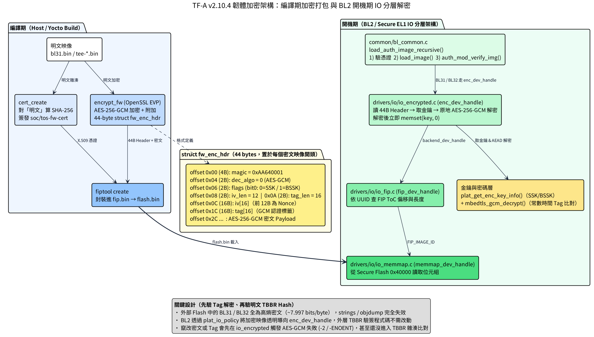
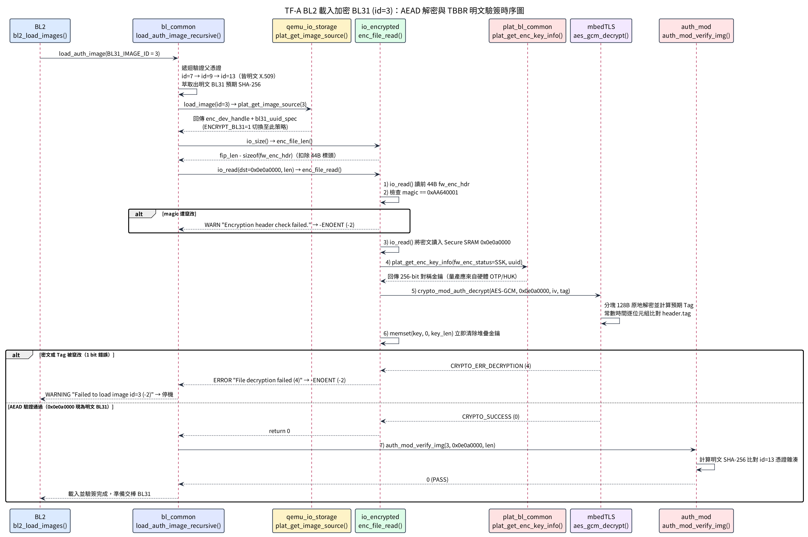

# TF-A 韌體加密實戰：以 AES-256-GCM 阻斷靜態逆向工程（QEMU ARMv8 / TF-A v2.10.4 + OP-TEE 4.1.0）

光開啟 Secure Boot（TBBR 驗簽）只能防止別人「竄改」你的韌體，卻完全擋不住競爭對手把外部 Flash 拆下來做**靜態逆向工程**。實測我們先前開啟 TBBR 的 `flash.bin`：對裡面的 `BL31`（`soc-fw.bin`）與 `OP-TEE`（`tos-fw-extra1.bin`）直接跑 `strings` 和 `aarch64-linux-gnu-objdump`，函式名稱、原始碼路徑與完整 ARM64 組合語言一覽無遺。**TF-A Firmware Encryption（韌體加密）**透過 `encrypt_fw` 在編譯期以 **AES-256-GCM** 將 `BL31` 與 `BL32` 加密成高熵密文再封進 `fip.bin`，開機時由 BL2 透過分層 IO 驅動 `io_encrypted` 在 Secure SRAM 內即時解密並驗證 GCM Tag，最後再走原本的 TBBR 明文雜湊驗簽，讓靜態反組譯徹底失效。

---

## 1. 基本概念

開始追碼前，先釐清 TF-A Firmware Encryption 的核心名詞與設計重點：

- **AEAD（Authenticated Encryption with Associated Data，認證加密）**：TF-A 預設使用 **AES-256-GCM**，同時提供「機密性（密文無法反組譯）」與「完整性（16-byte Auth Tag，改動密文或 Tag 任 1 bit 立即報錯）」。
- **`struct fw_enc_hdr`（44 bytes）**：`encrypt_fw` 工具在每個密文映像開頭附加的固定標頭（`include/tools_share/firmware_encrypted.h:32-40`），內含魔術數 `0xAA640001`、解密演算法、金鑰旗標、12-byte IV（Nonce）與 16-byte GCM Tag。
- **SSK vs BSSK 金鑰模型**：
  - **SSK（Secret Symmetric Key，`FW_ENC_STATUS=0`）**：晶片商或裝置群組共用的對稱解密金鑰，適合產線量產與 OTA 統一分發。
  - **BSSK（Binding Secret Symmetric Key，`FW_ENC_STATUS=1`）**：與單顆晶片 HUK 綁定的專屬對稱金鑰（實務上常在首次開機時用 SSK 解密後，改以該晶片專屬 BSSK 重新加密回寫 Flash，達到「一機一密、拆 Flash 換板即報廢」）。
- **先解密、後驗明文 Hash（Encrypt-then-Decrypt-before-TBBR）**：編譯期 `cert_create` 是對**明文** `bl31.bin` 算 SHA-256 放進 X.509 憑證；開機時 BL2 先在 `load_image()` 內經 `io_encrypted` 原地解密成明文，再交給 `auth_mod_verify_img()` 驗證明文雜湊，因此外層 TBBR 驗證邏輯完全不必改寫。

### 1.1 TF-A Firmware Encryption 關鍵編譯旗標

| 編譯變數（`make_helpers/defaults.mk`） | 本實驗設定值 | 作用說明 |
| :--- | :--- | :--- |
| `DECRYPTION_SUPPORT` | `aes_gcm` | 啟用 BL1/BL2 的 `io_encrypted.c` 驅動與 mbedTLS AES-GCM 解密（強制依賴 `TRUSTED_BOARD_BOOT=1`） |
| `ENCRYPT_BL31` | `1` | 編譯期呼叫 `encrypt_fw` 加密 `bl31.bin`，並在 `qemu_io_storage.c` 將 `BL31_IMAGE_ID` 導向 `enc_dev_handle` |
| `ENCRYPT_BL32` | `1` | 同時加密 `BL32`（`tee-header_v2.bin`）、`BL32_EXTRA1`（`tee-pager_v2.bin`）與 `BL32_EXTRA2` |
| `FW_ENC_STATUS` | `0` | 寫入 `fw_enc_hdr.flags` bit0：`0` = `FW_ENC_WITH_SSK`、`1` = `FW_ENC_WITH_BSSK` |
| `ENC_KEY` | 64 位 hex（256-bit） | 256-bit AES 金鑰（本 QEMU 實驗對應 `plat_bl_common.c:86` 的 `DUMMY_FIP_ENC_KEY`） |
| `ENC_NONCE` | 24 位 hex（96-bit） | AES-GCM 12-byte IV（量產環境每次出板**必須隨機產生**，絕不可重用同一把 Key + IV） |

---

## 2. 整體架構與分層說明



整個機制分成編譯期與開機期兩段、共四個層次：

- **第一層（編譯期工具鏈：`cert_create` + `encrypt_fw` + `fiptool`）**：`make_helpers/build_macros.mk:612-615` 在 `ENCRYPT_BL31=1` 時會把明文 `bl31.bin` 交給 `cert_create` 算雜湊簽證，同時交給 `tools/encrypt_fw` 產出「44-byte `fw_enc_hdr` + AES-256-GCM 密文」的 `bl31_enc.bin`，最後由 `fiptool` 封進 `fip.bin`。
- **第二層（BL2 平台 IO 策略層：`plat/qemu/common/qemu_io_storage.c`）**：透過 `policies[]` 陣列決定每個 `image_id` 的讀取裝置；未加密映像（如憑證、BL33）直接走 `fip_dev_handle`，而加密的 `BL31` / `BL32` 則無縫切換到 `enc_dev_handle`。
- **第三層（加密 IO 抽象驅動：`drivers/io/io_encrypted.c`）**：把 `io_fip` 包在底層當作 `backend_dev_handle`，在 `enc_file_len()` 扣掉 44 bytes 標頭長度、在 `enc_file_read()` 驗證標頭魔術數、讀取密文、向平台索取金鑰並呼叫解密引擎，解密完立即清零堆疊金鑰。
- **第四層（密碼與平台金鑰層：`mbedtls_crypto.c` + `plat_get_enc_key_info()`）**：`aes_gcm_decrypt()` 以 128-byte 緩衝區原地解密並執行常數時間 GCM Tag 比對；量產 SoC 應覆寫弱函式 `plat_get_enc_key_info()`，改由硬體 OTP/eFuse 或 Keyladder 取得金鑰。

### 2.1 檔案地圖（TF-A v2.10.4 與本專案 Overlay）

```text
kas/fw-enc.yml                                  ---- 本專案新增的 kas overlay（開啟 AES-GCM 加密 BL31 / BL32）
kas/offline.yml                                 ---- 離線增量建置 overlay（BB_NO_NETWORK=1 + 遮罩未用的 ts-sp-fwu）
include/tools_share/firmware_encrypted.h        ---- 定義 ENC_HEADER_MAGIC (0xAA640001)、struct fw_enc_hdr 與 SSK/BSSK 列舉
tools/encrypt_fw/src/encrypt.c                  ---- Host 端加密工具，使用 OpenSSL EVP_aes_256_gcm() 產出密文與標頭
make_helpers/build_macros.mk                    ---- MAKE_BL / TOOL_ADD_IMG 判斷 ENCRYPT_BL31/32 並串接 encrypt_fw 與 cert_create
plat/qemu/qemu/platform.mk                      ---- 依 DECRYPTION_SUPPORT 引入 io_encrypted.c 與 BL32_EXTRA1/2 加密規則
plat/qemu/common/qemu_io_storage.c              ---- 註冊 enc_dev_handle，於 policies[] 將 BL31/BL32 導向 open_enc_fip()
drivers/io/io_encrypted.c                       ---- 加密 IO 驅動核心（enc_file_len / enc_file_read / 清除金鑰）
plat/common/plat_bl_common.c                    ---- 弱函式 plat_get_enc_key_info()（QEMU 測試用 DUMMY_FIP_ENC_KEY）
drivers/auth/crypto_mod.c                       ---- 密碼模組介面 crypto_mod_auth_decrypt()
drivers/auth/mbedtls/mbedtls_crypto.c           ---- mbedTLS AES-256-GCM 原地解密與常數時間 Tag 驗證實作
```

---

## 3. 總流程

入口：透過 `kas/fw-enc.yml` 重編 TF-A（`.venv/bin/kas shell kas/base.yml:kas/tbbr.yml:kas/debug.yml:kas/fw-enc.yml:kas/offline.yml -c 'bitbake trusted-firmware-a'`），接著啟動 QEMU 載入新的 `flash.bin`。

BL2 載入加密後的 `BL31`（`image id=3`）呼叫鏈如下（編號對應第 4 節原始碼解析）：

```text
bl2_main()->
    bl2_load_images()->                                ## 依序載入 BL31(3)、BL32(4/21)、BL33(5)
        load_auth_image_recursive(BL31_IMAGE_ID=3)->   ## 先遞迴驗過明文憑證 id=7 → id=9 → id=13
            load_image(id=3)->
                plat_get_image_source(3)->             ## 4.1 查 policies[3] → 回傳 enc_dev_handle（qemu_io_storage.c:231）
                    open_enc_fip()                     ##     初始化 enc_dev 指向底層 fip_dev
                io_size() -> enc_file_len()            ## 4.2 回報明文長度 = fip_len - 44B fw_enc_hdr（io_encrypted.c:128）
                io_read() -> enc_file_read()->         ## 4.3 讀標頭 + 密文 + 解密核心（重點關注，io_encrypted.c:153）
                    is_valid_header(&header)           ##     檢查 magic == 0xAA640001；不符回 -ENOENT (-2)
                    io_read(backend, dst, len)         ##     將密文 payload 讀入 Secure SRAM 0x0e0a0000
                    plat_get_enc_key_info()            ## 4.4 依 SSK/BSSK 取得 256-bit 金鑰（plat_bl_common.c:82）
                    crypto_mod_auth_decrypt()->        ##     分派至 mbedTLS 密碼後端（crypto_mod.c:170）
                        aes_gcm_decrypt()              ## 4.5 128B 原地解密 + 常數時間 Tag 比對（mbedtls_crypto.c:289）
                    memset(key, 0, key_len)            ##     ★ 立即清零堆疊上的對稱金鑰
            auth_mod_verify_img(3, 0x0e0a0000, len)    ##     ★ 解密成功後，對 RAM 明文做 TBBR SHA-256 驗簽
```



---

## 4. 詳細分析（TF-A v2.10.4）

### 4.1 `policies[]` 與 `open_enc_fip`（`plat/qemu/common/qemu_io_storage.c:231-260, 428-443`）

```c
// 當 ENCRYPT_BL31=1 且啟用解密支援時，BL31 改走 enc_dev_handle 而不直接走 fip_dev_handle
#if ENCRYPT_BL31 && !defined(DECRYPTION_SUPPORT_none)
	[BL31_IMAGE_ID] = {
		&enc_dev_handle,
		(uintptr_t)&bl31_uuid_spec,
		open_enc_fip
	},
#else
	[BL31_IMAGE_ID] = {
		&fip_dev_handle,
		(uintptr_t)&bl31_uuid_spec,
		open_fip
	},
#endif
// 同理，ENCRYPT_BL32=1 會把 OP-TEE 的 header (id=4)、pager (id=21)、pageable (id=22) 全部導向 enc_dev_handle
#if ENCRYPT_BL32 && !defined(DECRYPTION_SUPPORT_none)
	[BL32_IMAGE_ID] = {
		&enc_dev_handle,
		(uintptr_t)&bl32_uuid_spec,
		open_enc_fip
	},
	[BL32_EXTRA1_IMAGE_ID] = {
		&enc_dev_handle,
		(uintptr_t)&bl32_extra1_uuid_spec,
		open_enc_fip
	},
	[BL32_EXTRA2_IMAGE_ID] = {
		&enc_dev_handle,
		(uintptr_t)&bl32_extra2_uuid_spec,
		open_enc_fip
	},
#endif
```

```c
// 將加密裝置的底層後端指向 ENC_IMAGE_ID（即 fip_dev_handle），並確認目標 UUID 存在於 FIP 中
static int open_enc_fip(const uintptr_t spec)
{
	int result;
	uintptr_t local_image_handle;

	result = io_dev_init(enc_dev_handle, (uintptr_t)ENC_IMAGE_ID);
	if (result == 0) {
		result = io_open(enc_dev_handle, spec, &local_image_handle);
		if (result == 0) {
			VERBOSE("Using encrypted FIP\n");
			io_close(local_image_handle);
		}
	}
	return result;
}
```

這層抽象設計非常優雅：透過在 `policies[]` 替換 `dev_handle`，`bl_common.c` 裡的 `load_image()` 完全不需要知道目標映像有沒有加密，就能自動多過一層解密管線。

### 4.2 `enc_file_len`（`drivers/io/io_encrypted.c:128-151`）

```c
static int enc_file_len(io_entity_t *entity, size_t *length)
{
	int result;

	assert(entity != NULL);
	assert(length != NULL);

	// 先向底層 FIP 驅動查詢加密後的總檔案大小（44B 標頭 + 密文）
	result = io_size(backend_handle, length);
	if (result != 0) {
		WARN("Failed to read blob length (%i)\n", result);
		return -ENOENT;
	}

	// 若連 44-byte fw_enc_hdr 都放不下，直接回傳 I/O 錯誤
	if (*length < sizeof(struct fw_enc_hdr))
		return -EIO;

	// 扣除標頭長度，回報給上層的剛好是「明文映像長度」（AES-GCM 密文與明文等長）
	*length -= sizeof(struct fw_enc_hdr);

	return result;
}
```

`enc_file_len()` 扣除 `sizeof(struct fw_enc_hdr)`（44 bytes）後，上層 `load_image()` 檢查目標 SRAM/DRAM 空間上限以及後續 `auth_mod_verify_img()` 計算 SHA-256 時，拿到的 `image_size` 就與原始明文大小完全一致。

### 4.3 `enc_file_read`（`drivers/io/io_encrypted.c:153-218`）

```c
static int enc_file_read(io_entity_t *entity, uintptr_t buffer, size_t length,
			 size_t *length_read)
{
	int result;
	struct fw_enc_hdr header;
	enum fw_enc_status_t fw_enc_status;
	size_t bytes_read;
	uint8_t key[ENC_MAX_KEY_SIZE];
	size_t key_len = sizeof(key);
	unsigned int key_flags = 0;
	const io_uuid_spec_t *uuid_spec = (io_uuid_spec_t *)backend_image_spec;
	...
	// 1. 從底層 FIP 讀取前 44 bytes 的加密標頭
	result = io_read(backend_handle, (uintptr_t)&header, sizeof(header),
			 &bytes_read);
	if (result != 0) {
		WARN("Failed to read encryption header (%i)\n", result);
		return -ENOENT;
	}

	// 2. 驗證 magic == ENC_HEADER_MAGIC (0xAA640001)（對應 Test B 竄改測試攔截點）
	if (!is_valid_header(&header)) {
		WARN("Encryption header check failed.\n");
		return -ENOENT;
	}

	// 3. 解析旗標（0=SSK, 1=BSSK）並防呆檢查 IV / Tag 長度不超過 16 bytes
	fw_enc_status = header.flags & FW_ENC_STATUS_FLAG_MASK;
	if ((header.iv_len > ENC_MAX_IV_SIZE) ||
	    (header.tag_len > ENC_MAX_TAG_SIZE)) {
		WARN("Incorrect IV or tag length\n");
		return -ENOENT;
	}

	// 4. 將密文 payload 讀入目標安全記憶體 buffer（例：BL31 位於 0x0e0a0000）
	result = io_read(backend_handle, buffer, length, &bytes_read);
	if (result != 0) {
		WARN("Failed to read encrypted payload (%i)\n", result);
		return -ENOENT;
	}
	*length_read = bytes_read;

	// 5. 向平台層索取對稱解密金鑰（傳入 SSK/BSSK 狀態與映像 UUID 供金鑰衍生）
	result = plat_get_enc_key_info(fw_enc_status, key, &key_len, &key_flags,
				       (uint8_t *)&uuid_spec->uuid,
				       sizeof(uuid_t));
	if (result != 0) {
		WARN("Failed to obtain encryption key (%i)\n", result);
		return -ENOENT;
	}

	// 6. 呼叫 mbedTLS 原地 AES-256-GCM 解密並驗證 16-byte Auth Tag
	result = crypto_mod_auth_decrypt(header.dec_algo,
					 (void *)buffer, *length_read, key,
					 key_len, key_flags, header.iv,
					 header.iv_len, header.tag,
					 header.tag_len);
	// ★ 安全衛生：不論成功失敗，立即清零堆疊上的 32-byte 金鑰
	memset(key, 0, key_len);

	// 7. 若密文或 Tag 有任 1 bit 遭竄改，印出錯誤（result=4=CRYPTO_ERR_DECRYPTION）並回傳 -ENOENT (-2)
	if (result != 0) {
		ERROR("File decryption failed (%i)\n", result);
		return -ENOENT;
	}

	return result;
}
```

注意兩個重要細節：第一，`enc_file_read()` 在解密完成後立即 `memset(key, 0, key_len)`，避免金鑰殘留在 BL2 Stack 上；第二，若 AES-GCM 解密/Tag 驗證失敗，函式在 `load_image()` 階段就直接回傳 `-ENOENT`（`-2`），根本不會讓損毀的資料進到下一步 TBBR 雜湊驗證。

### 4.4 `plat_get_enc_key_info`（`plat/common/plat_bl_common.c:82-100`）

```c
// 弱符號實作：僅供 QEMU 與開發測試使用；量產 SoC 必須覆寫此函式改由 OTP/HUK/Keyladder 取鑰
int plat_get_enc_key_info(enum fw_enc_status_t fw_enc_status, uint8_t *key,
			  size_t *key_len, unsigned int *flags,
			  const uint8_t *img_id, size_t img_id_len)
{
#define DUMMY_FIP_ENC_KEY { 0x12, 0x34, 0x56, 0x78, 0x90, 0xab, 0xcd, 0xef, \
			    0x12, 0x34, 0x56, 0x78, 0x90, 0xab, 0xcd, 0xef, \
			    0x12, 0x34, 0x56, 0x78, 0x90, 0xab, 0xcd, 0xef, \
			    0x12, 0x34, 0x56, 0x78, 0x90, 0xab, 0xcd, 0xef }

	const uint8_t dummy_key[] = DUMMY_FIP_ENC_KEY;

	assert(*key_len >= sizeof(dummy_key));

	*key_len = sizeof(dummy_key);
	memcpy(key, dummy_key, *key_len);
	// flags=0 代表 key 是原始位元組；若 SoC 使用硬體 Key Slot，可設 ENC_KEY_IS_IDENTIFIER
	*flags = 0;

	return 0;
}
```

> **量產防逆向關鍵警告**：在 QEMU 預設實作中，`DUMMY_FIP_ENC_KEY` 是寫死在 `bl2.bin` 程式碼裡（明文存在 Flash 裡）！如果在真實產品忘記覆寫 `plat_get_enc_key_info()`，攻擊者只要反組譯明文的 BL2 就能抄出這把金鑰再解開 BL31/BL32。真實 HRoT 平台（例如 `plat/st/common/stm32mp_crypto_lib.c:509`）會將金鑰鎖在 **OTP/eFuse 或硬體 Keyladder**，甚至透過 `ENC_KEY_IS_IDENTIFIER` 只傳 Key Slot 編號給硬體 AES 引擎，讓金鑰全程不暴露在 CPU 記憶體中。

### 4.5 `aes_gcm_decrypt`（`drivers/auth/mbedtls/mbedtls_crypto.c:289-366`）

```c
// 每次在堆疊上用 128 bytes 小區塊串流原地解密，兼顧 Secure SRAM 用量與速度
#define DEC_OP_BUF_SIZE		128

static int aes_gcm_decrypt(void *data_ptr, size_t len, const void *key,
			   unsigned int key_len, const void *iv,
			   unsigned int iv_len, const void *tag,
			   unsigned int tag_len)
{
	mbedtls_gcm_context ctx;
	unsigned char buf[DEC_OP_BUF_SIZE];
	unsigned char tag_buf[CRYPTO_MAX_TAG_SIZE];
	unsigned char *pt = data_ptr;
	...
	mbedtls_gcm_init(&ctx);
	// 設定 AES-256 金鑰（key_len * 8 = 256 bits）與 12-byte IV
	rc = mbedtls_gcm_setkey(&ctx, MBEDTLS_CIPHER_ID_AES, key, key_len * 8);
	...
	rc = mbedtls_gcm_starts(&ctx, MBEDTLS_GCM_DECRYPT, iv, iv_len);
	...
	// 逐塊解密並覆寫回原始位址（in-place decryption）
	while (len > 0) {
		dec_len = MIN(sizeof(buf), len);
		rc = mbedtls_gcm_update(&ctx, pt, dec_len, buf, sizeof(buf), &output_length);
		if (rc != 0) { rc = CRYPTO_ERR_DECRYPTION; goto exit_gcm; }
		memcpy(pt, buf, dec_len);
		pt += dec_len;
		len -= dec_len;
	}

	// 產生計算出的 16-byte GCM Authentication Tag
	rc = mbedtls_gcm_finish(&ctx, NULL, 0, &output_length, tag_buf, sizeof(tag_buf));
	...
	// ★ 常數時間（constant-time）比對 Tag，防止透過比對耗時差做 Timing Side-Channel 攻擊
	for (diff = 0, i = 0; i < tag_len; i++)
		diff |= ((const unsigned char *)tag)[i] ^ tag_buf[i];

	if (diff != 0) {
		rc = CRYPTO_ERR_DECRYPTION; // 數值為 4
		goto exit_gcm;
	}
	rc = CRYPTO_SUCCESS;
exit_gcm:
	mbedtls_gcm_free(&ctx);
	return rc;
}
```

這段實作除了原地解密節省珍貴的 Secure SRAM，還刻意用 `diff |= tag[i] ^ tag_buf[i]` 取代 `memcmp()` 做常數時間比對，避免攻擊者從提前中止的耗時差推測出合法 Tag。

---

## 5. 實機驗證：加密前後防逆向對照與竄改實測

### 5.1 靜態逆向工程前後對照（Baseline 明文 vs Track 1 密文）

| 檢驗項目 | 加密前（Baseline 僅 TBBR） | 加密後（`kas/fw-enc.yml`） | 防逆向效果 |
| :--- | :--- | :--- | :--- |
| **`soc-fw.bin`（BL31）大小** | `53,356` bytes | `53,400` bytes（**`+44B`** = `fw_enc_hdr`） | 標頭 `magic=0xaa640001`、`iv_len=12`、`tag_len=16` |
| **`soc-fw.bin` 香農熵（Entropy）** | **`4.4351`** bits/byte | **`7.9969`** bits/byte（接近理論極值 8.0） | 位元組分布近乎完全均勻隨機 |
| **`tos-fw-extra1.bin`（OP-TEE）熵值** | **`7.1075`** bits/byte | **`7.9997`** bits/byte（**`+44B`**） | OP-TEE 核心與 fTPM Early TA 全數密文化 |
| **`strings` 搜尋敏感字串** | 直接露出 `BL31: Preparing...`、`tee_ta_invoke_command`、`/usr/src/debug/...` | **0 筆符合** | 無法透過字串定位關鍵邏輯 |
| **`aarch64-objdump` 反組譯** | 清晰還原 `mov x20, x0`、`msr vbar_el3, x0`、`mrs x0, sctlr_el3` | 滿篇 `.inst 0xfe9423b7 ; undefined` 亂碼 | Ghidra / IDA 靜態反組譯完全失效 |
| **TBBR `soc-fw-cert.bin` 內雜湊** | 對應明文 `bl31.bin` SHA-256 | 仍為明文 `bl31.bin` SHA-256（`780596cc...0a67270d`） | 證實「先解密成明文，再驗 TBBR 雜湊」 |

*(完整靜態分析輸出見 [baseline-plaintext-re.log](logs/baseline-plaintext-re.log) 與 [fw-enc-static-analysis.log](logs/fw-enc-static-analysis.log)。)*

加密前後 `soc-fw.bin`（BL31）前幾條指令反組譯直接對比：

```text
# 加密前（Baseline：明文 BL31 直接被反組譯）
       0:  aa0003f4  mov  x20, x0
       4:  aa0103f5  mov  x21, x1
      10:  10033f80  adr  x0, 0x6800
      14:  d51ec000  msr  vbar_el3, x0

# 加密後（跳過 44B fw_enc_hdr 後的密文：反組譯器完全無法解析）
       0:  d839246a  prfm plil2keep, 0x7248c
       4:  fe9423b7  .inst 0xfe9423b7 ; undefined
       8:  3b86a826  .inst 0x3b86a826 ; undefined
       c:  2220eb1e  .inst 0x2220eb1e ; undefined
```

### 5.2 正常解密開機與三組竄改實驗結果

| 編號 | 實驗項目 | 操作方式 | 實測關鍵輸出 | 完整 Log |
| :---: | :--- | :--- | :--- | :--- |
| **Exp 1** | 加密韌體正常開機 | 啟動含加密 BL31/BL32 的 `flash.bin` 進入 Linux 並執行 `optee_example_hello_world` | BL2 自動解密載入 `id=3/4/21` → 通過 TBBR → `optee: revision 4.1` → **`TA incremented value to 43`** | [fw-enc-boot-verify.log](logs/fw-enc-boot-verify.log) |
| **Exp 2A** | 竄改 BL31 密文 1 byte | 翻轉 `flash.bin @ 0x54939`（BL31 `+0x100`）：`0x1f → 0xe0` | **`ERROR: File decryption failed (4)`** → `WARNING: Failed to load image id=3 (-2)` 立即停機 | [fw-enc-tamper-test.log](logs/fw-enc-tamper-test.log) |
| **Exp 2B** | 竄改 `fw_enc_hdr.magic` 1 byte | 翻轉 `flash.bin @ 0x54839`（BL31 `+0x00`）：`0x01 → 0xfe` | **`WARNING: Encryption header check failed.`** → `WARNING: Failed to load image id=3 (-2)` 立即停機 | [fw-enc-tamper-test.log](logs/fw-enc-tamper-test.log) |
| **Exp 2C** | 竄改 GCM Auth Tag 1 byte | 翻轉 `flash.bin @ 0x54859`（BL31 `+0x20`）：`0xf4 → 0x0b` | **`ERROR: File decryption failed (4)`** → `WARNING: Failed to load image id=3 (-2)` 立即停機 | [fw-enc-tamper-test.log](logs/fw-enc-tamper-test.log) |

關鍵攔截日誌節錄（摘自 [fw-enc-tamper-test.log](logs/fw-enc-tamper-test.log)）：

```text
=== Test A: Flip 1 byte in BL31 AES-GCM ciphertext (+0x100 inside BL31) (flash.bin @ 0x54939: 0x1f -> 0xe0) ===
INFO:    Loading image id=13 at address 0xe0a0000
INFO:    Image id=13 loaded: 0xe0a0000 - 0xe0a0438
INFO:    Loading image id=3 at address 0xe0a0000
ERROR:   File decryption failed (4)
WARNING: Failed to load image id=3 (-2)
ERROR:   BL2: Failed to load image id 3

=== Test B: Flip 1 byte in BL31 fw_enc_hdr.magic (+0x00 inside BL31) (flash.bin @ 0x54839: 0x01 -> 0xfe) ===
INFO:    Loading image id=3 at address 0xe0a0000
WARNING: Encryption header check failed.
WARNING: Failed to load image id=3 (-2)
ERROR:   BL2: Failed to load image id 3
```

---

## 6. 重點整理

- **靜態反組譯防護立即見效**：啟用 `DECRYPTION_SUPPORT=aes_gcm`、`ENCRYPT_BL31=1`、`ENCRYPT_BL32=1` 後，`fip.bin` 內的 BL31 與 OP-TEE 熵值躍升至 `~7.997` bits/byte，`strings` 歸零且 `objdump` 全為亂碼。
- **雙重把關（AEAD + TBBR）**：密文或 Tag 被竄改 1 bit，會先在 `io_encrypted` 觸發 AES-GCM 認證失敗（`CRYPTO_ERR_DECRYPTION = 4` → `-ENOENT = -2`）；解密通過後，明文還要再過一次 X.509 憑證內的 SHA-256 驗簽（`-EAUTH = -80`）。
- **透明的 IO 驅動抽象**：透過 `plat_io_policy` 把加密映像切到 `enc_dev_handle`，上層 `bl_common.c` 的遞迴驗簽架構完全無須修改。
- **量產落地的兩條紅線**：(1) 必須覆寫弱函式 `plat_get_enc_key_info()` 改用硬體 HUK/Keyladder，絕不可把金鑰留在明文 BL2；(2) 每次建置與每個映像**必須使用唯一隨機 Nonce (`ENC_NONCE`)**，否則 AES-GCM 重用 `(Key, IV)` 會導致金鑰流外洩與 Tag 偽造風險。
- 俗話說「**鎖門還要拉上窗簾**」，TBBR 驗簽是把門鎖死不讓壞人改程式，Firmware Encryption 則是拉上窗簾，讓拆晶片的人連裡面長什麼樣都看不見。

## 參考

- 本專案設定：[kas/fw-enc.yml](../kas/fw-enc.yml)、[kas/offline.yml](../kas/offline.yml)
- TF-A v2.10.4 原始碼：`drivers/io/io_encrypted.c`、`plat/qemu/common/qemu_io_storage.c`、`plat/common/plat_bl_common.c`、`drivers/auth/mbedtls/mbedtls_crypto.c`、`tools/encrypt_fw/src/encrypt.c`、`include/tools_share/firmware_encrypted.h`
- 實測日誌：[baseline-plaintext-re.log](logs/baseline-plaintext-re.log)、[fw-enc-static-analysis.log](logs/fw-enc-static-analysis.log)、[fw-enc-boot-verify.log](logs/fw-enc-boot-verify.log)、[fw-enc-tamper-test.log](logs/fw-enc-tamper-test.log)
- TF-A 官方設計文件：[Firmware Encryption Design — Trusted Firmware-A v2.10](https://trustedfirmware-a.readthedocs.io/en/lts-v2.10/design/firmware-design.html)
