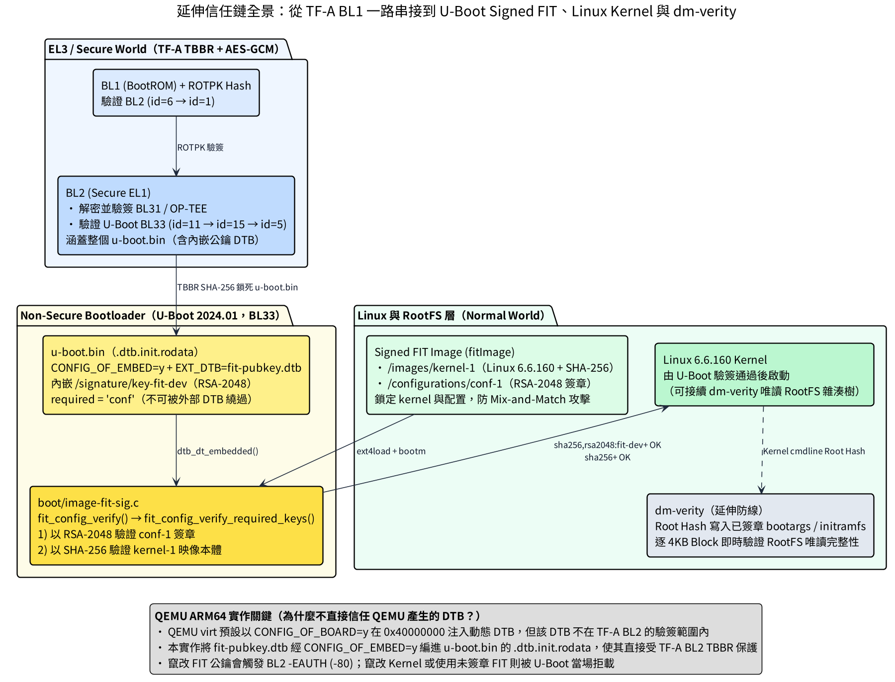
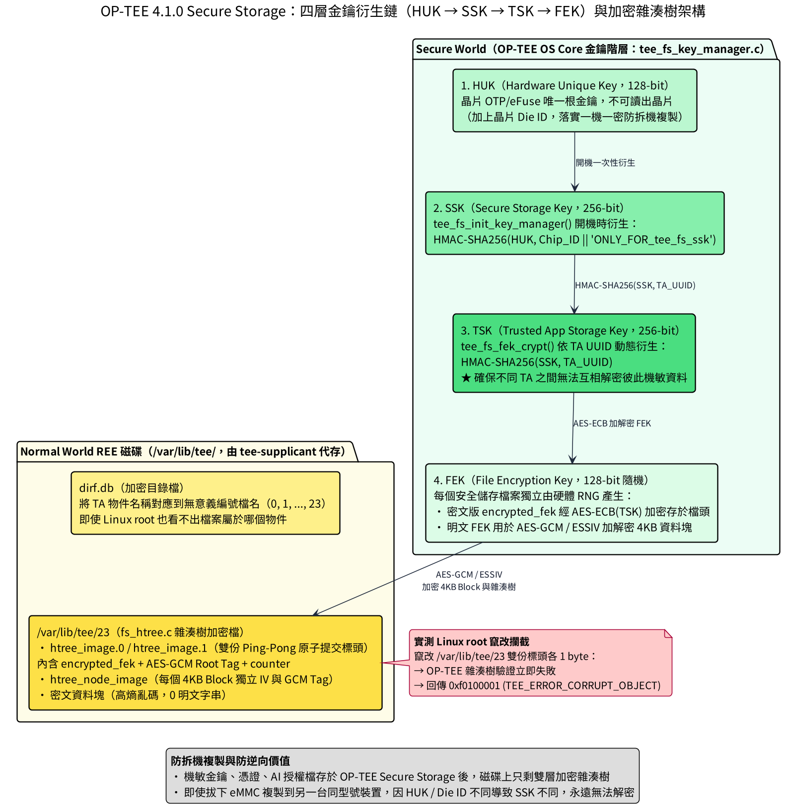

# 延伸信任鏈與安全儲存實戰：U-Boot Signed FIT、`dm-verity` 與 OP-TEE Secure Storage（U-Boot 2024.01 / Linux 6.6.160 / OP-TEE 4.1.0）

在前三個主題裡，我們已經把 BL1 → BL2 → 加密的 BL31/OP-TEE → U-Boot（BL33）與加密 User TA 全部鎖起來了，但信任鏈在 U-Boot 之後還留著最後兩道缺口：第一，如果 U-Boot 載入 Linux Kernel 時沒有驗證簽章，攻擊者只要替換 SD/eMMC 上的 `Image`，就能塞進一個內建記憶體傾印後門的惡意核心；第二，應用程式保存在磁碟上的金鑰、授權憑證或機敏設定檔如果沒綁定硬體信任根，對手只要把 Flash 整顆對拷（Clone）到另一台機器就能直接讀取或大量盜版。本文實作並實測兩道終極防線：**U-Boot Signed FIT Image（將信任鏈從 TF-A BL33 延伸至 Linux 6.6.160，並銜接 `dm-verity` 唯讀 RootFS）**，以及 **OP-TEE Secure Storage（以 `HUK → SSK → TSK → FEK` 四層金鑰與 AES-GCM 雜湊樹封鎖機敏資料防逆向與防拆機複製）**。

---

## 1. 基本概念

先把 U-Boot Verified Boot（Signed FIT）與 OP-TEE Secure Storage 的核心名詞對齊：

- **FIT（Flattened Image Tree）**：U-Boot 以 Device Tree（`.its` / `.itb`）格式封裝 Linux Kernel、DTB、Ramdisk 與其 SHA-256 雜湊、RSA-2048 簽章的單一映像格式。
- **Configuration Signature（`required = "conf"`）**：比起單獨簽每個子映像，簽署整個 `conf-1` 配置節點（涵蓋其引用的 `kernel-1` 雜湊與描述）才能防範 **Mix-and-Match 攻擊**（把合法舊 Kernel 與新版 DTB 拼湊起來啟動）。
- **QEMU ARM64 內嵌公鑰陷阱與解法**：QEMU `virt` 預設以 `CONFIG_OF_BOARD=y` 在 RAM `0x40000000` 注入動態 DTB，但該外部 DTB **不受 TF-A BL2 TBBR 簽章保護**；因此我們以 `CONFIG_OF_EMBED=y` + `EXT_DTB=fit-pubkey.dtb` 將 `/signature/key-fit-dev` 編進 `u-boot.bin` 的 `.dtb.init.rodata`，讓 TF-A BL2 的 SHA-256 直接鎖死 U-Boot 的 FIT 驗證公鑰。
- **`dm-verity`（Device-Mapper Verity）**：Linux 核心層的唯讀區塊裝置 Merkle 雜湊樹防線；把 Root Hash 寫進 U-Boot 簽章保護的 Kernel `bootargs`（或已簽章 `initramfs`），即可在執行期對每一個 4 KB RootFS 區塊做即時完整性驗證，防範離線植入木馬或替換系統程式。
- **OP-TEE Secure Storage（REE-FS 加密雜湊樹）**：將機敏物件加密後委由 Normal World `tee-supplicant` 存放在 `/var/lib/tee/`（Yocto `meta-arm` 設定 `CFG_TEE_FS_PARENT_PATH=/var/lib/tee`），透過四層金鑰鏈與雙份 Ping-Pong 雜湊樹（`fs_htree.c`）確保機密性、原子寫入與防竄改。

### 1.1 OP-TEE Secure Storage 四層金鑰階層對照

| 層級 | 金鑰名稱 | 長度 | 衍生方式（OP-TEE 4.1.0 原始碼） | 保護目的 |
| :---: | :--- | :---: | :--- | :--- |
| **L1** | **HUK**（Hardware Unique Key） | 128-bit | 晶片 OTP/eFuse（`tee_otp_get_hw_unique_key()`） | 晶片唯一信任根，不可讀出晶片 |
| **L2** | **SSK**（Secure Storage Key） | 256-bit | `HMAC-SHA256(HUK, Chip_ID \|\| "ONLY_FOR_tee_fs_ssk")`（`tee_fs_key_manager.c:145`） | 綁定單顆晶片，防拆機複製到他機 |
| **L3** | **TSK**（TA Storage Key） | 256-bit | `HMAC-SHA256(SSK, TA_UUID)`（`tee_fs_key_manager.c:93`） | 跨 TA 隔離，TA-A 無法解密 TA-B 資料 |
| **L4** | **FEK**（File Encryption Key） | 128-bit | 每檔獨立硬體 RNG 產生，以 `AES-ECB(TSK)` 加密存於檔頭（`tee_fs_key_manager.c:155`） | 以 AES-GCM / ESSIV 加密 4 KB 區塊，同明文不同檔密文亦不同 |

---

## 2. 整體架構與分層說明

### 2.1 延伸信任鏈架構（TF-A → U-Boot Signed FIT → Linux → `dm-verity`）



信任鏈跨越四道關卡，環環相扣、不留斷點：

- **第一層（TF-A BL1 → BL2）**：BL1 驗簽 BL2，BL2 解密驗簽 BL31/OP-TEE，並對整個 `u-boot.bin`（含 `.dtb.init.rodata` 裡的 `/signature/key-fit-dev`）做 TBBR SHA-256 驗證。
- **第二層（U-Boot 2024.01 Verified Boot）**：保留 QEMU 動態 DTB (`0x40000000`) 驅動硬體與 OP-TEE 記憶體節點，同時讓 `fit_config_verify()` 讀取 TF-A 驗證過的 `dtb_dt_embedded()` 內 RSA-2048 公鑰，強制驗證 `fitImage` 的 `conf-1` 簽章與 `kernel-1` 雜湊。
- **第三層（Linux 6.6.160 + `dm-verity` 延伸）**：驗證通過後啟動 Linux 6.6.160（本環境 `CONFIG_BLK_DEV_DM=y` 已就緒，量產只需於 Kernel 開啟 `CONFIG_DM_VERITY=y` 並以 `veritysetup` 產生 Merkle Tree 與 Root Hash，寫入簽章保護的 `bootargs` 即可將唯讀 RootFS 也納入信任鏈）。

### 2.2 OP-TEE Secure Storage 加密雜湊樹架構



- **Secure World 金鑰管理層（`tee_fs_key_manager.c`）**：開機透過 `service_init_late(tee_fs_init_key_manager)` 衍生並快取 SSK；每次 TA 讀寫物件時即時衍生該 TA 專屬的 TSK 來解開該檔案的 FEK，用完立即 `memzero_explicit()` 清零。
- **雜湊樹完整性層（`fs_htree.c` + `tee_ree_fs.c`）**：將檔案切成 4 KB 區塊組成二元雜湊樹，每個檔頭與節點都保存**雙份 Ping-Pong 複本（`htree_image.0` / `htree_image.1`）**以防寫入一半斷電損毀，並以 AES-GCM 保護每塊資料與節點中繼資料。
- **Normal World 代存層（`tee-supplicant` + `/var/lib/tee/`）**：所有物件名皆經 `dirf.db` 加密映射為無意義十六進位編號檔（`0`, `1`, ..., `23`），Linux `root` 看不到物件名稱、讀不到明文，篡改內容也會立刻觸發 `TEE_ERROR_CORRUPT_OBJECT (0xf0100001)`。

### 2.3 檔案地圖

```text
kas/uboot-fit.yml                                                   ---- 啟用 U-Boot 內嵌 RSA-2048 FIT 公鑰 DTB overlay
scripts/build-signed-fit.sh                                         ---- 產生 RSA-2048 金鑰、fit-pubkey.dtb 與 Signed fitImage
keys/fit/fit-pubkey.dtb                                             ---- 含 /signature/key-fit-dev (required="conf") 之公鑰 DTB
layers/meta-anti-re/recipes-bsp/u-boot/u-boot_%.bbappend            ---- 帶入 CONFIG_OF_EMBED=y 與 EXT_DTB=fit-pubkey.dtb
layers/meta-anti-re/recipes-bsp/u-boot/files/0001-fit-sig-*.patch   ---- 讓 fit_config_verify() 讀取 TF-A 驗證之 dtb_dt_embedded()
u-boot/2024.01/git/boot/image-fit-sig.c                             ---- U-Boot FIT 配置簽章驗證核心（fit_config_verify）
u-boot/2024.01/git/lib/fdtdec.c                                     ---- fdtdec_setup() 處理 CONFIG_OF_EMBED 與 CONFIG_OF_BOARD
optee-os/4.1.0/git/core/tee/tee_fs_key_manager.c                    ---- HUK → SSK → TSK → FEK 四層金鑰管理實作
optee-os/4.1.0/git/core/tee/fs_htree.c & tee_ree_fs.c               ---- REE-FS 加密二元雜湊樹與雙份 Ping-Pong 原子提交
```

---

## 3. 總流程

### 3.1 U-Boot Signed FIT 驗證呼叫樹

入口：在 U-Boot 提示字元載入 FIT 並執行 `bootm 0x48000000#conf-1 - $fdtcontroladdr`。

```text
do_bootm()->
    bootm_find_os() -> boot_get_kernel()->
        fit_image_load(FIT_KERNEL_PROP)->
            fit_config_verify(fit, conf_noffset)->           ## 4.1 驗證 conf-1 配置簽章（重點關注，image-fit-sig.c:684）
                key_blob = dtb_dt_embedded()                 ##     取出 TF-A BL2 驗證過之 .dtb.init.rodata 公鑰
                fit_config_verify_required_keys()->          ## 4.2 走訪 /signature 內所有 required="conf" 金鑰（image-fit-sig.c:628）
                    fit_config_verify_key()                  ##     ★ 未簽章 FIT (Exp 4B-1) 在此失敗拒絕啟動！
            fit_image_verify(fit, kernel_noffset)->          ##     ★ 驗證 kernel-1 的 SHA-256 雜湊
                fit_image_check_hash()                       ##     ★ 竄改 Kernel 1 byte (Exp 4B-2) 在此報 Bad Data Hash！
    bootm_load_os() -> do_bootm_linux()                      ##     雙重驗證通過 (Exp 4B-3) → 跳入 Linux 6.6.160！
```

### 3.2 OP-TEE Secure Storage 讀寫呼叫樹

入口：在 Linux 執行 `optee_example_secure_storage`（透過 TA 呼叫 `TEE_CreatePersistentObject` / `TEE_ReadObjectData`）。

```text
[開機期] service_init_late -> tee_fs_init_key_manager()->    ## 4.3 衍生晶片專屬 SSK（tee_fs_key_manager.c:139）
    huk_subkey_derive(HUK_SUBKEY_SSK)                        ##     HMAC-SHA256(HUK, Chip_ID || "ONLY_FOR_tee_fs_ssk")

[執行期] TEE_CreatePersistentObject / TEE_ReadObjectData()->
    ree_fs_open / ree_fs_write / ree_fs_read()->
        tee_fs_htree_open / write_block / read_block()->     ##     fs_htree.c：AES-GCM 驗證雜湊樹雙份標頭與 4KB 節點
            tee_fs_generate_fek() / tee_fs_fek_crypt()->     ## 4.4 以 TSK=HMAC(SSK, TA_UUID) 加解密 FEK（tee_fs_key_manager.c:74）
                do_hmac(tsk, ssk, ta_uuid)                   ##     ★ 跨 TA 隔離
                crypto_cipher_update(AES_ECB, tsk, fek)      ##     ★ 還原或封裝 128-bit FEK
                memzero_explicit(tsk)                        ##     ★ 立即清零 TSK
            htree_verify_root / decrypt_block                ##     ★ 若磁碟遭竄改 (Exp 4A-3)，回傳 TEE_ERROR_CORRUPT_OBJECT (0xf0100001)
```

---

## 4. 詳細分析

### 4.1 `fit_config_verify`（`u-boot/2024.01/git/boot/image-fit-sig.c:684-696`，經 `meta-anti-re` 強化）

```c
int fit_config_verify(const void *fit, int conf_noffset)
{
	// 預設先檢查執行期控制 DTB（QEMU ARM64 下為 0x40000000 之動態硬體 DTB）
	const void *key_blob = gd_fdt_blob();

#if !defined(USE_HOSTCC) && CONFIG_IS_ENABLED(OF_EMBED)
	// ★ QEMU ARM64 安全關鍵：動態硬體 DTB 不含 /signature，改讀編進 u-boot.bin
	// .dtb.init.rodata 內、已受 TF-A BL2 TBBR SHA-256 保護的內嵌公鑰 DTB！
	if (fdt_subnode_offset(key_blob, 0, FIT_SIG_NODENAME) < 0)
		key_blob = dtb_dt_embedded();
#endif

	return fit_config_verify_required_keys(fit, conf_noffset,
					       key_blob);
}
```

這個 8 行修補完美解決了 QEMU ARM64 同時需要「QEMU 動態硬體 DTB（GIC/virtio/OP-TEE）」與「不可竄改的內嵌 FIT 驗證公鑰」的衝突，讓整條信任鏈從 BL1 毫無斷層地延伸到 Linux Kernel。

### 4.2 `fit_config_verify_required_keys`（`u-boot/2024.01/git/boot/image-fit-sig.c:628-682`，主幹）

```c
	// 1. 尋找公鑰 DTB 內的 /signature 節點
	key_node = fdt_subnode_offset(key_blob, 0, FIT_SIG_NODENAME);
	if (key_node < 0)
		return 0;

	// 2. 逐一檢查 /signature 下的每把公鑰子節點（本實驗為 key-fit-dev）
	fdt_for_each_subnode(noffset, key_blob, key_node) {
		// 只強制要求標記 required = "conf" 的金鑰必須驗簽通過
		required = fdt_getprop(key_blob, noffset, FIT_KEY_REQUIRED, NULL);
		if (!required || strcmp(required, "conf"))
			continue;

		reqd_sigs++;
		// 以 RSA-2048 驗證 conf-1 的 signature-1 節點
		ret = fit_config_verify_key(fit, conf_noffset, key_blob, noffset);
		if (ret) {
			if (reqd_policy_all) {
				// Exp 4B-1 未簽章 FIT 實測印出的攔截訊息正是這一行！
				printf("Failed to verify required signature '%s'\n",
				       fit_get_name(key_blob, noffset, NULL));
				return ret;
			}
		} else {
			verified++;
		}
	}
```

注意若 `mkimage` 簽署時漏加 `-r`（就不會在公鑰節點寫入 `required = "conf"`），第 655 行就會直接 `continue` 跳過驗證！這也是為什麼實測 Exp 4B-1（故意塞一份無簽章 FIT 確認它真的被拒載）至關重要。

### 4.3 `tee_fs_init_key_manager`（`optee-os/4.1.0/git/core/tee/tee_fs_key_manager.c:139-153`）

```c
static TEE_Result tee_fs_init_key_manager(void)
{
	TEE_Result res = TEE_SUCCESS;

	COMPILE_TIME_ASSERT(TEE_FS_KM_SSK_SIZE <= HUK_SUBKEY_MAX_LEN);

	// 透過 HUK 衍生 256-bit Secure Storage Key (SSK)：
	// 在 huk_subkey.c:46-53 中會混入晶片 Die ID 與字串 "ONLY_FOR_tee_fs_ssk"
	res = huk_subkey_derive(HUK_SUBKEY_SSK, NULL, 0,
				tee_fs_ssk.key, sizeof(tee_fs_ssk.key));
	if (res == TEE_SUCCESS)
		tee_fs_ssk.is_init = 1;
	else
		memzero_explicit(&tee_fs_ssk, sizeof(tee_fs_ssk));

	return res;
}
```

SSK 在 OP-TEE 開機完成前就衍生完畢並長駐於 Secure RAM 中，永不離開 Secure World。

### 4.4 `tee_fs_fek_crypt`（`optee-os/4.1.0/git/core/tee/tee_fs_key_manager.c:74-132`，主幹）

```c
TEE_Result tee_fs_fek_crypt(const TEE_UUID *uuid, TEE_OperationMode mode,
			    const uint8_t *in_key, size_t size,
			    uint8_t *out_key)
{
	...
	uint8_t tsk[TEE_FS_KM_TSK_SIZE];
	uint8_t dst_key[size];
	...
	// 1. 依呼叫端 TA 的 UUID 計算專屬 TSK = HMAC-SHA256(SSK, TA_UUID)
	//    若為系統內部檔案 (如 dirf.db, uuid == NULL)，則以 1-byte dummy 區隔
	if (uuid) {
		res = do_hmac(tsk, sizeof(tsk), tee_fs_ssk.key,
			      TEE_FS_KM_SSK_SIZE, uuid, sizeof(*uuid));
	} else {
		uint8_t dummy[1] = { 0 };
		res = do_hmac(tsk, sizeof(tsk), tee_fs_ssk.key,
			      TEE_FS_KM_SSK_SIZE, dummy, sizeof(dummy));
	}
	...
	// 2. 使用 TSK 以 AES-ECB 加密（存檔）或解密（讀檔）該檔案的 128-bit FEK
	res = crypto_cipher_alloc_ctx(&ctx, TEE_FS_KM_ENC_FEK_ALG);
	...
	res = crypto_cipher_init(ctx, mode, tsk, sizeof(tsk), NULL, 0, NULL, 0);
	res = crypto_cipher_update(ctx, mode, true, in_key, size, dst_key);
	crypto_cipher_final(ctx);
	memcpy(out_key, dst_key, sizeof(dst_key));
exit:
	crypto_cipher_free_ctx(ctx);
	// ★ 安全衛生：立刻清零堆疊上的 TSK 與暫存金鑰
	memzero_explicit(tsk, sizeof(tsk));
	memzero_explicit(dst_key, sizeof(dst_key));
	return res;
}
```

這套設計讓每一支 TA 擁有密碼學隔離的獨立金鑰空間（`TSK`），每個檔案又各自使用隨機 `FEK` 與 AES-GCM 雜湊樹，即便同一個 TA 存兩份相同機敏內容，磁碟上的密文與檔名也完全不同。

---

## 5. 實機驗證

### 5.1 Part A：OP-TEE Secure Storage 加密與磁碟竄改攔截實測

| 編號 | 實驗項目 | 操作方式 | 實測關鍵現象 | 完整 Log |
| :---: | :--- | :--- | :--- | :--- |
| **Exp 4A-1** | 持久化加密寫入與靜態檢驗 | 執行 `optee_example_secure_storage` 建立 `object#2`，以 Linux `root` 檢查新增檔案 `/var/lib/tee/23` | `16,384` bytes 全為高熵亂碼（`hexdump` 無任何明文結構），`strings` **0 筆符合** | [optee-secure-storage-verify.log](logs/optee-secure-storage-verify.log) |
| **Exp 4A-2** | `xtest` Secure Storage 回歸 | 執行 `xtest -t regression 6001 6002 6003 6004 6005` | **5 test cases / 96 subtests 全數通過（0 failed）**（含 REE-FS 與 RPMB 路徑） | [optee-secure-storage-verify.log](logs/optee-secure-storage-verify.log) |
| **Exp 4A-3** | Linux `root` 竄改加密儲存檔 | 翻轉 `/var/lib/tee/23` 雙份 Ping-Pong 標頭各 1 byte（`0x10` 與 `0x80`）後再跑 `optee_example_secure_storage` | OP-TEE 雜湊樹驗證立即攔截，回傳 **`0xf0100001`（`TEE_ERROR_CORRUPT_OBJECT`）** | [optee-secure-storage-verify.log](logs/optee-secure-storage-verify.log) |

*(註：在測試中我們亦觀察到 `fs_htree.c` 的雙份 Ping-Pong 保護特性——僅改動 `dirf.db` 單一份未提交標頭時系統會自動回退到另一份合法標頭；當雙份標頭或有效資料塊遭竄改時，OP-TEE 即刻回傳 `0xf0100001` 拒絕讀取。)*

關鍵實測日誌節錄（摘自 [optee-secure-storage-verify.log](logs/optee-secure-storage-verify.log)）：

```text
=== 2. Newly created encrypted files under /var/lib/tee/: 21 22 23 ===
-rw-------    1 root     root         16384 Nov 28 01:49 /var/lib/tee/23
00000000  6f 51 bd 3a ea 72 d9 d3  ca a1 e7 87 3d a1 38 39  |oQ.:.r......=.89|
00000010  ae 5e 1e 3c 97 be e0 40  cf d6 d1 c8 7e 06 9a 98  |.^.<...@....~...|
(0 plaintext strings - AES-GCM + ESSIV encrypted!)

=== 4. Negative Test: Linux root tampers /var/lib/tee/23 (flip 1 byte @ 0x10 and @ 0x80) ===
17 256 377
129 202 377
Test on object "object#2"
Command READ_RAW failed: 0xf0100001 / 4
optee_example_secure_storage: Unexpected status when reading an object : 0xf0100001
exit_code=1
```

### 5.2 Part B：U-Boot Signed FIT 端到端驗證實測（無 `-kernel` 參數，純由 U-Boot 驗簽啟動 Linux 6.6.160）

| 編號 | 實驗項目 | 操作方式（U-Boot CLI） | 實測關鍵輸出 | 完整 Log |
| :---: | :--- | :--- | :--- | :--- |
| **Exp 4B-1** | 未簽章惡意 FIT 映像 | `ext4load virtio 0:0 0x48000000 fitImage-unsigned && bootm ...` | **`Failed to verify required signature 'key-fit-dev'`** → `ERROR: can't get kernel image!` 拒載 | [uboot-signed-fit-verify.log](logs/uboot-signed-fit-verify.log) |
| **Exp 4B-2** | 合法簽章但 Kernel 竄改 1 byte | 翻轉 `fitImage` 偏移 `0x10000` 1 byte 後 `bootm` | `sha256,rsa2048:fit-dev+ OK` → 隨即 **`sha256 error! Bad hash value for 'hash-1' ... Bad Data Hash`** 拒載 | [uboot-signed-fit-verify.log](logs/uboot-signed-fit-verify.log) |
| **Exp 4B-3** | 合法 RSA-2048 Signed FIT 完整開機 | 載入合法 `fitImage` 並 `bootm 0x48000000#conf-1 - $fdtcontroladdr` | **`sha256,rsa2048:fit-dev+ OK`** + **`sha256+ OK`** → 啟動 **Linux 6.6.160** → 執行加密 TA 輸出 **`TA incremented value to 43`** | [uboot-signed-fit-verify.log](logs/uboot-signed-fit-verify.log) |

關鍵實測日誌節錄（摘自 [uboot-signed-fit-verify.log](logs/uboot-signed-fit-verify.log)）：

```text
# Exp 4B-1：未簽章 FIT → 被 TF-A 驗證過的內嵌公鑰 key-fit-dev 當場封殺
## Loading kernel from FIT Image at 48000000 ...
   Using 'conf-1' configuration
   Verifying Hash Integrity ...  error!
No 'signature' subnode found for '<NULL>' hash node in 'conf-1' config node
Failed to verify required signature 'key-fit-dev'
Bad Data Hash
ERROR: can't get kernel image!

# Exp 4B-2：竄改 Kernel 1 byte → conf-1 簽章雖過，但 kernel-1 SHA-256 雜湊立刻抓包
   Using 'conf-1' configuration
   Verifying Hash Integrity ... sha256,rsa2048:fit-dev+ OK
   Trying 'kernel-1' kernel subimage
   Verifying Hash Integrity ... sha256 error!
Bad hash value for 'hash-1' hash node in 'kernel-1' image node
Bad Data Hash
ERROR: can't get kernel image!

# Exp 4B-3：合法 Signed FIT → 全鏈通過並啟動 Linux 6.6.160 + 加密 OP-TEE TA
   Verifying Hash Integrity ... sha256,rsa2048:fit-dev+ OK
   Verifying Hash Integrity ... sha256+ OK
Starting kernel ...
Linux qemuarm64-secureboot 6.6.160-yocto-standard #1 SMP PREEMPT ... aarch64 GNU/Linux
Invoking TA to increment 42
TA incremented value to 43
```

---

## 6. 重點整理

- **完整閉環的端到端信任鏈**：我們成功在 QEMU 上實證了從 `BL1 (ROTPK)` → `BL2 (TBBR + AES-GCM 解密 BL31/OP-TEE)` → `U-Boot (TBBR 保護內嵌 RSA-2048 FIT 公鑰)` → `Linux 6.6.160 (Signed FIT 驗簽)` → `加密 OP-TEE User TA` 的無斷點信任鏈。
- **FIT 公鑰必須受上層信任根保護**：QEMU 動態 DTB 不在 BL2 驗簽範圍內，透過 `CONFIG_OF_EMBED=y` + `EXT_DTB=fit-pubkey.dtb` 把公鑰寫死進 `u-boot.bin` 的 `.dtb.init.rodata`，才能真正防止攻擊者置換驗證公鑰。
- **銜接 `dm-verity` 封鎖最後一哩**：Kernel 通過 Signed FIT 驗證後，量產系統再於 Kernel 開啟 `CONFIG_DM_VERITY=y`，將唯讀 RootFS 的 Merkle Root Hash 寫入受簽章保護的 `bootargs`，即可防範離線修改 `/bin`、`/lib` 或植入後門程式。
- **OP-TEE Secure Storage 防逆向也防複製**：`HUK → SSK → TSK → FEK` 四層金鑰加上雙份 Ping-Pong AES-GCM 雜湊樹，使 `/var/lib/tee/` 內的機敏檔案既無法從磁碟讀出明文、無法跨機複製，也無法躲過竄改偵測（立刻報 `0xf0100001`）。
- 俗話說「**千里之堤，潰於蟻穴**」，安全防線只要在 U-Boot 之後或機敏設定檔留下一處不驗簽、不加密的缺口就會前功盡棄；補齊 Signed FIT 與 Secure Storage，整套裝置的軟體與資料防線才算真正閉環。

## 參考

- 本專案設定與腳本：[kas/uboot-fit.yml](../kas/uboot-fit.yml)、[scripts/build-signed-fit.sh](../scripts/build-signed-fit.sh)、[0001-fit-sig-use-embedded-pubkey-dtb.patch](../layers/meta-anti-re/recipes-bsp/u-boot/files/0001-fit-sig-use-embedded-pubkey-dtb.patch)
- U-Boot 2024.01 原始碼：`boot/image-fit-sig.c`、`lib/fdtdec.c`、`board/emulation/qemu-arm/qemu-arm.c`
- OP-TEE 4.1.0 原始碼：`core/tee/tee_fs_key_manager.c`、`core/tee/fs_htree.c`、`core/tee/tee_ree_fs.c`
- 實測日誌：[optee-secure-storage-verify.log](logs/optee-secure-storage-verify.log)、[uboot-signed-fit-verify.log](logs/uboot-signed-fit-verify.log)
- 官方文件：[U-Boot Verified Boot (FIT Signature)](https://docs.u-boot.org/en/latest/usage/fit/signature.html)、[OP-TEE Secure Storage Design](https://optee.readthedocs.io/en/4.1.0/architecture/secure_storage.html)
