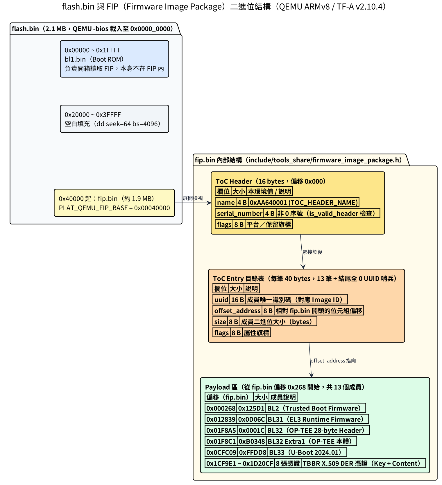

# TF-A 問答筆記：什麼是 FIP（Firmware Image Package）？（QEMU ARMv8 / TF-A v2.10.4）

> **問題**：What is FIP?（什麼是 FIP？）

在 BL1 與 BL2 剛啟動的階段，系統還沒有 ext4、FAT 這類檔案系統驅動，但開機過程卻必須從 Flash 裡讀出十幾個檔案（BL2、BL31、OP-TEE、U-Boot，再加上 TBBR 啟用後的 8 張 X.509 憑證）。如果把每個檔案都寫死在 Flash 的固定偏移位址，只要任何一支韌體變大幾 KB，後面的分區全都會撞在一起。**FIP（Firmware Image Package，韌體映像封裝包）正是為了解決這個問題而設計的超輕量「韌體版無壓縮 `.tar` 檔」**——前面放一張目錄表（ToC），後面緊接所有原始二進位內容，讓 BL1/BL2 只要認得一個起始位址，就能用 UUID 查表讀出任何韌體或憑證。

---

## 1. 一句話記住 FIP

- **FIP = ToC 目錄表（UUID → Offset + Size）＋ 原始韌體與憑證 Payload**。
- 它沒有檔案系統的目錄樹、沒有權限、也沒有壓縮；解析器（`drivers/io/io_fip.c`）體積極小，非常適合放進空間緊繃的 Boot ROM（BL1）與 BL2。

---

## 2. 二進位結構全景



> **注意一個常見誤區**：**BL1 不在 `fip.bin` 裡面**。因為 BL1 本身是燒在 Flash 開頭（`0x00000`）負責「開箱讀取 FIP」的第一棒；我們餵給 QEMU `-bios` 的 `flash.bin`，就是把 `bl1.bin`（`0x00000`）與 `fip.bin`（`0x40000`）拼在一起的結果。

---

## 3. 核心資料結構（TF-A v2.10.4）

定義在 `include/tools_share/firmware_image_package.h:15, 97-108`：

```c
// FIP 魔術數字：io_fip.c:88-90 的 is_valid_header() 會檢查 name == 0xAA640001 且 serial_number != 0
#define TOC_HEADER_NAME	0xAA640001

// 檔案最開頭的目錄檔頭（固定 16 bytes）
typedef struct fip_toc_header {
	uint32_t	name;           // 必須為 TOC_HEADER_NAME (0xAA640001)
	uint32_t	serial_number;  // 非 0 序號
	uint64_t	flags;          // 平台保留旗標
} fip_toc_header_t;

// 目錄表中的每一筆成員紀錄（固定 40 bytes，結尾以一筆全 0 UUID 作哨兵）
typedef struct fip_toc_entry {
	uuid_t		uuid;           // 16 bytes 成員 UUID（例如 UUID_EL3_RUNTIME_FIRMWARE_BL31）
	uint64_t	offset_address; // 相對 fip.bin 起點 (0x40000) 的位元組偏移
	uint64_t	size;           // 該成員的實際大小 (bytes)
	uint64_t	flags;          // 屬性旗標
} fip_toc_entry_t;
```

開機時 `plat/qemu/common/qemu_io_storage.c` 會建立一張「**Image ID ↔ UUID**」對照表並將 Flash 偏移 `0x40000` 註冊給 `io_fip` 驅動；當 BL1 呼叫 `load_auth_image(BL2_IMAGE_ID)` 或 BL2 呼叫 `load_auth_image(BL33_IMAGE_ID)` 時，`drivers/io/io_fip.c` 就會掃描 ToC Entry 比對 UUID，找到 `offset_address` 與 `size` 後直接從 Flash 讀出對應資料。

---

## 4. 本環境 `fip.bin` 實測成員一覽

本環境在啟用 TBBR 後，由 `fiptool` 打包產出的 `fip.bin` 共包含 **13 個成員**（5 個韌體映像＋8 張 X.509 憑證），完整實測輸出存於 [fiptool-info.log](logs/fiptool-info.log)：

| 類別 | 成員名稱 | `fiptool` 參數 | `fip.bin` 偏移 | 大小（bytes） | 對應 `flash.bin` 實體偏移 |
| :--- | :--- | :--- | :---: | :---: | :---: |
| 韌體 | BL2（Trusted Boot FW） | `--tb-fw` | `0x000268` | `0x125D1` | `0x040268` |
| 韌體 | BL31（EL3 Runtime FW） | `--soc-fw` | `0x012839` | `0x0D06C` | `0x052839` |
| 韌體 | BL32（OP-TEE 28B Header） | `--tos-fw` | `0x01F8A5` | `0x0001C` | `0x05F8A5` |
| 韌體 | BL32 Extra1（OP-TEE 本體） | `--tos-fw-extra1` | `0x01F8C1` | `0xB0348` | `0x05F8C1` |
| 韌體 | BL33（U-Boot 2024.01） | `--nt-fw` | `0x0CFC09` | `0xFFDD8` | `0x10FC09` |
| 憑證 | Trusted Key Cert (`id=7`) | `--trusted-key-cert` | `0x1CF9E1` | `0x00616` | `0x20F9E1` |
| 憑證 | SoC FW Key Cert (`id=9`) | `--soc-fw-key-cert` | `0x1CFFF7` | `0x004E2` | `0x20FFF7` |
| 憑證 | TOS FW Key Cert (`id=10`) | `--tos-fw-key-cert` | `0x1D04D9` | `0x004F0` | `0x2104D9` |
| 憑證 | NT FW Key Cert (`id=11`) | `--nt-fw-key-cert` | `0x1D09C9` | `0x004F2` | `0x2109C9` |
| 憑證 | TB FW Content Cert (`id=6`) | `--tb-fw-cert` | `0x1D0EBB` | `0x004BE` | `0x210EBB` |
| 憑證 | SoC FW Content Cert (`id=13`) | `--soc-fw-cert` | `0x1D1379` | `0x00438` | `0x211379` |
| 憑證 | TOS FW Content Cert (`id=14`) | `--tos-fw-cert` | `0x1D17B1` | `0x004D6` | `0x2117B1` |
| 憑證 | NT FW Content Cert (`id=15`) | `--nt-fw-cert` | `0x1D1C87` | `0x00448` | `0x211C87` |

> **實務小技巧**：在我們的竄改實驗中，想要精準改到 U-Boot（BL33）的第 256 個位元組，就是用上表的公式算出 `flash.bin` 實體偏移：`0x40000 (FIP 起點) + 0xCFC09 (BL33 偏移) + 0x100 = 0x10FD09`（見 [tbbr-tamper-test.log](logs/tbbr-tamper-test.log)）。

---

## 5. 常用 `fiptool` 操作指令

TF-A 提供的主機工具 `fiptool`（編譯於 `tools/fiptool/fiptool`）專門用來檢視、拆解與打包 FIP：

| 指令 | 功能 |
| :--- | :--- |
| `fiptool info fip.bin` | 列出 ToC 目錄裡所有成員的名稱、偏移、大小與對應旗標 |
| `fiptool unpack fip.bin` | 將全部成員解包成獨立檔案（例如 `nt-fw.bin`、`nt-fw-cert.bin`），方便用 `openssl x509` 與 `sha256sum` 檢驗 |
| `fiptool create --tb-fw bl2.bin ... fip.bin` | 從零建立一個新的 `fip.bin` |
| `fiptool update --nt-fw u-boot.bin fip.bin` | 只替換既有 `fip.bin` 中的單一成員（例如抽換 BL33，注意若開啟 TBBR 須同步更新對應憑證） |

---

## 6. 重點整理

- **FIP 是 TF-A 專用的無檔案系統打包格式**：用 16-byte ToC Header（`0xAA640001`）＋ 40-byte ToC Entry 目錄表管理所有開機映像與 X.509 憑證。
- **靠 UUID 查表，不靠寫死位址**：任何成員增減大小都不必重新切割 Flash 分區。
- **BL1 不在 FIP 裡**：BL1 放在 `0x00000` 負責開箱，FIP 放在 `0x40000`（`flash.bin` 實體偏移 = `0x40000 + FIP 內偏移`）。
- 一句話記住 FIP：**「開機前期的韌體集裝箱」**——把分散的韌體與憑證貼上 UUID 標籤裝進同一個貨櫃，讓輕量化的 BL1/BL2 一箱帶走、按號取貨。

---

## 參考

- 實測目錄輸出：[fiptool-info.log](logs/fiptool-info.log)
- 手動拆包與 `openssl` 驗證教學：[手動操作實驗手冊（hands-on-lab-manual.md）](hands-on-lab-manual.md)
- 前篇：[TF-A BL1 啟動全流程解析（bl1-boot-flow.md）](bl1-boot-flow.md)、[BL2 到 BL33 啟動與驗簽全流程解析（bl2-to-bl33-boot-flow.md）](bl2-to-bl33-boot-flow.md)
- Trusted Firmware-A v2.10.4 原始碼：`include/tools_share/firmware_image_package.h`、`drivers/io/io_fip.c`
